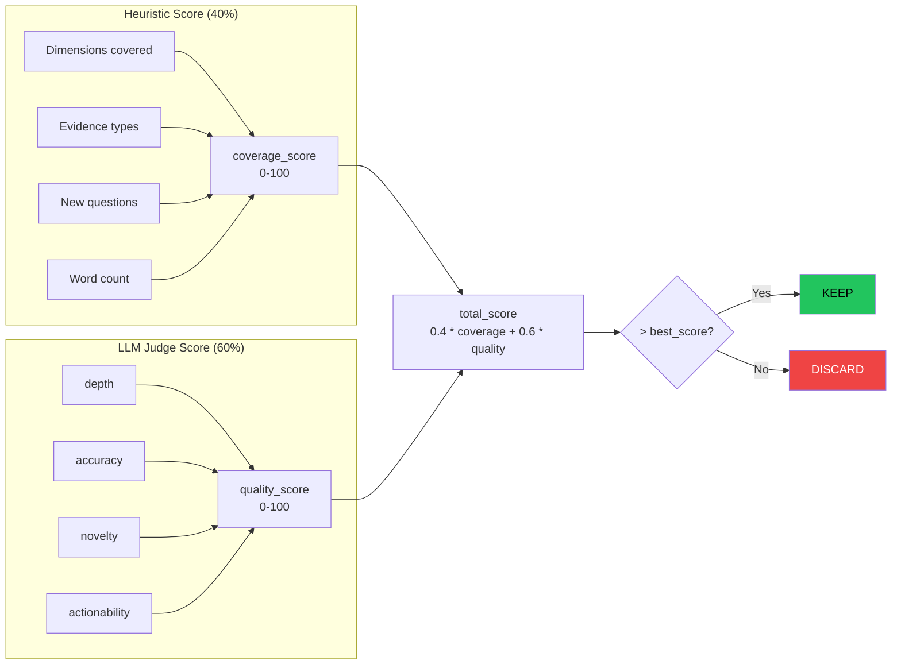
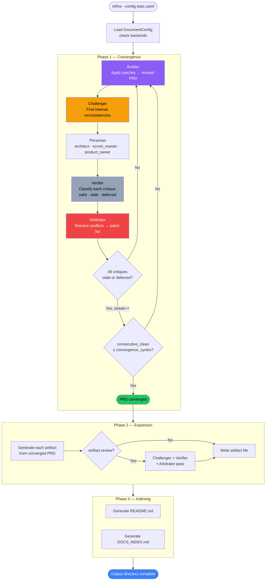

# Autoresearch

Autonomous research framework powered by AI coding agent CLIs.
Adapts [Karpathy's autoresearch pattern](https://github.com/karpathy/autoresearch)
-- replacing GPU training runs with LLM agent calls for deep, iterative research
on any topic.

Supports **Claude**, **Codex**, **Gemini**, and **Copilot** backends with
**multi-backend strategies**: ensemble research, adversarial review, serial
refinement, and specialist routing.

## What This System Is

A **methodologically-aware autonomous research system** -- not a fully
validated scientific research engine.

- Autonomously explores topics across dimensions, accumulates findings,
  compares iterations, and synthesizes a deliverable
- Includes structured rigor: methodology fields, provenance artifacts,
  evaluation layers, inter-rater agreement metrics, and reproducibility metadata
- Still relies on heuristic extraction, LLM judges, and benchmark logic
  that do **not** make its conclusions scientifically true by default

| Question | Answer |
|----------|--------|
| Autonomous agent research system? | Yes |
| Professional research workflow? | Yes |
| Full scientific rigor? | Not yet (see [roadmap](docs/design/scientific-rigor-roadmap.md)) |
| Useful and serious? | Yes |

## Quick Start

```bash
uv sync

# Single backend (Claude)
uv run python -m src.cli run --config configs/aws_api_gateway.yaml

# Multi-backend adversarial (codex researches, claude critiques)
uv run python -m src.cli run --config configs/localstack_alternatives.yaml

# Resume a previous session
uv run python -m src.cli run --config configs/aws_api_gateway.yaml --resume

# Generate synthesis from existing iterations
uv run python -m src.cli run --config configs/aws_api_gateway.yaml --synthesize
```

Copy `configs/_template.yaml` to create a new research topic.

For iterative document refinement (PRDs, architecture specs, technical proposals), see
[Document Refinement](#document-refinement) below.

## The Pattern

Karpathy's original autoresearch runs an infinite loop on a GPU: modify code,
train for 5 minutes, measure loss, keep or revert. This framework applies the
same loop to knowledge research:

```plaintext
LOOP:
  1. Hypothesis  -- Agent picks the next dimension to investigate
  2. Execute     -- Agent researches it (web search, docs, analysis)
  3. Score       -- Heuristic + LLM judge evaluate findings
  4. Decide      -- Score improved? KEEP and merge. Otherwise: DISCARD.
  5. Log         -- Append to results.tsv, save iteration file
  6. Compress    -- Every N iterations, distill the knowledge base
```

Each iteration produces a scored markdown file. Findings that beat the current
best are merged into a growing knowledge base. The loop stops on Ctrl+C,
`max_iterations`, or `target_dimensions_total`. On exit, a final synthesis
report is generated along with quality metrics and provenance artifacts.

## Architecture

```mermaid
flowchart TD
    START([cli.py --config topic.yaml]) --> INIT[Load config + check backends]
    INIT --> STRAT[Build strategy<br>single / ensemble / adversarial /<br>parallel / serial / specialist]
    STRAT --> CHECK{--resume flag?}
    CHECK -->|Yes| RESUME[Rebuild state from<br>iterations/ + results.tsv]
    CHECK -->|No| FRESH[Initialize empty<br>knowledge base]
    RESUME --> LOOP
    FRESH --> LOOP

    LOOP[[INFINITE LOOP]] --> HYPO

    subgraph ITERATION ["Each Iteration"]
        HYPO[1. HYPOTHESIS<br>primary backend<br>Pick next dimension]
        HYPO --> EXHAUST{Dimension<br>exhausted?}
        EXHAUST -->|Yes, 3+ attempts| SKIP_DIM[Skip, mark explored]
        EXHAUST -->|No| EXEC
        SKIP_DIM --> HYPO
        EXEC[2. EXECUTE<br>strategy.execute_research&#40;&#41;<br>single / parallel / serial]
        EXEC --> CRIT{Post-research?}
        CRIT -->|Adversarial| CRITIQUE[Critique by<br>adversary backend]
        CRIT -->|No| CRASH
        CRITIQUE --> CRASH
        CRASH{Crash?}
        CRASH -->|Yes| LOG_CRASH[Log crash<br>Track attempt count]
        CRASH -->|No| SCORE
        LOG_CRASH --> LOOP
        SCORE[3. SCORE<br>judge backend<br>Heuristic 40% + Judge 60%]
        SCORE --> DECIDE{total > best?}
        DECIDE -->|KEEP| MERGE[Merge findings<br>into knowledge_base.md]
        DECIDE -->|DISCARD| SAVE[Save iteration file<br>but don't merge]
        MERGE --> LOG
        SAVE --> LOG
        LOG[4. LOG to results.tsv]
    end

    LOG --> RATE{Rate limited?}
    RATE -->|>90%| WAIT_LONG[Backoff 120s]
    RATE -->|>80%| WAIT_SHORT[Cooldown 30s]
    RATE -->|OK| COMPRESS
    WAIT_LONG --> COMPRESS
    WAIT_SHORT --> COMPRESS
    COMPRESS{Every N iters?}
    COMPRESS -->|Yes| SHRINK[Compress knowledge base<br>utility backend]
    COMPRESS -->|No| LOOP
    SHRINK --> LOOP

    LOOP -.->|Ctrl+C or stop criteria| SYNTH[Generate synthesis.md<br>primary backend]
    SYNTH --> DONE([Print summary + rubric grade + exit])

    style LOOP fill:#f59e0b,color:#000
    style MERGE fill:#22c55e,color:#000
    style SAVE fill:#94a3b8,color:#000
    style LOG_CRASH fill:#ef4444,color:#fff
    style SYNTH fill:#3b82f6,color:#fff
    style WAIT_LONG fill:#f97316,color:#000
    style STRAT fill:#8b5cf6,color:#fff
    style CRITIQUE fill:#f59e0b,color:#000
```



## Scoring



After synthesis, a **rubric** grades the output on citation coverage, evidence
quality, source diversity, uncertainty reporting, actionability, and
contradiction handling.

When ensemble or parallel strategies produce multiple candidates for the same
dimension, **inter-rater agreement** (Cohen's kappa) is computed across
backends -- quantifying whether independent review is adding real value or
just cost.

Both the rubric grade and agreement metrics are displayed in the CLI
completion banner alongside the run metrics.

## Multi-Backend Strategies

| Strategy | How It Works | Cost | Min Backends |
|----------|-------------|------|-------------|
| **single** | One backend for everything | 1x | 1 |
| **ensemble** | 2 backends research in parallel, different judge | ~1.5x | 2 |
| **adversarial** | Research + critique + adjudication | ~1.3x | 2 |
| **parallel** | All backends independently, best wins | Nx | 2+ |
| **serial** | Cheap backend drafts, precise one refines | ~1.5x | 2 |
| **specialist** | Route dimensions to best-fit backend | 1x | 2+ |

The key principle: **the judge must be a different provider than the
researchers** to avoid self-confirmation bias.

```yaml
# Example: adversarial strategy
research:
  execution:
    strategy: adversarial
    backends:
      primary: claude           # hypothesis + synthesis
      research:
        - codex                 # researcher
        - claude                # adversary (critiques codex's findings)
      judge: codex              # adjudicator (different from critic)
      utility: codex            # compression
```

For detailed strategy diagrams and recommendations, see the strategy tables
in `configs/_template.yaml`.

## Backends

| Backend | Default Model | Budget Cap | Rate Limit Detection | Recommended Role |
|---------|--------------|------------|---------------------|-----------------|
| **claude** | sonnet | Yes | Yes | Primary (hypothesis, judge, synthesis) |
| **codex** | gpt-5.4 | No | No | Research, adversarial judge |
| **gemini** | gemini-2.5-flash | No | No | Utility, cheap research |
| **copilot** | gpt-4.1 | No | No | Research only (no structured JSON) |

Claude shortnames (`sonnet`, `opus`, `haiku`) are automatically translated to
each backend's default model.

## Output Artifacts

Each run produces a directory under `output/<config-name>/`:

**Core artifacts** (always generated):

| File | Description |
|------|-------------|
| `results.tsv` | Experiment log (scores, gaps, cumulative cost/tokens) |
| `knowledge_base.md` | Accumulated research findings |
| `iterations/iter_NNN.md` | Per-iteration markdown files |
| `synthesis.md` | Final synthesized report |
| `run_manifest.json` | Reproducibility metadata (config, env, versions) |
| `metrics.json` | Machine-readable run summary |
| `methods.md` | Human-readable research methodology |

**Provenance artifacts** (always generated):

| File | Description |
|------|-------------|
| `claims.json` | Extracted claims with type and confidence labels |
| `citations.json` | Extracted URLs with source type classification |
| `evidence_links.json` | Claim-to-citation links with support strength |
| `evidence_quality.json` | Run-level evidence quality summary |
| `rubric.json` | Research quality rubric (grade + 6 dimensions) |
| `contradictions.json` | Detected recommendation conflicts |

**Agreement artifacts** (multi-backend runs only):

| File | Description |
|------|-------------|
| `agreement.json` | Inter-rater agreement: per-dimension scores, decision agreement rate, Cohen's kappa |

**Evaluation artifacts** (when configured):

| File | Description |
|------|-------------|
| `baseline.md` | Single-pass baseline answer for comparison |
| `evaluation.json` | Iterative-vs-baseline comparison |
| `comparison.json` | Reference-run consistency analysis |
| `semantic_review.json` | Optional final judge review |
| `semantic_calibration.json` | Calibrated quality score |
| `dashboard.json` | Executive summary |

**Reports** (when configured):

| File | Description |
|------|-------------|
| `report.html` | Stakeholder-facing HTML report |
| `report.pdf` | PDF export |
| `portfolio.json` / `portfolio.html` | Cross-run portfolio aggregation |

## Configuration

See `configs/_template.yaml` for the full reference with inline documentation.

Key fields:

| Field | Default | Description |
|-------|---------|-------------|
| `topic` | (required) | The research question |
| `goal` | same as topic | Desired output description |
| `dimensions` | `[]` | Dimensions to explore |
| `backend` | `claude` | CLI backend |
| `model` | `sonnet` | Model name |
| `max_iterations` | `0` | Max iterations (0 = infinite) |
| `max_budget_per_call` | `0.50` | USD cap per invocation (Claude only) |
| `timeout_seconds` | `600` | Timeout per invocation |
| `strategy` | `single` | Multi-backend strategy |
| `lightweight_mode` | `false` | Short-form output for smoke tests |
| `isolate_backend_context` | `true` | Run backends from isolated temp dirs |
| `sanitize_backend_env` | `true` | Pass reduced subprocess environment |

Optional sections: `methodology:` (academic framing), `evaluation:` (baselines,
benchmarks, semantic review), `reporting:` (HTML/PDF export). See the template
for details.

## Project Structure

```plaintext
src/
    cli.py                  Entry point (run + refine subcommands)
    config.py               YAML config loader (ResearchConfig + DocumentConfig)
    orchestrator.py         AutoResearcher -- setup, synthesis, artifact wiring
    research_loop.py        Core iteration loop (hypothesis -> research -> score -> decide)
    scorer.py               Heuristic scoring, LLM-as-judge, inter-rater agreement
    strategy.py             Multi-backend strategies (single/ensemble/adversarial/…)
    provenance.py           Claim/citation extraction, evidence linking, rubric
    comparison.py           Benchmark/reference-run comparison
    semantic_eval.py        Semantic review and calibration
    constraints.py          Goal-shape enforcement, lightweight mode
    artifacts.py            Artifact payload builders, writers, env helpers
    run_state.py            Runtime state helpers (usage tracking, merge, resume)
    run_io.py               Iteration/results filesystem persistence
    reporting.py            HTML report renderer
    pdf_report.py           PDF renderer
    portfolio.py            Cross-run portfolio aggregation
    prompts.py              Prompt template loading
    document_refiner.py     Document mode — Phase 1/2/3 orchestrator
    document_strategy.py    Document mode — ConvergeStrategy (5-step cycle)
    document_loop.py        Document mode — CycleState, run_cycle, stop condition
    hitl.py                 Document mode — human-in-the-loop deferral
    backends/
        base.py             Backend ABC, subprocess management
        claude.py           ClaudeBackend (rate limits, budget caps)
        codex.py            CodexBackend
        gemini.py           GeminiBackend
        copilot.py          CopilotBackend
        types.py            Shared types (CallOptions, AgentResponse, etc.)
        registry.py         Backend discovery
    templates/              HTML report templates and CSS
configs/
    _template.yaml          Research mode config reference
    prd_template.yaml       Document refinement config reference
    smoke_test_*.yaml       Per-backend and per-strategy smoke tests
prompts/                    Prompt templates for each phase (research + document mode)
benchmarks/                 Reusable benchmark definitions
docs/design/                Architecture decision records
tests/                      382 tests across all modules
```

## Resilience

- **Crash recovery**: Dimensions retried up to 3 times, then skipped
- **Resume**: `--resume` rebuilds state from existing iteration files
- **Rate limiting**: Detects rate limits (Claude), backs off 30-120s
- **Budget cap**: Per-call USD limit prevents runaway costs
- **Graceful shutdown**: Ctrl+C generates synthesis before exiting
- **Windows support**: Reliable subprocess kill via `CREATE_NEW_PROCESS_GROUP` + `taskkill /T`
- **Model translation**: Claude shortnames auto-mapped across backends
- **Isolated execution**: Backends run from temp dirs with sanitized env to prevent context leakage

## Requirements

- Python 3.10+
- At least one supported AI coding CLI installed and authenticated:
  - [Claude Code](https://claude.ai/download) (`claude`) -- recommended
  - [OpenAI Codex](https://developers.openai.com/codex) (`codex`)
  - [Google Gemini CLI](https://github.com/google-gemini/gemini-cli) (`gemini`)
  - [GitHub Copilot CLI](https://docs.github.com/en/copilot) (`copilot`)

## Running Tests

```bash
uv sync --group dev
uv run pytest tests/ -v
```

## Design Documents

- `docs/design/evaluation-architecture.md` -- evaluation pipeline rationale, module boundaries, data flow
- `docs/design/scientific-rigor-roadmap.md` -- PRISMA/GRADE-informed roadmap toward scientific rigor

---

## Document Refinement

The `refine` subcommand runs a **multi-LLM convergence loop** on a document —
a PRD, architecture spec, or any structured technical proposal — until no
agent can find a new valid issue with it.
See also [Plan Refinement](#plan-refinement) for implementation-plan-specific review.

```bash
# Refine a document interactively (human-in-the-loop enabled)
uv run python -m src.cli refine --config configs/prd_template.yaml

# Non-interactive (fails fast if human input is required)
uv run python -m src.cli refine --config configs/my_prd.yaml --no-interactive

# Resume after answering deferred questions
uv run python -m src.cli refine --config configs/my_prd.yaml --resume

# Write output to a custom directory
uv run python -m src.cli refine --config configs/my_prd.yaml --output ./docs/output
```

Copy `configs/prd_template.yaml` to create a new document refinement config.

### How It Works

Refinement runs in three sequential phases:

**Phase 1 — Convergence:** The primary document is revised cycle-by-cycle until
`convergence_cycles` consecutive clean cycles pass (no valid critiques remain).

**Phase 2 — Expansion:** Companion artifacts (architecture docs, sprint plans, etc.)
are derived from the converged document. Each artifact can optionally run its own
review pass.

**Phase 3 — Indexing:** `README.md` and `DOCS_INDEX.md` are auto-generated to
orient readers in the output directory.



### Per-Cycle Steps

Each convergence cycle runs five agents in sequence:

| Step | Agent | Backend role | What it does |
|------|-------|-------------|--------------|
| 1 | **Builder** | `research[0]` | Applies the previous cycle's patches; produces the revised document |
| 2 | **Challenger** | `research[1]` | Finds internal inconsistencies and gaps (not subject-matter critique) |
| 3 | **Personas** | `primary` | Each persona (architect, scrum_master, product_owner) reviews from its domain perspective |
| 4 | **Verifier** | `utility` | Classifies each critique as `valid`, `stale`, or `deferred` |
| 5 | **Arbitrator** | `judge` | Merges valid critiques into a concrete patch list for the next Builder call |

Personas run in parallel by default (`persona_mode: parallel`).
Set `persona_mode: serial` to run them sequentially in declaration order.

### Configuration

```yaml
document:
  topic: "Iris Platform"
  goal: >
    A production-ready PRD that lets a team of 5 engineers begin sprint
    planning immediately, with clear P0/P1/P2 tiers and acceptance criteria.

  primary_artifact: "PRD.md"
  source_material: ""          # optional seed content for cycle 0

  convergence_cycles: 2        # consecutive clean cycles before stopping
  max_cycles: 10               # hard cap (0 = unlimited)
  persona_mode: parallel       # parallel | serial

  personas:
    - name: architect
    - name: scrum_master
    - name: product_owner

  artifacts:
    - name: ARCHITECTURE.md
      layer: execution
      review: true             # runs challenger + verifier + arbitrator on this artifact
    - name: SPRINT_PLAN.md
      layer: execution
      review: false

  backends:
    primary: claude            # personas, synthesis
    research:
      - claude                 # Builder (research[0])
      - gemini                 # Challenger (research[1])
    judge: claude              # Arbitrator
    utility: gemini            # Verifier (cheap, fast classification)
```

See `configs/prd_template.yaml` for the full annotated reference.

### Companion Files (`source_files`)

`source_files` lets you inject existing documents — architecture decision records,
design specs, API contracts, existing RFCs — as structured context into agent
prompts. Each file targets specific roles so only the relevant agents see it.

```yaml
source_files:
  - path: docs/architecture/**/*.md   # glob, expanded at load time
    roles: [builder, architect]

  - path: docs/product/roadmap.md     # single file, relative to config dir
    roles: [builder, product_owner, scrum_master]

  - path: /absolute/path/to/spec.md  # absolute path
    roles: [all]                      # expands to builder + challenger + all personas
```

**Valid roles:**

| Role | Who receives the file |
|------|-----------------------|
| `builder` | The PRD Builder (applies patches each cycle) |
| `challenger` | The internal-consistency Challenger |
| `architect` | The architect persona reviewer |
| `scrum_master` | The scrum master persona reviewer |
| `product_owner` | The product owner persona reviewer |
| any custom persona name | The persona declared with that name |
| `all` | Every role above — builder + challenger + all personas |

**Path resolution:**

| Pattern type | Example | Behavior |
|---|---|---|
| Relative glob | `docs/**/*.md` | Expanded relative to the config file's directory |
| Absolute glob | `/workspace/docs/**/*.md` | Expanded from filesystem root |
| Relative literal | `docs/spec.md` | Resolved relative to config file; error if missing |
| Absolute literal | `/abs/path/spec.md` | Used as-is; error if missing |

A glob that matches nothing logs a warning and is silently skipped.
A literal path that does not exist raises a `ValueError` at load time.

### Output Artifacts

Each refinement run writes to `output/<config-name>/` (or `--output <dir>`):

| File | Description |
|------|-------------|
| `PRD.md` (or `primary_artifact`) | The converged primary document |
| `ARCHITECTURE.md`, `SPRINT_PLAN.md`, … | Phase 2 companion artifacts (as configured) |
| `README.md` | Auto-generated orientation guide for the output directory |
| `DOCS_INDEX.md` | Auto-generated index of all artifacts with descriptions |
| `.run/run_manifest.json` | Reproducibility metadata (cycles, cost, token counts) |
| `.run/issue_registry.json` | All critiques from every cycle with their final status |
| `.run/cycles/cycle_NNN.md` | Per-cycle snapshot (valid issues, clean streak, PRD excerpt) |
| `.run/PRD_vN.md` | Full PRD snapshot after each cycle |
| `.run/pending_questions.json` | Deferred human-input questions (when HITL is triggered) |

### Human-in-the-Loop (HITL)

When a persona raises a question that requires human judgement (scope decisions,
external constraints, strategic trade-offs), the cycle pauses and writes the
pending questions to `.run/pending_questions.json`.

In interactive mode (`--interactive`, the default), the CLI prompts you inline.
In non-interactive mode (`--no-interactive`), the run exits with code `2` and
prints the path to the pending questions file. Fill in your answers, then resume:

```bash
# After filling in .run/pending_questions.json
uv run python -m src.cli refine --config configs/my_prd.yaml --resume
```

### Project Structure (Document Mode)

```plaintext
src/
    document_refiner.py     DocumentRefiner — Phase 1/2/3 orchestrator
    document_strategy.py    ConvergeStrategy — 5-step cycle (Builder→Challenger→Personas→Verifier→Arbitrator)
    document_loop.py        CycleState, run_cycle, convergence stop condition
    hitl.py                 Human-in-the-loop deferral, question serialization, decision loading
configs/
    prd_template.yaml       Annotated config reference for document mode
prompts/
    prd_builder.md          Builder prompt (applies patches, writes revised PRD)
    prd_challenger.md       Challenger prompt (finds inconsistencies)
    prd_persona_*.md        Per-persona review prompts
    prd_verify.md           Verifier prompt (classifies critiques)
    prd_arbitrate.md        Arbitrator prompt (produces patch list)
    artifact_*.md           Per-artifact generation prompts (Phase 2)
    generate_readme.md      README generation prompt (Phase 3)
    generate_docs_index.md  DOCS_INDEX generation prompt (Phase 3)
```

---

## Plan Refinement

The `plan` subcommand runs the same multi-LLM convergence loop as `refine`, but
targets implementation plans — PLAN.md files generated by the `writing-plans`
skill or any LLM. Seven domain-specific reviewers critique the plan from distinct
angles until no valid issues remain.

```bash
# Refine a plan interactively
uv run python -m src.cli plan --config configs/plan_template.yaml

# Non-interactive (exit code 2 if human input needed)
uv run python -m src.cli plan --config configs/my_plan.yaml --no-interactive

# Resume after answering deferred questions
uv run python -m src.cli plan --config configs/my_plan.yaml --resume
```

Copy `configs/plan_template.yaml` to create a new plan refinement config.

### Reviewer Personas

| Persona | What it looks for |
|---|---|
| **Architect** | File boundaries, coupling between tasks, missing abstraction layers |
| **Tech Lead** | Task sizing, dependency order, commit granularity, naming consistency |
| **QA Engineer** | TDD discipline (test before implementation), edge cases, flaky setups |
| **AI Engineer** | LLM output validation, model selection rationale, non-determinism handling |
| **Data Engineer** | Data flow order, schema migration sequencing, rollback steps |
| **Security Engineer** | Input validation, injection surfaces, secrets handling |
| **Devil's Advocate** | Hidden assumptions, failure scenarios, "obvious" missing steps |

The **Challenger** (distinct from personas) finds structural gaps: missing tasks,
wrong task order, vague steps, steps that reference undefined symbols.

See [Document Refinement](#document-refinement) for the full convergence loop
architecture, HITL flow, and output artifact descriptions — `plan` uses the
same three-phase pipeline.

---

## Related Projects

- [karpathy/autoresearch](https://github.com/karpathy/autoresearch) -- the original GPU-based framework
