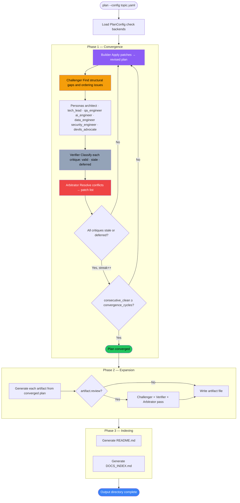

# Plan Refinement Mode (`plan`)

The `plan` subcommand runs a **multi-LLM convergence loop** on an implementation plan — a PLAN.md file generated by an LLM or written manually — until no agent can find a new valid issue with it. Seven domain-specific reviewers critique the plan from distinct angles.

## Quick Start

```bash
# Refine a plan interactively (human-in-the-loop enabled)
uv run python -m src.cli plan --config configs/plan_template.yaml

# Non-interactive (exits with code 2 if human input is required)
uv run python -m src.cli plan --config configs/my_plan.yaml --no-interactive

# Resume after answering deferred questions
uv run python -m src.cli plan --config configs/my_plan.yaml --resume

# Write output to a custom directory
uv run python -m src.cli plan --config configs/my_plan.yaml --output ./docs/output

# Validate config, backend wiring, and planned outputs without running refinement
uv run python -m src.cli plan --config configs/plan_template.yaml --dry-run
```

Copy `configs/plan_template.yaml` to create a new plan refinement config.

## Dry Run

Use `--dry-run` to validate:
- config parsing
- backend/provider wiring
- backend availability
- planned output paths

without executing the convergence loop or writing run artifacts.

Important constraint:
- `--dry-run` cannot be combined with `--resume`

Useful smoke command:

```bash
uv run python -m src.cli plan --config configs/plan_template.yaml --dry-run
```

## How It Works

Refinement runs in three sequential phases:

**Phase 1 — Convergence:** The plan is revised cycle-by-cycle until `convergence_cycles` consecutive clean cycles pass (no valid critiques remain).

**Phase 2 — Expansion:** Companion artifacts (risk registers, runbooks, etc.) are derived from the converged plan. Each artifact can optionally run its own review pass.

**Phase 3 — Indexing:** `README.md` and `DOCS_INDEX.md` are auto-generated to orient readers in the output directory.



## Per-Cycle Steps

Each convergence cycle runs five agents in sequence:

| Step | Agent | Backend role | What it does |
|------|-------|-------------|--------------|
| 1 | **Builder** | `research[0]` | Applies the previous cycle's patches; produces the revised plan |
| 2 | **Challenger** | `research[1]` | Finds structural gaps: missing tasks, wrong order, vague steps, undefined references |
| 3 | **Personas** | `primary` | Each persona reviews from its domain perspective (parallel by default) |
| 4 | **Verifier** | `utility` | Classifies each critique as `valid`, `stale`, or `deferred` |
| 5 | **Arbitrator** | `judge` | Merges valid critiques into a concrete patch list for the next Builder call |

Personas run in parallel by default (`persona_mode: parallel`). Set `persona_mode: serial` to run them sequentially.

## Reviewer Personas

| Persona | What it looks for |
|---|---|
| **Architect** | File boundaries, coupling between tasks, missing abstraction layers |
| **Tech Lead** | Task sizing, dependency order, commit granularity, naming consistency |
| **QA Engineer** | TDD discipline (test before implementation), edge cases, flaky setups |
| **AI Engineer** | LLM output validation, model selection rationale, non-determinism handling |
| **Data Engineer** | Data flow order, schema migration sequencing, rollback steps |
| **Security Engineer** | Input validation, injection surfaces, secrets handling |
| **Devil's Advocate** | Hidden assumptions, failure scenarios, "obvious" missing steps |

The **Challenger** (distinct from personas) finds structural gaps: missing tasks, wrong task order, vague steps, steps that reference undefined symbols.

## Configuration

```yaml
plan:
  topic: "Your feature or component"
  goal: >
    A complete, unambiguous implementation plan that a senior engineer
    can execute task-by-task without clarifying questions.

  primary_artifact: "PLAN.md"
  source_material: ""          # optional seed plan for cycle 0

  convergence_cycles: 2        # consecutive clean cycles before stopping
  max_cycles: 10               # hard cap (0 = unlimited)
  persona_mode: parallel       # parallel | serial

  personas:
    - name: architect
    - name: tech_lead
    - name: qa_engineer
    - name: ai_engineer
    - name: data_engineer
    - name: security_engineer
    - name: devils_advocate

  artifacts: []
  # Example:
  # artifacts:
  #   - name: RISK_REGISTER.md
  #     layer: companion
  #     review: false

  providers:
    planner_main:
      adapter: claude-cli
      model: sonnet
    verifier_fast:
      adapter: gemini-cli
      model: gemini-2.5-flash

  backends:
    primary: planner_main          # personas, synthesis
    research:
      - planner_main               # Builder (research[0])
      - verifier_fast              # Challenger (research[1])
    judge: planner_main            # Arbitrator
    utility: verifier_fast         # Verifier (cheap, fast classification)
```

See `configs/plan_template.yaml` for the full annotated reference.

## Backends

| Backend | Transport | Kind | Default Model | Budget Cap | Recommended Role |
|---------|-----------|------|---------------|------------|-----------------|
| **claude-cli** | CLI | direct | sonnet | Yes | Primary, Builder, Arbitrator |
| **codex-cli** | CLI | direct | gpt-5.4 | No | Builder, Challenger |
| **gemini-cli** | CLI | direct | gemini-2.5-flash | No | Verifier (cheap classification) |
| **copilot-cli** | CLI | direct | gpt-4.1 | No | Builder only |
| **claude-api** | API | direct | claude-sonnet-4-5 | No | Primary direct API path |
| **codex-api** | API | direct | gpt-5.4 | No | Builder / challenger via Responses API |
| **gemini-api** | API | direct | gemini-2.5-flash | No | Utility / verifier via Gemini API |
| **litellm-api** | API | aggregator | openai/gpt-4.1-mini | No | Gateway-based routing |
| **copilot-api** | API | aggregator | openai/gpt-4.1 | No | GitHub Models aggregation |
| **bedrock-api** | API | aggregator | provider-defined | No | AWS Bedrock Converse routing |

For provider-instance contract details, see `docs/design/api-provider-contracts.md`.

### Model resolution contract

- `claude-cli` accepts Claude shortnames directly
- direct non-Claude providers translate Claude shortnames to their provider defaults
- aggregators require an **explicit model identifier**

That means gateway-style adapters should be configured with the actual routed model, not a shorthand.

### API-oriented example

```yaml
providers:
  planner_main:
    adapter: bedrock-api
    model: anthropic.claude-3-5-sonnet-20240620-v1:0
    region: us-east-1
    aws_profile: sandbox

  verifier_fast:
    adapter: litellm-api
    model: openai/gpt-4.1-mini
    base_url: http://localhost:4000

backends:
  primary: planner_main
  research: [planner_main, verifier_fast]
  judge: planner_main
  utility: verifier_fast
```

### `system_prompt` contract

You can provide a shared planning instruction in `execution.system_prompt`:

```yaml
execution:
  system_prompt: "You are a cautious architect and implementation planner."
```

Behavior:

- preserved for supported API backends
- stripped automatically for unsupported backends
- currently safest on API adapters, not CLI adapters

### Capability contract

- `allowed_tools` is removed automatically for backends that do not support tools
- `json_schema` is removed automatically for backends that do not support structured output
- normalized API function-tool execution is currently integrated in `run`, not
  in the `plan` runtime loop
- in `plan`, backend invocation still relies on capability stripping rather
  than the explicit runtime function-tool loop used by `run`

### Normalized API error contract

API failures are normalized into categories in `AgentResponse.raw["error"]`.

For planning workflows, the most important split is:

- retryable: `rate_limit`, `timeout`, `transport`, `server_error`
- configuration/input issues: `auth`, `permission`, `bad_request`, `quota`

## Companion Files (`source_files`)

Inject existing documents — existing code, architecture specs, API contracts — as structured context into agent prompts. Each file targets specific roles.

```yaml
source_files:
  - path: docs/specs/**/*.md       # glob, expanded at load time
    roles: [builder, architect, tech_lead]

  - path: docs/PRD.md              # single file, relative to config dir
    roles: [all]                   # expands to builder + challenger + all personas

  - path: /absolute/path/spec.md  # absolute path
    roles: [builder]
```

**Valid roles:**

| Role | Who receives the file |
|------|-----------------------|
| `builder` | The plan Builder (applies patches each cycle) |
| `challenger` | The structural Challenger |
| `architect` | The architect persona |
| `tech_lead` | The tech lead persona |
| `qa_engineer` | The QA engineer persona |
| `ai_engineer` | The AI engineer persona |
| `data_engineer` | The data engineer persona |
| `security_engineer` | The security engineer persona |
| `devils_advocate` | The devil's advocate persona |
| any custom persona name | The persona declared with that name |
| `all` | Every role above |

A glob that matches nothing logs a warning and is silently skipped. A literal path that does not exist raises a `ValueError` at load time.

## Output Artifacts

Each run writes to `output/<config-name>/` (or `--output <dir>`):

| File | Description |
|------|-------------|
| `PLAN.md` (or `primary_artifact`) | The converged implementation plan |
| `RISK_REGISTER.md`, … | Phase 2 companion artifacts (as configured) |
| `README.md` | Auto-generated orientation guide for the output directory |
| `DOCS_INDEX.md` | Auto-generated index of all artifacts with descriptions |
| `.run/run_manifest.json` | Reproducibility metadata (cycles, cost, token counts) |
| `.run/issue_registry.json` | All critiques from every cycle with their final status |
| `.run/cycles/cycle_NNN.md` | Per-cycle snapshot (valid issues, clean streak, plan excerpt) |
| `.run/PLAN_vN.md` | Full plan snapshot after each cycle |
| `.run/pending_questions.json` | Deferred human-input questions (when HITL is triggered) |

## Human-in-the-Loop (HITL)

When a persona raises a question requiring human judgement (scope decisions, external constraints, architectural trade-offs), the cycle pauses and writes the pending questions to `.run/pending_questions.json`.

In interactive mode (the default), the CLI prompts you inline. In non-interactive mode (`--no-interactive`), the run exits with code `2`. Fill in your answers, then resume:

```bash
# After filling in .run/pending_questions.json
uv run python -m src.cli plan --config configs/my_plan.yaml --resume
```

## Project Structure

```plaintext
src/
    plan_refiner.py         PlanRefiner — Phase 1/2/3 orchestrator
    plan_strategy.py        PlanStrategy — 5-step convergence cycle
    plan_loop.py            PlanCycleState, run_plan_cycle, convergence stop condition
    hitl.py                 Human-in-the-loop deferral, question serialization
configs/
    plan_template.yaml      Annotated config reference for plan mode
prompts/
    plan_builder.md         Builder prompt (applies patches, writes revised plan)
    plan_challenger.md      Challenger prompt (finds structural gaps)
    plan_persona_*.md       Per-persona review prompts (one per reviewer)
    plan_verify.md          Verifier prompt (classifies critiques)
    plan_arbitrate.md       Arbitrator prompt (produces patch list)
    artifact_*.md           Per-artifact generation prompts (Phase 2)
    generate_readme.md      README generation prompt (Phase 3)
    generate_docs_index.md  DOCS_INDEX generation prompt (Phase 3)
```
