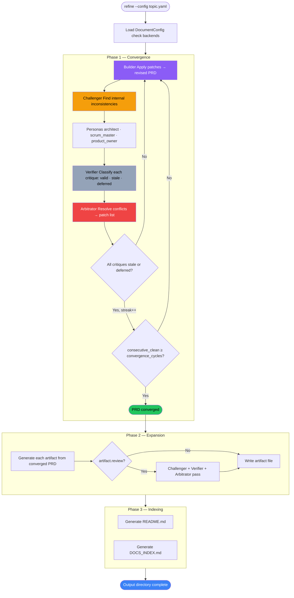

# Document Refinement Mode (`refine`)

The `refine` subcommand runs a **multi-LLM convergence loop** on a document — a PRD, architecture spec, or any structured technical proposal — until no agent can find a new valid issue with it.

## Quick Start

```bash
# Refine a document interactively (human-in-the-loop enabled)
uv run python -m src.cli refine --config configs/prd_template.yaml

# Non-interactive (exits with code 2 if human input is required)
uv run python -m src.cli refine --config configs/my_prd.yaml --no-interactive

# Resume after answering deferred questions
uv run python -m src.cli refine --config configs/my_prd.yaml --resume

# Write output to a custom directory
uv run python -m src.cli refine --config configs/my_prd.yaml --output ./docs/output

# Validate config, backend wiring, and planned outputs without running refinement
uv run python -m src.cli refine --config configs/prd_template.yaml --dry-run
```

Copy `configs/prd_template.yaml` to create a new document refinement config.

## Dry Run

Use `--dry-run` to validate:
- config parsing
- backend/provider wiring
- backend availability
- planned output paths

without executing the convergence loop or writing run artifacts.

Important constraint:
- `--dry-run` cannot be combined with `--resume`

Useful smoke command:

```bash
uv run python -m src.cli refine --config configs/prd_template.yaml --dry-run
```

## How It Works

Refinement runs in three sequential phases:

**Phase 1 — Convergence:** The primary document is revised cycle-by-cycle until `convergence_cycles` consecutive clean cycles pass (no valid critiques remain).

**Phase 2 — Expansion:** Companion artifacts (architecture docs, sprint plans, etc.) are derived from the converged document. Each artifact can optionally run its own review pass.

**Phase 3 — Indexing:** `README.md` and `DOCS_INDEX.md` are auto-generated to orient readers in the output directory.



## Per-Cycle Steps

Each convergence cycle runs five agents in sequence:

| Step | Agent | Backend role | What it does |
|------|-------|-------------|--------------|
| 1 | **Builder** | `research[0]` | Applies the previous cycle's patches; produces the revised document |
| 2 | **Challenger** | `research[1]` | Finds internal inconsistencies and gaps (not subject-matter critique) |
| 3 | **Personas** | `primary` | Each persona reviews from its domain perspective |
| 4 | **Verifier** | `utility` | Classifies each critique as `valid`, `stale`, or `deferred` |
| 5 | **Arbitrator** | `judge` | Merges valid critiques into a concrete patch list for the next Builder call |

Personas run in parallel by default (`persona_mode: parallel`). Set `persona_mode: serial` to run them sequentially.

## Personas

The default personas for document refinement:

| Persona | What it looks for |
|---|---|
| **Architect** | File structure, component coupling, missing abstraction layers |
| **Scrum Master** | Story sizing, acceptance criteria clarity, sprint feasibility |
| **Product Owner** | User value, priority ordering, scope creep, missing stakeholder needs |

Custom personas can be declared in config; each runs a domain-specific review prompt.

## Configuration

```yaml
document:
  topic: "Iris Platform"
  goal: >
    A production-ready PRD that lets a team of 5 engineers begin sprint
    planning immediately, with clear P0/P1/P2 tiers and acceptance criteria.

  primary_artifact: "PRD.md"
  source_material: ""          # optional seed content for cycle 0

  convergence_cycles: 2        # consecutive clean cycles before stopping
  max_cycles: 10               # hard cap (0 = unlimited)
  persona_mode: parallel       # parallel | serial

  personas:
    - name: architect
    - name: scrum_master
    - name: product_owner

  artifacts:
    - name: ARCHITECTURE.md
      layer: execution
      review: true             # runs challenger + verifier + arbitrator on this artifact
    - name: SPRINT_PLAN.md
      layer: execution
      review: false

  providers:
    builder_main:
      adapter: claude-cli
      model: sonnet
    challenger_fast:
      adapter: gemini-cli
      model: gemini-2.5-flash

  backends:
    primary: builder_main          # personas, synthesis
    research:
      - builder_main               # Builder (research[0])
      - challenger_fast            # Challenger (research[1])
    judge: builder_main            # Arbitrator
    utility: challenger_fast       # Verifier (cheap, fast classification)
```

See `configs/prd_template.yaml` for the full annotated reference.

## Backends

| Backend | Transport | Kind | Default Model | Budget Cap | Recommended Role |
|---------|-----------|------|---------------|------------|-----------------|
| **claude-cli** | CLI | direct | sonnet | Yes | Primary, Builder, Arbitrator |
| **codex-cli** | CLI | direct | gpt-5.4 | No | Builder, Challenger |
| **gemini-cli** | CLI | direct | gemini-2.5-flash | No | Verifier (cheap classification) |
| **copilot-cli** | CLI | direct | gpt-4.1 | No | Builder only |
| **claude-api** | API | direct | claude-sonnet-4-5 | No | Primary direct API path |
| **codex-api** | API | direct | gpt-5.4 | No | Builder / challenger via Responses API |
| **gemini-api** | API | direct | gemini-2.5-flash | No | Utility / verifier via Gemini API |
| **litellm-api** | API | aggregator | openai/gpt-4.1-mini | No | Gateway-based routing |
| **copilot-api** | API | aggregator | openai/gpt-4.1 | No | GitHub Models aggregation |
| **bedrock-api** | API | aggregator | provider-defined | No | AWS Bedrock Converse routing |

For provider-instance contract details, see `docs/design/api-provider-contracts.md`.

### Model resolution contract

- `claude-cli` accepts Claude shortnames directly
- direct non-Claude providers translate Claude shortnames to their `default_model`
- aggregators require an **explicit** model identifier

So:

- `adapter: codex-api` + `model: sonnet` is allowed and resolves to the provider default
- `adapter: litellm-api` + `model: sonnet` is rejected because the routed target is ambiguous

### API-oriented example

Use `providers:` when you want document refinement to target API adapters or gateways:

```yaml
providers:
  builder_main:
    adapter: claude-api
    model: claude-sonnet-4-5

  challenger_fast:
    adapter: litellm-api
    model: openai/gpt-4.1-mini
    base_url: http://localhost:4000

backends:
  primary: builder_main
  research: [builder_main, challenger_fast]
  judge: builder_main
  utility: challenger_fast
```

### `system_prompt` contract

You can set a shared instruction in `execution.system_prompt`:

```yaml
execution:
  system_prompt: "You are a rigorous product reviewer."
```

Behavior:

- preserved for supported API backends
- removed automatically for unsupported backends
- current CLI adapters still behave as unsupported unless explicitly modeled otherwise

### Capability contract

- `allowed_tools` is removed automatically for backends that do not support tools
- `json_schema` is removed automatically for backends that do not support structured output
- normalized API function-tool execution is currently integrated in `run`, not
  in the `refine` runtime loop
- in `refine`, backend invocation still relies on capability stripping rather
  than the explicit runtime function-tool loop used by `run`

### Normalized API error contract

When API backends fail, the normalized error category is stored in `AgentResponse.raw["error"]`.

The most useful categories for operators are:

- retryable: `rate_limit`, `timeout`, `transport`, `server_error`
- non-retryable until changed: `auth`, `permission`, `bad_request`, `quota`

## Companion Files (`source_files`)

Inject existing documents — architecture decision records, design specs, API contracts — as structured context into agent prompts. Each file targets specific roles.

```yaml
source_files:
  - path: docs/architecture/**/*.md   # glob, expanded at load time
    roles: [builder, architect]

  - path: docs/product/roadmap.md     # single file, relative to config dir
    roles: [builder, product_owner, scrum_master]

  - path: /absolute/path/to/spec.md  # absolute path
    roles: [all]                      # expands to builder + challenger + all personas
```

**Valid roles:**

| Role | Who receives the file |
|------|-----------------------|
| `builder` | The PRD Builder (applies patches each cycle) |
| `challenger` | The internal-consistency Challenger |
| `architect` | The architect persona reviewer |
| `scrum_master` | The scrum master persona reviewer |
| `product_owner` | The product owner persona reviewer |
| any custom persona name | The persona declared with that name |
| `all` | Every role above |

A glob that matches nothing logs a warning and is silently skipped. A literal path that does not exist raises a `ValueError` at load time.

## Output Artifacts

Each run writes to `output/<config-name>/` (or `--output <dir>`):

| File | Description |
|------|-------------|
| `PRD.md` (or `primary_artifact`) | The converged primary document |
| `ARCHITECTURE.md`, `SPRINT_PLAN.md`, … | Phase 2 companion artifacts (as configured) |
| `README.md` | Auto-generated orientation guide for the output directory |
| `DOCS_INDEX.md` | Auto-generated index of all artifacts with descriptions |
| `.run/run_manifest.json` | Reproducibility metadata (cycles, cost, token counts) |
| `.run/issue_registry.json` | All critiques from every cycle with their final status |
| `.run/cycles/cycle_NNN.md` | Per-cycle snapshot (valid issues, clean streak, PRD excerpt) |
| `.run/PRD_vN.md` | Full PRD snapshot after each cycle |
| `.run/pending_questions.json` | Deferred human-input questions (when HITL is triggered) |

## Human-in-the-Loop (HITL)

When a persona raises a question requiring human judgement (scope decisions, external constraints, strategic trade-offs), the cycle pauses and writes the pending questions to `.run/pending_questions.json`.

In interactive mode (the default), the CLI prompts you inline. In non-interactive mode (`--no-interactive`), the run exits with code `2`. Fill in your answers, then resume:

```bash
# After filling in .run/pending_questions.json
uv run python -m src.cli refine --config configs/my_prd.yaml --resume
```

## Project Structure

```plaintext
src/
    document_refiner.py     DocumentRefiner — Phase 1/2/3 orchestrator
    document_strategy.py    ConvergeStrategy — 5-step cycle
    document_loop.py        CycleState, run_cycle, convergence stop condition
    hitl.py                 Human-in-the-loop deferral, question serialization
configs/
    prd_template.yaml       Annotated config reference for document mode
prompts/
    prd_builder.md          Builder prompt (applies patches, writes revised PRD)
    prd_challenger.md       Challenger prompt (finds inconsistencies)
    prd_persona_*.md        Per-persona review prompts
    prd_verify.md           Verifier prompt (classifies critiques)
    prd_arbitrate.md        Arbitrator prompt (produces patch list)
    artifact_*.md           Per-artifact generation prompts (Phase 2)
    generate_readme.md      README generation prompt (Phase 3)
    generate_docs_index.md  DOCS_INDEX generation prompt (Phase 3)
```
