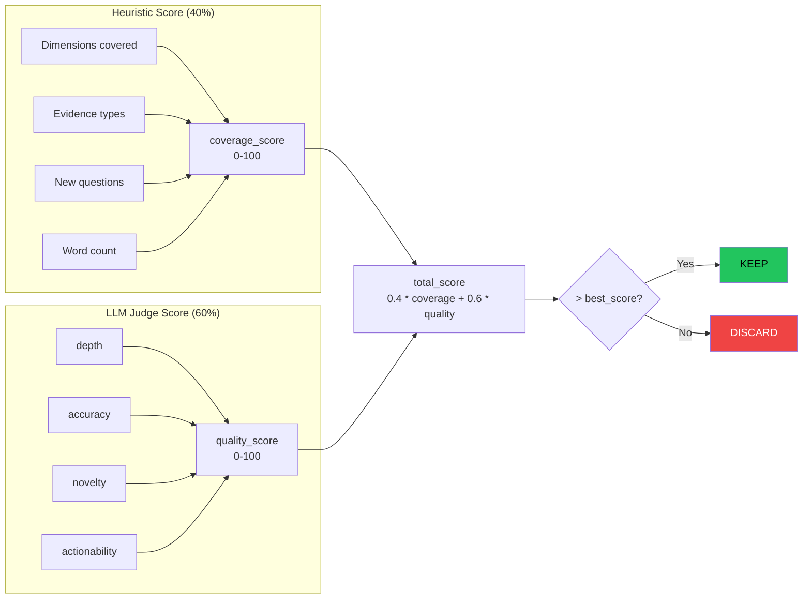

# Research Mode (`run`)

Autonomous iterative research loop powered by AI coding agent CLIs. Adapts [Karpathy's autoresearch pattern](https://github.com/karpathy/autoresearch) — replacing GPU training runs with LLM agent calls for deep, iterative exploration of any topic.

## What This Is

A **methodologically-aware autonomous research system** — not a fully validated scientific research engine.

- Autonomously explores topics across dimensions, accumulates findings, compares iterations, and synthesizes a deliverable
- Includes structured rigor: methodology fields, provenance artifacts, evaluation layers, inter-rater agreement metrics, and reproducibility metadata
- Still relies on heuristic extraction, LLM judges, and benchmark logic that do **not** make its conclusions scientifically true by default

| Question | Answer |
|----------|--------|
| Autonomous agent research system? | Yes |
| Professional research workflow? | Yes |
| Full scientific rigor? | Not yet (see [roadmap](design/scientific-rigor-roadmap.md)) |

## Quick Start

```bash
uv sync

# Single backend (Claude)
uv run python -m src.cli run --config configs/aws_api_gateway.yaml

# Multi-backend adversarial (codex researches, claude-cli critiques)
uv run python -m src.cli run --config configs/localstack_alternatives.yaml

# Resume a previous session
uv run python -m src.cli run --config configs/aws_api_gateway.yaml --resume

# Generate synthesis from existing iterations
uv run python -m src.cli run --config configs/aws_api_gateway.yaml --synthesize

# Validate config, backend wiring, and planned artifact paths only
uv run python -m src.cli run --config configs/aws_api_gateway.yaml --dry-run

# Example: GitHub Models + LiteLLM aggregators
uv run python -m src.cli run --config configs/example_github_models.yaml

# Example: Bedrock Converse + LiteLLM utility
uv run python -m src.cli run --config configs/example_bedrock.yaml
```

Copy `configs/_template.yaml` to create a new research topic.

## Dry Run

Use `--dry-run` when you want to validate a run configuration without executing the research loop.

What it checks:
- config parsing and schema validity
- strategy resolution
- backend/provider instantiation
- backend availability checks
- resolved output directory and planned artifact paths

What it does **not** do:
- invoke any backend research calls
- enter the autoresearch loop
- write normal run artifacts

Important constraints:
- `--dry-run` cannot be combined with `--resume`
- `--dry-run` cannot be combined with `--synthesize`

Exit codes:
- `0` → configuration is ready to run
- `1` → configuration or backend wiring is invalid

Useful smoke command:

```bash
uv run python -m src.cli run --config configs/example_github_models.yaml --dry-run
```

## The Pattern

Karpathy's original autoresearch runs an infinite loop on a GPU: modify code, train for 5 minutes, measure loss, keep or revert. This framework applies the same loop to knowledge research:

```plaintext
LOOP:
  1. Hypothesis  -- Agent picks the next dimension to investigate
  2. Execute     -- Agent researches it (web search, docs, analysis)
  3. Score       -- Heuristic 40% + LLM judge 60% evaluate findings
  4. Decide      -- Score improved? KEEP and merge. Otherwise: DISCARD.
  5. Log         -- Append to results.tsv, save iteration file
  6. Compress    -- Every N iterations, distill the knowledge base
```

Each iteration produces a scored markdown file. Findings that beat the current best are merged into a growing knowledge base. The loop stops on Ctrl+C, `max_iterations`, or `target_dimensions_total`. On exit, a final synthesis report is generated along with quality metrics and provenance artifacts.

## Runtime Logging & Audit Trail

Real `run` executions now emit two runtime traces in the output directory:

- `run.log` — human-readable operational log
- `audit_trail.jsonl` — structured append-only audit trail

`audit_trail.jsonl` records:
- step start / completion / failure
- iteration lifecycle events
- files created or updated by each step
- **sandbox and security events** (Milestone 2):
  - `sandbox_initialized` — workspace path created at setup (`output_dir`, `workspace_dir`)
  - `sandbox_policy_applied` — active runtime policy at setup (`tool_execution_mode`, `sandbox_active`, `filesystem_access`, `network_access`, `allow_host_bash`)
  - `policy_denied` — denial event recorded before exception propagates (`reason_code`, `policy_field`, `requested_action`, and optionally `requested_path`, `allowed_boundary`)

This is especially useful for debugging long iterations, because you can see which step was active before a stall and which artifacts were produced after each step.  Security events make it possible to audit exactly when and why a tool call or write was blocked.

## Architecture

```mermaid
flowchart TD
    START([cli.py --config topic.yaml]) --> INIT[Load config + check backends]
    INIT --> STRAT[Build strategy<br>single / ensemble / adversarial /<br>parallel / serial / specialist]
    STRAT --> CHECK{--resume flag?}
    CHECK -->|Yes| RESUME[Rebuild state from<br>iterations/ + results.tsv]
    CHECK -->|No| FRESH[Initialize empty<br>knowledge base]
    RESUME --> LOOP
    FRESH --> LOOP

    LOOP[[INFINITE LOOP]] --> HYPO

    subgraph ITERATION ["Each Iteration"]
        HYPO[1. HYPOTHESIS<br>primary backend<br>Pick next dimension]
        HYPO --> EXHAUST{Dimension<br>exhausted?}
        EXHAUST -->|Yes, 3+ attempts| SKIP_DIM[Skip, mark explored]
        EXHAUST -->|No| EXEC
        SKIP_DIM --> HYPO
        EXEC[2. EXECUTE<br>strategy.execute_research&#40;&#41;<br>single / parallel / serial]
        EXEC --> CRIT{Post-research?}
        CRIT -->|Adversarial| CRITIQUE[Critique by<br>adversary backend]
        CRIT -->|No| CRASH
        CRITIQUE --> CRASH
        CRASH{Crash?}
        CRASH -->|Yes| LOG_CRASH[Log crash<br>Track attempt count]
        CRASH -->|No| SCORE
        LOG_CRASH --> LOOP
        SCORE[3. SCORE<br>judge backend<br>Heuristic 40% + Judge 60%]
        SCORE --> DECIDE{total > best?}
        DECIDE -->|KEEP| MERGE[Merge findings<br>into knowledge_base.md]
        DECIDE -->|DISCARD| SAVE[Save iteration file<br>but don't merge]
        MERGE --> LOG
        SAVE --> LOG
        LOG[4. LOG to results.tsv]
    end

    LOG --> RATE{Rate limited?}
    RATE -->|>90%| WAIT_LONG[Backoff 120s]
    RATE -->|>80%| WAIT_SHORT[Cooldown 30s]
    RATE -->|OK| COMPRESS
    WAIT_LONG --> COMPRESS
    WAIT_SHORT --> COMPRESS
    COMPRESS{Every N iters?}
    COMPRESS -->|Yes| SHRINK[Compress knowledge base<br>utility backend]
    COMPRESS -->|No| LOOP
    SHRINK --> LOOP

    LOOP -.->|Ctrl+C or stop criteria| SYNTH[Generate synthesis.md<br>primary backend]
    SYNTH --> DONE([Print summary + rubric grade + exit])

    style LOOP fill:#f59e0b,color:#000
    style MERGE fill:#22c55e,color:#000
    style SAVE fill:#94a3b8,color:#000
    style LOG_CRASH fill:#ef4444,color:#fff
    style SYNTH fill:#3b82f6,color:#fff
    style WAIT_LONG fill:#f97316,color:#000
    style STRAT fill:#8b5cf6,color:#fff
    style CRITIQUE fill:#f59e0b,color:#000
```



## Scoring



After synthesis, a **rubric** grades the output on citation coverage, evidence quality, source diversity, uncertainty reporting, actionability, and contradiction handling.

When ensemble or parallel strategies produce multiple candidates for the same dimension, **inter-rater agreement** (Cohen's kappa) is computed across backends — quantifying whether independent review is adding real value or just cost.

## Multi-Backend Strategies

| Strategy | How It Works | Cost | Min Backends |
|----------|-------------|------|-------------|
| **single** | One backend for everything | 1x | 1 |
| **ensemble** | 2 backends research in parallel, different judge | ~1.5x | 2 |
| **adversarial** | Research + critique + adjudication | ~1.3x | 2 |
| **parallel** | All backends independently, best wins | Nx | 2+ |
| **serial** | Cheap backend drafts, precise one refines | ~1.5x | 2 |
| **specialist** | Route dimensions to best-fit backend | 1x | 2+ |

The key principle: **the judge must be a different provider than the researchers** to avoid self-confirmation bias.

```yaml
# Example: adversarial strategy
research:
  execution:
    strategy: adversarial
    providers:
      primary_reasoner:
        adapter: claude-cli
        model: sonnet
      research_coder:
        adapter: codex-cli
        model: gpt-5.4
      utility_gateway:
        adapter: litellm-api
        model: openai/gpt-4.1-mini
        base_url: http://localhost:4000
    backends:
      primary: primary_reasoner     # hypothesis + synthesis
      research:
        - research_coder            # researcher
        - utility_gateway           # alternate provider route
      judge: research_coder         # adjudicator (different from critic)
      utility: utility_gateway      # compression
```

## Backends

| Backend | Transport | Kind | Default Model | Budget Cap | Rate Limit Detection | Recommended Role |
|---------|-----------|------|---------------|------------|----------------------|-----------------|
| **claude-cli** | CLI | direct | sonnet | Yes | Yes | Primary (hypothesis, judge, synthesis) |
| **codex-cli** | CLI | direct | gpt-5.4 | No | No | Research, adversarial judge |
| **gemini-cli** | CLI | direct | gemini-2.5-flash | No | No | Utility, cheap research |
| **copilot-cli** | CLI | direct | gpt-4.1 | No | No | Research only (no structured JSON) |
| **claude-api** | API | direct | claude-sonnet-4-5 | No | No | Direct Anthropic integration |
| **codex-api** | API | direct | gpt-5.4 | No | No | Direct OpenAI Responses integration |
| **gemini-api** | API | direct | gemini-2.5-flash | No | No | Direct Google Gemini integration |
| **litellm-api** | API | aggregator | openai/gpt-4.1-mini | No | No | Gateway / multi-provider routing |
| **copilot-api** | API | aggregator | openai/gpt-4.1 | No | No | GitHub Models aggregation / org attribution |
| **bedrock-api** | API | aggregator | (provider-defined) | No | No | AWS Bedrock Converse routing |

### Model resolution contract

- `claude-cli` accepts Claude shortnames directly (`sonnet`, `opus`, `haiku`)
- direct non-Claude providers translate Claude shortnames to their own `default_model`
- aggregators (`litellm-api`, `copilot-api`, `bedrock-api`) require an **explicit model identifier**

Examples:

- `codex-api` + `sonnet` -> `gpt-5.4`
- `gemini-api` + `sonnet` -> `gemini-2.5-flash`
- `litellm-api` + `sonnet` -> **configuration error**

For provider-instance contract details, see `docs/design/api-provider-contracts.md`.
For ready-to-copy examples, see:

- `configs/example_direct_api.yaml`
- `configs/example_mixed_cli_api.yaml`
- `configs/example_litellm_only.yaml`
- `configs/example_github_models.yaml`
- `configs/example_bedrock.yaml`

### `system_prompt` contract

Use `execution.system_prompt` when you want a shared system/developer instruction:

```yaml
research:
  execution:
    system_prompt: "You are precise, evidence-driven, and concise."
```

Current behavior:

- preserved for supported API backends
- stripped automatically for backends that do not support it
- currently implemented for:
  - `claude-api`
  - `codex-api`
  - `gemini-api`
  - `litellm-api`
  - `copilot-api`
  - `bedrock-api`

### Methodology protocol fields

`methodology:` now supports richer protocol-style fields in addition to the
earlier inclusion/exclusion guidance:

```yaml
research:
  methodology:
    review_type: systematic_review
    search_sources:
      - official docs
      - benchmark corpora
    stopping_criteria:
      - cover all configured dimensions
      - stop when no new evidence appears
    stopping_rationale: "Bound cost while preserving coverage."
    scoring_rationale: "Prefer evidence-backed, actionable synthesis."
```

These fields are carried into:

- `methods.md`
- `run_manifest.json`
- prompt-side methodology summaries

### Reproducibility artifacts

Each run now also emits:

- `prompt_snapshot.json` — top-level prompt inputs sent to backends, with model/turn metadata and prompt hashes
- `rerun.sh` — a shell script that replays the run with the same config and output directory
- `certainty_tables.json` — first-pass conclusion-level certainty bands derived from claims, evidence links, citations, and contradictions

Current scope:

- prompt snapshots capture top-level orchestrator/backend invocations
- they do **not** yet snapshot raw backend payloads
- raw backend payload capture remains intentionally deferred even though an explicit opt-in config boundary now exists:
  - `reporting.capture_raw_backend_outputs`
  - `reporting.raw_backend_output_max_chars`
  - `reporting.raw_backend_output_redact`
- certainty tables are heuristic and GRADE-lite, not a full formal evidence-certainty implementation
- PDF summaries and cross-run portfolio views now surface compact certainty rollups
- portfolio views now expose certainty deltas versus the strongest certainty run and separate high-certainty recommendation counts
- HTML and PDF reports now surface factor-level certainty details for current-run conclusions

### Streaming contract

You can enable live run-time progress for research-phase calls with:

```yaml
research:
  execution:
    stream: true
```

Current behavior:

- only the `run` workflow uses this today
- only research-phase backend calls stream; hypothesis/judge/synthesis remain final-response only
- unsupported backends strip `stream` automatically
- currently implemented for:
  - `claude-api`
  - `codex-api`
  - `gemini-api`
  - `litellm-api`
  - `copilot-api`
  - `bedrock-api`
- streamed text is for operator feedback only; the final backend response remains authoritative

### Tools and structured-output contract

- `allowed_tools` is normalized away for backends that do not support tools.
- `json_schema` is normalized away for backends that do not support structured output.
- normalized API function tools are a separate contract from CLI `allowed_tools`
- Today:
  - `copilot-api` supports `json_schema`
  - `litellm-api` supports `json_schema`
  - `bedrock-api` does not
  - function-tool runtime loops are integrated in `run`; other workflows still rely on capability stripping rather than explicit tool execution

### API function-tool calling

The first normalized API tool-calling slice is intentionally narrow:

- function tools only
- non-streaming only
- `claude-api`, `codex-api`, `gemini-api`, `litellm-api`, `copilot-api`, and `bedrock-api`
- explicit runtime/tool-registry usage only

Important:

- this is **not** the same thing as CLI `allowed_tools`
- tool-enabled API calls currently require a runtime tool registry
- streaming + function tools is intentionally unsupported in the first slice
- `execution.retry_api_errors` only applies to plain non-streaming API calls; tool loops and streaming calls are intentionally not retried automatically
- retry counts are surfaced in run artifacts and reports so backend instability is visible after the run
- retry reporting now highlights dominant retry categories and the most unstable backend in the run summary
- PRISMA-like search/screening summaries are surfaced from `search_log.json` and `screening_log.json`
- tool-loop observability is written into `metrics.json` and `dashboard.json`, including per-backend and per-tool usage/failure counts
- detailed per-run tool call traces are written into `tool_trace.json`
- tool traces store redacted argument summaries and truncated output previews rather than raw full payloads
- HTML/PDF reports surface compact tool-usage highlights when a run uses normalized API function tools
- dashboard/report summaries now also highlight tool-trace failure patterns such as dominant failure codes

### Normalized API error contract

API adapters normalize failures into `AgentResponse.raw["error"]`.

Current categories:

- `auth`
- `permission`
- `not_found`
- `bad_request`
- `quota`
- `rate_limit`
- `timeout`
- `transport`
- `malformed_response`
- `server_error`
- `unknown`

Operational rule of thumb:

- retryable: `rate_limit`, `timeout`, `transport`, `server_error`
- usually non-retryable without changing input/config:
  - `auth`
  - `permission`
  - `bad_request`
  - `quota`

### Turn budget (`max_turns`)

Each backend invocation is capped at `max_turns` agentic turns. A **turn** is one round-trip between the model and the environment — including tool calls. When a backend uses a tool (e.g. web search), it consumes turns as follows:

```
Turn 1: model decides to call WebSearch
Turn 2: model reads the search result
Turn 3: model writes the final answer
```

If `max_turns` is exhausted mid-tool-call, the `result` field in the response is empty and the iteration is logged as a crash. The dimension is retried up to 3 times before being skipped.

**Rule of thumb:** set `max_turns` to at least `(expected tool calls × 2) + 1`. For a single web search, `5` is a safe minimum. The default in `_template.yaml` is `10`.

## Output Artifacts

Each run produces a directory under `output/<config-name>/`:

**Core artifacts** (always generated):

| File | Description |
|------|-------------|
| `effective_config.json` | Full normalized snapshot of the resolved config written at run start |
| `results.tsv` | Experiment log (scores, gaps, cumulative cost/tokens) |
| `knowledge_base.md` | Accumulated research findings |
| `iterations/iter_NNN.md` | Per-iteration markdown files |
| `synthesis.md` | Final synthesized report |
| `run_manifest.json` | Reproducibility metadata (config, env, versions) |
| `prompt_snapshot.json` | Captured prompt inputs with backend/model metadata and hashes |
| `rerun.sh` | Shell command artifact for replaying the run |
| `metrics.json` | Machine-readable run summary |
| `methods.md` | Human-readable research methodology |

**Provenance artifacts** (always generated):

| File | Description |
|------|-------------|
| `claims.json` | Extracted claims with type, confidence, and `trust_class` labels |
| `citations.json` | Extracted URLs with source type classification and `trust_class` |
| `search_log.json` | Source-consideration log derived from extracted citations |
| `screening_log.json` | Inclusion/exclusion screening log derived from linked evidence |
| `evidence_links.json` | Claim-to-citation links with support strength |
| `evidence_quality.json` | Run-level evidence quality summary |
| `certainty_tables.json` | Conclusion-level certainty bands with factor-level downgrade reasons |
| `rubric.json` | Research quality rubric (grade + 6 dimensions) |
| `contradictions.json` | Detected recommendation conflicts |

#### Citation and claim trust classification

Every record in `citations.json` and `claims.json` carries a `trust_class` field that answers "where did this come from?" (origin), distinct from `source_quality_weight` (reliability).

Active trust classes:

| Class | Applied to | Meaning |
|---|---|---|
| `untrusted_web_content` | URL citations | Externally fetched web content |
| `user_provided_source_material` | Local-path citations | Operator-supplied source files (local input material) |
| `inferred_claim` | All LLM claims | Synthesized by the LLM from its context |

`dashboard.json` includes a `trust_summary` object with counts per class, giving a quick origin breakdown for a run's evidence.

**Agreement artifacts** (multi-backend runs only):

| File | Description |
|------|-------------|
| `agreement.json` | Inter-rater agreement: per-dimension scores, decision agreement rate, Cohen's kappa |

**Evaluation artifacts** (when configured):

| File | Description |
|------|-------------|
| `baseline.md` | Single-pass baseline answer for comparison |
| `evaluation.json` | Iterative-vs-baseline comparison |
| `comparison.json` | Reference-run consistency analysis |
| `semantic_review.json` | Optional final judge review |
| `semantic_calibration.json` | Calibrated quality score |
| `dashboard.json` | Executive summary |

**Reports** (when configured):

| File | Description |
|------|-------------|
| `report.html` | Stakeholder-facing HTML report |
| `report.pdf` | PDF export |
| `portfolio.json` / `portfolio.html` | Cross-run portfolio aggregation, including retry/tool activity and certainty rollups |

## Configuration

See `configs/_template.yaml` for the full reference with inline documentation.

Key fields:

| Field | Default | Description |
|-------|---------|-------------|
| `topic` | (required) | The research question |
| `goal` | same as topic | Desired output description |
| `dimensions` | `[]` | Dimensions to explore |
| `backend` | `claude-cli` | Default adapter name (`claude-cli`, `codex-cli`, `gemini-cli`, `copilot-cli`, `claude-api`, `codex-api`, `gemini-api`, `litellm-api`, `copilot-api`, `bedrock-api`) |
| `model` | `sonnet` | Model name |
| `max_iterations` | `0` | Max iterations (0 = infinite) |
| `max_turns` | `10` | Max agentic turns per backend call — see [Turn budget](#turn-budget-max_turns) |
| `max_budget_per_call` | `0.50` | USD cap per invocation (Claude only) |
| `timeout_seconds` | `600` | Timeout per invocation |
| `strategy` | `single` | Multi-backend strategy |
| `lightweight_mode` | `false` | Short-form output for smoke tests |
| `isolate_backend_context` | `true` | Run backends from isolated temp dirs |
| `sanitize_backend_env` | `true` | Pass reduced subprocess environment |

Optional sections: `methodology:` (academic framing), `evaluation:` (baselines, benchmarks, semantic review), `reporting:` (HTML/PDF export).

### Output style

`run` synthesis now supports a first-class prose/profile selector:

```yaml
reporting:
  output_style: default   # default | paper | technical_doc | executive_brief | decision_memo
```

Profiles:
- `default` — current decision-support report style with summary, trade-offs, and recommendations
- `paper` — more formal research-paper / whitepaper structure with abstract, methodology, discussion, and limitations
- `technical_doc` — internal engineering-document structure with problem statement, options, decision, implementation considerations, and open questions
- `executive_brief` — concise executive-facing brief with headline recommendation, key risks, and immediate next actions
- `decision_memo` — memo-style structure focused on the decision, recommended option, rationale, and consequences

This applies to **run synthesis only**. `refine` and `plan` keep their own document structures.

Optional style overrides:

```yaml
reporting:
  output_style: technical_doc
  style_overrides:
    include_executive_summary: false
    include_comparison_table: true
    include_methodology: false
    include_limitations: true
    include_next_actions: true
    section_order: recommendation_first
    recommendation_mode: decision_only
    citation_mode: references_section
```

Supported overrides:
- `include_executive_summary`: `true | false | null`
- `include_comparison_table`: `true | false | null`
- `include_methodology`: `true | false | null`
- `include_limitations`: `true | false | null`
- `include_next_actions`: `true | false | null`
- `section_order`: `standard | recommendation_first | evidence_first`
- `recommendation_mode`: `ranked | decision_only`
- `citation_mode`: `inline_links | references_section`

#### Deterministic references (paper style only)

When `output_style: paper`, `synthesis.md` automatically receives a deterministic `## References` section after synthesis is written:

- Built from `citations.json` — only URL-bearing citations are included; local-source-material records are excluded
- URLs are deduplicated by normalized URL (tracking parameters such as `utm_*`, `fbclid`, `gclid` stripped; trailing slashes and fragments removed)
- References are numbered in discovery order; titled entries use `[title](url)` format, bare URLs used as fallback
- If the LLM already generated a `## References` or `## Bibliography` heading, it is replaced with the deterministic version; any content after the references section (e.g. appendices) is preserved
- Non-paper output styles (`default`, `technical_doc`, `executive_brief`, `decision_memo`) are not affected
- Resumed and synthesize-only runs restore prior `citations.json` before building the references section so the output is complete

`citation_mode: references_section` (in `style_overrides`) instructs the LLM to include its own citation list in the synthesis text; the deterministic injection step replaces that LLM-generated list with the normalized, deduped artifact-derived version.

The selected `output_style` also affects HTML/PDF report presentation metadata:
- style label shown in the HTML header
- style-aware Methods/Synthesis section headings
- style-aware PDF title suffixes for profiles like `paper`, `executive_brief`, and `decision_memo`

The selected style also shows up in operator-facing artifacts:
- `run --dry-run` includes the selected style plus active override labels
- `run_manifest.json` includes `output_style_label` and `active_style_overrides`
- `dashboard.json` includes `output_style`, `output_style_label`, and `active_style_overrides`

Example persisted outputs and screenshots for the same research corpus are available in:
- [`docs/showcase/localstack-alternatives/`](./showcase/localstack-alternatives/README.md)

### Security policy

`security:` is a first-class config section declaring and enforcing the runtime security policy for a run.

```yaml
research:
  security:
    content_trust: strict        # strict | permissive
    tool_execution_mode: direct  # direct | sandboxed
    allow_host_bash: true        # false blocks Bash tool in all backend calls
    allow_filesystem_write_outside_output: false  # true relaxes write boundary
    sandbox:
      mode: off                  # off | tool_calls
      scope: run
      filesystem_access: output_only   # output_only | workspace_only
      network_access: unrestricted     # unrestricted | web_only | none
```

Defaults: `content_trust: strict`, `tool_execution_mode: direct`, `allow_host_bash: true`, sandbox fully off.

**Declared-only fields** (not yet operationally enforced):
- `content_trust` — sanitization posture for backend-returned content

**Dispatch-enforced fields** (Milestone 4, when `sandbox_active=True`):
- `tool_execution_mode: sandboxed` + `sandbox.mode: tool_calls` — activates the sandbox executor: backend subprocesses run from the workspace cwd, writes go through the executor boundary, and network policy is gate-enforced at dispatch level
- `sandbox.network_access` — enforced at executor-dispatch level when `sandbox_active=True`: `web_only` restricts networked tool calls (`WebSearch`, `WebFetch`) to web destinations; `none` blocks them entirely. **This is dispatch-level enforcement only — not OS-level firewalling.**

**Runtime-enforced fields** (Milestone 2+):
- `allow_host_bash: false` — hard-blocks any backend call that includes `Bash` in `allowed_tools`; denial raises `PolicyDeniedError` and is recorded in `audit_trail.jsonl` before the backend is invoked
- `sandbox.filesystem_access` — controls the allowed write roots checked by `guard_path_write` and the `SandboxExecutor`:
  - `output_only` (default) — writes must be within the run `output_dir`
  - `workspace_only` — writes must be within `output_dir/.workspace/`
- `allow_filesystem_write_outside_output: true` — explicitly permits writes anywhere (disables filesystem write policy)

#### Run-scoped workspace

Every real `run` creates a dedicated workspace directory at:

```
output/<run>/.workspace/
```

This directory is the write root when `sandbox.filesystem_access: workspace_only`.  When `sandbox_active=True` (i.e. `tool_execution_mode: sandboxed` + `sandbox.mode: tool_calls`), it also becomes the working directory for all backend subprocesses — the sandbox executor calls `prepare_workspace()` before each invocation.  The workspace path is recorded in `audit_trail.jsonl` (`sandbox_initialized` event).  Inspect-only commands (`explain config`, `explain resume`) never create it.

#### Denial behavior

When a policy check fails, the platform:
1. emits a `policy_denied` event to `audit_trail.jsonl` with `reason_code`, `policy_field`, `requested_action`, and (when applicable) `requested_path` and `allowed_boundary`
2. raises `PolicyDeniedError` — the run is aborted at that point

Reason codes:
- `host_bash_disabled` — `Bash` was in `allowed_tools` but `allow_host_bash: false`
- `write_outside_allowed_roots` — write target was outside the declared filesystem boundary
- `network_access_disallowed` — networked tool call blocked by `sandbox.network_access` policy (dispatch-level enforcement)

The full resolved security policy is persisted in `effective_config.json` and surfaced by `explain config`.

#### Security enforcement truth table

`doctor config` reports which fields are actively enforced at runtime versus which are declared intent only:

| Field | Status | Enforcement mechanism |
|---|---|---|
| `allow_host_bash: false` | **Enforced** | Hard-blocks Bash tool in `_call_with`; raises `PolicyDeniedError` |
| `sandbox.filesystem_access` | **Enforced** | Write boundary checked by `guard_path_write` + `SandboxExecutor` on every file write |
| `allow_filesystem_write_outside_output` | **Enforced** | Relaxes write boundary when `true` |
| `tool_execution_mode: sandboxed` (sandbox_active=True) | **Dispatch-enforced** | Workspace cwd for backend subprocesses; executor routing for writes and network |
| `sandbox.network_access` (sandbox_active=True) | **Dispatch-enforced** | `WebSearch`/`WebFetch` gated at executor-dispatch level; `none` blocks them, `web_only` limits to web — **not OS-level firewalling** |
| `tool_execution_mode: sandboxed` (sandbox_active=False) | **Declared intent** | `sandbox.mode` must be `tool_calls` to activate enforcement |
| `sandbox.network_access` (sandbox_active=False) | **Declared intent** | No operational effect without `sandbox_active`; set `mode: tool_calls` to activate |
| `content_trust` | **Declared-only** | Declares content sanitization posture; enforcement deferred |

Use `autoresearch doctor config --config <path>` to see this table for a specific config with live health status.

## Explain commands

`explain` is a pure inspection subcommand. It does **not** create output directories, run backends, check backend availability, or instantiate `AutoResearcher`. Exit code `0` on success, `1` on bad input.

### `explain config`

```bash
uv run python -m src.cli explain config --config configs/aws_api_gateway.yaml
```

Prints a human-readable summary of the resolved research config:

- research topic, goal, and dimensions
- strategy and execution flags
- backend role mapping (primary / research / judge / utility)
- provider instances (adapter + model)
- output style and active overrides
- reporting outputs (HTML, PDF)
- full security policy (all `security:` fields)
- default artifact paths preview

Useful for verifying a config is wired correctly before committing to a run.

### `explain resume`

```bash
uv run python -m src.cli explain resume --output output/aws_api_gateway
```

Inspects an existing run output directory and prints:

- whether the run is resumable (`yes` / `no`)
- number of iteration files found
- best score (from `metrics.json` when present)
- run status (from `metrics.json` when present)
- per-artifact presence table (`effective_config.json`, `results.tsv`, `knowledge_base.md`, `synthesis.md`, `report.html`, …)
- explicit **reused** list: iteration files, `results.tsv`, `knowledge_base.md`
- explicit **regenerated** list: `synthesis.md`, `methods.md`, `dashboard.json`, `report.html`, `report.pdf`

Returns exit code `1` if the output directory does not exist.

## Doctor commands

`doctor` is a diagnostic subcommand for validating configs and inspecting run output health. Like `explain`, it does **not** execute research, write run artifacts, or instantiate backends. Exit code `0` (healthy) / `1` (warnings or errors present).

### `doctor config`

```bash
uv run python -m src.cli doctor config --config configs/aws_api_gateway.yaml
```

Validates a config file and prints a structured diagnostic report covering:

- **Config validity** — whether the YAML parses and passes schema validation
- **Security enforcement truth table** — which security fields are actively enforced at runtime vs declared-only intent (see [Security enforcement truth table](#security-enforcement-truth-table))
- **Backend validity** — whether declared backends are registered and available
- **Operator risk notes** — explicit warnings for conditions that affect run safety:
  - Host shell exposed (`allow_host_bash: true` with Bash in `allowed_tools`)
  - Sandbox declared but not active (`tool_execution_mode: sandboxed` without `sandbox.mode: tool_calls`)
  - Network policy set but sandbox not active (`sandbox.network_access` has no effect without `sandbox_active`)

**Health status:**

| Output | Exit code | Meaning |
|---|---|---|
| `HEALTH: OK` | `0` | No warnings; config is clean |
| `HEALTH: WARNINGS (N)` | `1` | At least one risk note or backend warning |

Any printed warning drives a non-zero exit code — the doctor command does not print warnings and return `0`.

### `doctor output`

```bash
uv run python -m src.cli doctor output --output output/aws_api_gateway
```

Inspects an existing run output directory and reports:

- **Run classification** — `complete` / `partial (no synthesis)` / `partial (synthesis only)` / `empty`
- **Artifact status table** — presence of each key artifact (`effective_config.json`, `audit_trail.jsonl`, `synthesis.md`, `report.html`, `metrics.json`, `knowledge_base.md`, `results.tsv`)
- **Resumability** — whether the run can be resumed and which artifacts are _actually_ reusable (derived from real artifact presence, not assumed)
- **Synthesis readiness** — whether the run has enough state to regenerate synthesis

**Health status:**

| Output | Exit code | Meaning |
|---|---|---|
| `HEALTH: OK` | `0` | Complete run: all required artifacts present |
| `HEALTH: WARNINGS (N)` | `1` | Partial or empty run; missing required artifacts |

## Resilience

- **Crash recovery**: Dimensions retried up to 3 times, then skipped
- **Resume**: `--resume` rebuilds state from existing iteration files
- **Rate limiting**: Detects rate limits (Claude), backs off 30–120s
- **Budget cap**: Per-call USD limit prevents runaway costs
- **Graceful shutdown**: Ctrl+C generates synthesis before exiting
- **Windows support**: Reliable subprocess kill via `CREATE_NEW_PROCESS_GROUP` + `taskkill /T`
- **Model translation**: Claude shortnames auto-mapped across backends
- **Isolated execution**: Backends run from temp dirs with sanitized env to prevent context leakage

## Project Structure

```plaintext
src/
    cli.py                  Entry point
    config.py               YAML config loader (ResearchConfig)
    explain.py              Explain commands (config + resume inspection)
    doctor.py               Doctor commands (config health + output run diagnostics)
    trust.py                Citation/claim trust classification (origin labels for provenance)
    references.py           Deterministic references assembly from citations.json (paper style)
    orchestrator.py         AutoResearcher — setup, synthesis, artifact wiring
    research_loop.py        Core iteration loop (hypothesis → research → score → decide)
    scorer.py               Heuristic scoring, LLM-as-judge, inter-rater agreement
    strategy.py             Multi-backend strategies (single/ensemble/adversarial/…)
    provenance.py           Claim/citation extraction, evidence linking, rubric
    comparison.py           Benchmark/reference-run comparison
    semantic_eval.py        Semantic review and calibration
    constraints.py          Goal-shape enforcement, lightweight mode
    artifacts.py            Artifact payload builders, writers, env helpers
    run_state.py            Runtime state helpers (usage tracking, merge, resume)
    run_io.py               Iteration/results filesystem persistence
    reporting.py            HTML report renderer
    pdf_report.py           PDF renderer
    portfolio.py            Cross-run portfolio aggregation
    prompts.py              Prompt template loading
    backends/
        base.py             Backend ABC, subprocess management
        claude.py           ClaudeBackend (rate limits, budget caps)
        codex.py            CodexBackend
        gemini.py           GeminiBackend
        copilot.py          CopilotBackend
        types.py            Shared types (CallOptions, AgentResponse, etc.)
        registry.py         Backend discovery
    templates/              HTML report templates and CSS
configs/
    _template.yaml          Full annotated config reference
    smoke_test_*.yaml       Per-backend and per-strategy smoke tests
prompts/                    Prompt templates (research phases)
benchmarks/                 Reusable benchmark definitions
```
