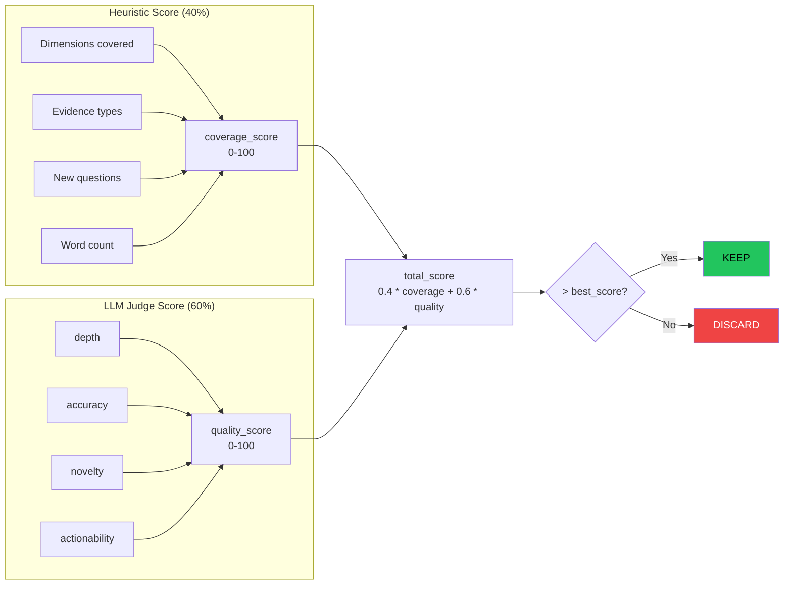

# Research Mode (`run`)

Autonomous iterative research loop powered by AI coding agent CLIs. Adapts [Karpathy's autoresearch pattern](https://github.com/karpathy/autoresearch) — replacing GPU training runs with LLM agent calls for deep, iterative exploration of any topic.

## What This Is

A **methodologically-aware autonomous research system** — not a fully validated scientific research engine.

- Autonomously explores topics across dimensions, accumulates findings, compares iterations, and synthesizes a deliverable
- Includes structured rigor: methodology fields, provenance artifacts, evaluation layers, inter-rater agreement metrics, and reproducibility metadata
- Still relies on heuristic extraction, LLM judges, and benchmark logic that do **not** make its conclusions scientifically true by default

| Question | Answer |
|----------|--------|
| Autonomous agent research system? | Yes |
| Professional research workflow? | Yes |
| Full scientific rigor? | Not yet (see [roadmap](design/scientific-rigor-roadmap.md)) |

## Quick Start

```bash
uv sync

# Single backend (Claude)
uv run python -m src.cli run --config configs/aws_api_gateway.yaml

# Multi-backend adversarial (codex researches, claude-cli critiques)
uv run python -m src.cli run --config configs/localstack_alternatives.yaml

# Resume a previous session
uv run python -m src.cli run --config configs/aws_api_gateway.yaml --resume

# Generate synthesis from existing iterations
uv run python -m src.cli run --config configs/aws_api_gateway.yaml --synthesize

# Example: GitHub Models + LiteLLM aggregators
uv run python -m src.cli run --config configs/example_github_models.yaml

# Example: Bedrock Converse + LiteLLM utility
uv run python -m src.cli run --config configs/example_bedrock.yaml
```

Copy `configs/_template.yaml` to create a new research topic.

## The Pattern

Karpathy's original autoresearch runs an infinite loop on a GPU: modify code, train for 5 minutes, measure loss, keep or revert. This framework applies the same loop to knowledge research:

```plaintext
LOOP:
  1. Hypothesis  -- Agent picks the next dimension to investigate
  2. Execute     -- Agent researches it (web search, docs, analysis)
  3. Score       -- Heuristic 40% + LLM judge 60% evaluate findings
  4. Decide      -- Score improved? KEEP and merge. Otherwise: DISCARD.
  5. Log         -- Append to results.tsv, save iteration file
  6. Compress    -- Every N iterations, distill the knowledge base
```

Each iteration produces a scored markdown file. Findings that beat the current best are merged into a growing knowledge base. The loop stops on Ctrl+C, `max_iterations`, or `target_dimensions_total`. On exit, a final synthesis report is generated along with quality metrics and provenance artifacts.

## Architecture


## Scoring



After synthesis, a **rubric** grades the output on citation coverage, evidence quality, source diversity, uncertainty reporting, actionability, and contradiction handling.

When ensemble or parallel strategies produce multiple candidates for the same dimension, **inter-rater agreement** (Cohen's kappa) is computed across backends — quantifying whether independent review is adding real value or just cost.

## Multi-Backend Strategies

| Strategy | How It Works | Cost | Min Backends |
|----------|-------------|------|-------------|
| **single** | One backend for everything | 1x | 1 |
| **ensemble** | 2 backends research in parallel, different judge | ~1.5x | 2 |
| **adversarial** | Research + critique + adjudication | ~1.3x | 2 |
| **parallel** | All backends independently, best wins | Nx | 2+ |
| **serial** | Cheap backend drafts, precise one refines | ~1.5x | 2 |
| **specialist** | Route dimensions to best-fit backend | 1x | 2+ |

The key principle: **the judge must be a different provider than the researchers** to avoid self-confirmation bias.

```yaml
# Example: adversarial strategy
research:
  execution:
    strategy: adversarial
    providers:
      primary_reasoner:
        adapter: claude-cli
        model: sonnet
      research_coder:
        adapter: codex-cli
        model: gpt-5.4
      utility_gateway:
        adapter: litellm-api
        model: openai/gpt-4.1-mini
        base_url: http://localhost:4000
    backends:
      primary: primary_reasoner     # hypothesis + synthesis
      research:
        - research_coder            # researcher
        - utility_gateway           # alternate provider route
      judge: research_coder         # adjudicator (different from critic)
      utility: utility_gateway      # compression
```

## Backends

| Backend | Transport | Kind | Default Model | Budget Cap | Rate Limit Detection | Recommended Role |
|---------|-----------|------|---------------|------------|----------------------|-----------------|
| **claude-cli** | CLI | direct | sonnet | Yes | Yes | Primary (hypothesis, judge, synthesis) |
| **codex-cli** | CLI | direct | gpt-5.4 | No | No | Research, adversarial judge |
| **gemini-cli** | CLI | direct | gemini-2.5-flash | No | No | Utility, cheap research |
| **copilot-cli** | CLI | direct | gpt-4.1 | No | No | Research only (no structured JSON) |
| **claude-api** | API | direct | claude-sonnet-4-5 | No | No | Direct Anthropic integration |
| **codex-api** | API | direct | gpt-5.4 | No | No | Direct OpenAI Responses integration |
| **gemini-api** | API | direct | gemini-2.5-flash | No | No | Direct Google Gemini integration |
| **litellm-api** | API | aggregator | openai/gpt-4.1-mini | No | No | Gateway / multi-provider routing |
| **copilot-api** | API | aggregator | openai/gpt-4.1 | No | No | GitHub Models aggregation / org attribution |
| **bedrock-api** | API | aggregator | (provider-defined) | No | No | AWS Bedrock Converse routing |

### Model resolution contract

- `claude-cli` accepts Claude shortnames directly (`sonnet`, `opus`, `haiku`)
- direct non-Claude providers translate Claude shortnames to their own `default_model`
- aggregators (`litellm-api`, `copilot-api`, `bedrock-api`) require an **explicit model identifier**

Examples:

- `codex-api` + `sonnet` -> `gpt-5.4`
- `gemini-api` + `sonnet` -> `gemini-2.5-flash`
- `litellm-api` + `sonnet` -> **configuration error**

For provider-instance contract details, see `docs/design/api-provider-contracts.md`.
For ready-to-copy examples, see:

- `configs/example_direct_api.yaml`
- `configs/example_mixed_cli_api.yaml`
- `configs/example_litellm_only.yaml`
- `configs/example_github_models.yaml`
- `configs/example_bedrock.yaml`

### `system_prompt` contract

Use `execution.system_prompt` when you want a shared system/developer instruction:

```yaml
research:
  execution:
    system_prompt: "You are precise, evidence-driven, and concise."
```

Current behavior:

- preserved for supported API backends
- stripped automatically for backends that do not support it
- currently implemented for:
  - `claude-api`
  - `codex-api`
  - `gemini-api`
  - `litellm-api`
  - `copilot-api`
  - `bedrock-api`

### Streaming contract

You can enable live run-time progress for research-phase calls with:

```yaml
research:
  execution:
    stream: true
```

Current behavior:

- only the `run` workflow uses this today
- only research-phase backend calls stream; hypothesis/judge/synthesis remain final-response only
- unsupported backends strip `stream` automatically
- currently implemented for:
  - `claude-api`
  - `codex-api`
  - `gemini-api`
  - `litellm-api`
  - `copilot-api`
  - `bedrock-api`
- streamed text is for operator feedback only; the final backend response remains authoritative

### Tools and structured-output contract

- `allowed_tools` is normalized away for backends that do not support tools.
- `json_schema` is normalized away for backends that do not support structured output.
- normalized API function tools are a separate contract from CLI `allowed_tools`
- Today:
  - `copilot-api` supports `json_schema`
  - `litellm-api` supports `json_schema`
  - `bedrock-api` does not
  - API aggregators are still tool-disabled in this project

### API function-tool calling

The first normalized API tool-calling slice is intentionally narrow:

- function tools only
- non-streaming only
- `claude-api`, `codex-api`, `gemini-api`, `litellm-api`, `copilot-api`, and `bedrock-api`
- explicit runtime/tool-registry usage only

Important:

- this is **not** the same thing as CLI `allowed_tools`
- tool-enabled API calls currently require a runtime tool registry
- streaming + function tools is intentionally unsupported in the first slice
- `execution.retry_api_errors` only applies to plain non-streaming API calls; tool loops and streaming calls are intentionally not retried automatically
- retry counts are surfaced in run artifacts and reports so backend instability is visible after the run
- retry reporting now highlights dominant retry categories and the most unstable backend in the run summary
- tool-loop observability is written into `metrics.json` and `dashboard.json`, including per-backend and per-tool usage/failure counts
- detailed per-run tool call traces are written into `tool_trace.json`
- tool traces store redacted argument summaries and truncated output previews rather than raw full payloads
- HTML/PDF reports surface compact tool-usage highlights when a run uses normalized API function tools
- dashboard/report summaries now also highlight tool-trace failure patterns such as dominant failure codes

### Normalized API error contract

API adapters normalize failures into `AgentResponse.raw["error"]`.

Current categories:

- `auth`
- `permission`
- `not_found`
- `bad_request`
- `quota`
- `rate_limit`
- `timeout`
- `transport`
- `malformed_response`
- `server_error`
- `unknown`

Operational rule of thumb:

- retryable: `rate_limit`, `timeout`, `transport`, `server_error`
- usually non-retryable without changing input/config:
  - `auth`
  - `permission`
  - `bad_request`
  - `quota`

### Turn budget (`max_turns`)

Each backend invocation is capped at `max_turns` agentic turns. A **turn** is one round-trip between the model and the environment — including tool calls. When a backend uses a tool (e.g. web search), it consumes turns as follows:

```
Turn 1: model decides to call WebSearch
Turn 2: model reads the search result
Turn 3: model writes the final answer
```

If `max_turns` is exhausted mid-tool-call, the `result` field in the response is empty and the iteration is logged as a crash. The dimension is retried up to 3 times before being skipped.

**Rule of thumb:** set `max_turns` to at least `(expected tool calls × 2) + 1`. For a single web search, `5` is a safe minimum. The default in `_template.yaml` is `10`.

## Output Artifacts

Each run produces a directory under `output/<config-name>/`:

**Core artifacts** (always generated):

| File | Description |
|------|-------------|
| `results.tsv` | Experiment log (scores, gaps, cumulative cost/tokens) |
| `knowledge_base.md` | Accumulated research findings |
| `iterations/iter_NNN.md` | Per-iteration markdown files |
| `synthesis.md` | Final synthesized report |
| `run_manifest.json` | Reproducibility metadata (config, env, versions) |
| `metrics.json` | Machine-readable run summary |
| `methods.md` | Human-readable research methodology |

**Provenance artifacts** (always generated):

| File | Description |
|------|-------------|
| `claims.json` | Extracted claims with type and confidence labels |
| `citations.json` | Extracted URLs with source type classification |
| `evidence_links.json` | Claim-to-citation links with support strength |
| `evidence_quality.json` | Run-level evidence quality summary |
| `rubric.json` | Research quality rubric (grade + 6 dimensions) |
| `contradictions.json` | Detected recommendation conflicts |

**Agreement artifacts** (multi-backend runs only):

| File | Description |
|------|-------------|
| `agreement.json` | Inter-rater agreement: per-dimension scores, decision agreement rate, Cohen's kappa |

**Evaluation artifacts** (when configured):

| File | Description |
|------|-------------|
| `baseline.md` | Single-pass baseline answer for comparison |
| `evaluation.json` | Iterative-vs-baseline comparison |
| `comparison.json` | Reference-run consistency analysis |
| `semantic_review.json` | Optional final judge review |
| `semantic_calibration.json` | Calibrated quality score |
| `dashboard.json` | Executive summary |

**Reports** (when configured):

| File | Description |
|------|-------------|
| `report.html` | Stakeholder-facing HTML report |
| `report.pdf` | PDF export |
| `portfolio.json` / `portfolio.html` | Cross-run portfolio aggregation, including retry/tool activity rollups |

## Configuration

See `configs/_template.yaml` for the full reference with inline documentation.

Key fields:

| Field | Default | Description |
|-------|---------|-------------|
| `topic` | (required) | The research question |
| `goal` | same as topic | Desired output description |
| `dimensions` | `[]` | Dimensions to explore |
| `backend` | `claude-cli` | Default adapter name (`claude-cli`, `codex-cli`, `gemini-cli`, `copilot-cli`, `claude-api`, `codex-api`, `gemini-api`, `litellm-api`, `copilot-api`, `bedrock-api`) |
| `model` | `sonnet` | Model name |
| `max_iterations` | `0` | Max iterations (0 = infinite) |
| `max_turns` | `10` | Max agentic turns per backend call — see [Turn budget](#turn-budget-max_turns) |
| `max_budget_per_call` | `0.50` | USD cap per invocation (Claude only) |
| `timeout_seconds` | `600` | Timeout per invocation |
| `strategy` | `single` | Multi-backend strategy |
| `lightweight_mode` | `false` | Short-form output for smoke tests |
| `isolate_backend_context` | `true` | Run backends from isolated temp dirs |
| `sanitize_backend_env` | `true` | Pass reduced subprocess environment |

Optional sections: `methodology:` (academic framing), `evaluation:` (baselines, benchmarks, semantic review), `reporting:` (HTML/PDF export).

## Resilience

- **Crash recovery**: Dimensions retried up to 3 times, then skipped
- **Resume**: `--resume` rebuilds state from existing iteration files
- **Rate limiting**: Detects rate limits (Claude), backs off 30–120s
- **Budget cap**: Per-call USD limit prevents runaway costs
- **Graceful shutdown**: Ctrl+C generates synthesis before exiting
- **Windows support**: Reliable subprocess kill via `CREATE_NEW_PROCESS_GROUP` + `taskkill /T`
- **Model translation**: Claude shortnames auto-mapped across backends
- **Isolated execution**: Backends run from temp dirs with sanitized env to prevent context leakage

## Project Structure

```plaintext
src/
    cli.py                  Entry point
    config.py               YAML config loader (ResearchConfig)
    orchestrator.py         AutoResearcher — setup, synthesis, artifact wiring
    research_loop.py        Core iteration loop (hypothesis → research → score → decide)
    scorer.py               Heuristic scoring, LLM-as-judge, inter-rater agreement
    strategy.py             Multi-backend strategies (single/ensemble/adversarial/…)
    provenance.py           Claim/citation extraction, evidence linking, rubric
    comparison.py           Benchmark/reference-run comparison
    semantic_eval.py        Semantic review and calibration
    constraints.py          Goal-shape enforcement, lightweight mode
    artifacts.py            Artifact payload builders, writers, env helpers
    run_state.py            Runtime state helpers (usage tracking, merge, resume)
    run_io.py               Iteration/results filesystem persistence
    reporting.py            HTML report renderer
    pdf_report.py           PDF renderer
    portfolio.py            Cross-run portfolio aggregation
    prompts.py              Prompt template loading
    backends/
        base.py             Backend ABC, subprocess management
        claude.py           ClaudeBackend (rate limits, budget caps)
        codex.py            CodexBackend
        gemini.py           GeminiBackend
        copilot.py          CopilotBackend
        types.py            Shared types (CallOptions, AgentResponse, etc.)
        registry.py         Backend discovery
    templates/              HTML report templates and CSS
configs/
    _template.yaml          Full annotated config reference
    smoke_test_*.yaml       Per-backend and per-strategy smoke tests
prompts/                    Prompt templates (research phases)
benchmarks/                 Reusable benchmark definitions
```
