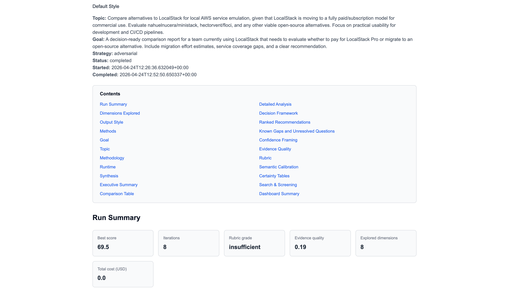

<!--
Demo deck for the research mode showcase. Built with Marp.

Render to PowerPoint:
  npx @marp-team/marp-cli --allow-local-files docs/showcase/demo.md -o demo.pptx

Render to HTML (single file, great for screen recording):
  npx @marp-team/marp-cli --allow-local-files docs/showcase/demo.md --html -o demo.html

Render to PDF:
  npx @marp-team/marp-cli --allow-local-files docs/showcase/demo.md --pdf

Or open in VS Code with the Marp extension installed for live preview.
-->

<!-- _class: lead -->
<!-- _paginate: false -->

# Multi-LLM Adversarial Convergence Framework

### Autonomous research, three audiences, one corpus

---

## How this started

I follow [Andrej Karpathy](https://x.com/karpathy) on X/Twitter.

He posted about [`autoresearch`](https://github.com/karpathy/autoresearch) — an infinite loop that:

- modifies a small model's code
- trains it for ~5 minutes on a GPU
- measures the loss
- keeps the change if it improved, reverts if it didn't

I cloned it. I ran it on my **gaming laptop**.

It actually worked.

---

## Same loop, different substrate

The loop isn't really about training neural networks.

It's about: **propose → test → score → keep or discard → compress**.

That shape applies to anything you can score. So why not knowledge?

| Karpathy's `autoresearch` | This framework |
|---|---|
| GPU training run | LLM agent call |
| Loss function | Heuristic + LLM judge |
| Weights | Knowledge corpus |
| ~5 minutes per iteration | One backend call per iteration |

Multiple backends can **argue** (adversarial), **agree in parallel** (ensemble), or **take turns** (serial).

---

## CLIs first, then API

Why start with CLI adapters — `claude-cli`, `codex-cli`, `gemini-cli`, `copilot-cli`?

**Economics of experimentation:**

- I already pay flat-rate subscriptions (Claude Pro, Copilot, etc.)
- CLI sessions reuse those subscriptions — **flat cost**, not per-token
- API calls bill per-token — expensive when iterating on a research loop that calls dozens of times per run

**APIs came later** for:

- Adapters that don't ship a CLI
- Aggregators (LiteLLM, Bedrock, GitHub Models)
- Stricter cost / latency / tool-calling control
- CI / unattended runs where there's no interactive CLI session

---

## The loop

```text
┌─────────────────┐
│ 1. Hypothesise  │  Pick the next dimension to investigate
└────────┬────────┘
         ▼
┌─────────────────┐
│ 2. Execute      │  Research it (web, docs, analysis)
└────────┬────────┘
         ▼
┌─────────────────┐
│ 3. Score        │  Heuristic 40% + LLM judge 60%
└────────┬────────┘
         ▼
┌─────────────────┐
│ 4. Decide       │  Score improved? KEEP. Otherwise: DISCARD.
└────────┬────────┘
         ▼
┌─────────────────┐
│ 5. Compress     │  Every N iterations, distill the corpus
└─────────────────┘
```

Stops on `Ctrl+C`, `max_iterations`, or `target_dimensions_total`.

---

## Three modes

| Mode | CLI | What you get |
|---|---|---|
| **research** | `src.cli research` | Scored, synthesised report on a topic with citations and audit trail |
| **refine** | `src.cli refine` | Converged PRD / spec / technical proposal |
| **plan** | `src.cli plan` | Converged implementation plan |

Same execution semantics. Each mode owns its config schema and convergence loop.

This deck focuses on `research`.

---

## Backends — bring your own model

**CLI adapters** (use the official tool, you already have it set up):
- `claude-cli`, `codex-cli`, `gemini-cli`, `copilot-cli`

**Direct API adapters** (use the SDK directly):
- `claude-api`, `codex-api`, `gemini-api`

**Aggregator API adapters** (one config, many vendors):
- `litellm-api`, `copilot-api`, `bedrock-api`

Mix and match. CLI for primary, API for adversary, aggregator for utility — all valid.

---

## Strategies — how the backends collaborate

| Strategy | Behavior |
|---|---|
| `single` | One backend, one perspective |
| `ensemble` | Parallel research, blind judging by a different backend |
| `adversarial` | Researcher + critic + arbitrator across backends |
| `parallel` | All backends research independently; best wins |
| `serial` | Backends take turns, each builds on the previous |
| `specialist` | Each backend assigned a specific persona/role |

`adversarial` is the headline. **Different LLMs catch different errors.**

---

## Output styles — same corpus, three presentations

`reporting.output_style` controls how the synthesised report is rendered.

| Style | Audience | Vibe |
|---|---|---|
| `default` (raw) | Internal exploration | Fast narrative synthesis |
| `paper` | Stakeholders, reviewers | Academic with deterministic references |
| `technical_doc` | Engineers, decision-makers | Structured, comparison-tables, decision-ready |

*Also available: `executive_brief`, `decision_memo` — out of scope for this demo.*

---

## Output: `default` — raw narrative



**What you get:** quick narrative synthesis, sectioned by dimension, embedded comparison tables.

**Use when:**
- Exploring a topic
- Sharing internal findings
- Fast iteration before publishing

**Closest analog:** a really thorough Notion page.

---

## Output: `paper` — academic-grade


**What you get:** abstract, methodology section, evidence-backed claims, **deterministic `## References` section** auto-built from `citations.json`.

**Use when:**
- Writing for external review
- Stakeholder reports where evidence trail matters
- Anything that will be cited

**Closest analog:** a literature review.

---

## Output: `technical_doc` — engineering-focused


**What you get:** comparison tables, decision matrix, recommendation upfront, structured pros/cons.

**Use when:**
- Architecture Decision Records (ADRs)
- Vendor / tool comparisons
- Decision memos for engineering teams

**Closest analog:** an RFC or ADR.

---

## Switching styles

```yaml
# configs/research/<topic>.yaml
research:
  reporting:
    output_style: paper          # default | paper | technical_doc | ...
    style_overrides:
      executive_summary: true
      comparison_table: true
      recommendation_mode: lead   # lead | trail | hidden
      section_ordering: evidence_first
```

**Same research run. Same data. Different artifact.**

You can re-render any past run with `src.cli research --synthesize` after changing the style.

---

## Reproducibility — every run is replayable

Each real run writes:

| File | Purpose |
|---|---|
| `run.log` | Human-readable operational log |
| `audit_trail.jsonl` | Structured append-only audit trail (step lifecycle, files touched, security events, policy denials) |
| `effective_config.json` | Full normalized snapshot of the resolved config |
| `tool_trace.json` | Per-tool argument summaries + truncated outputs |
| `prompt_snapshot.json` | Exact prompts sent at run start |
| **`rerun.sh`** | Runnable script to replay the exact run |

You can audit, debug, or replay. No "it worked on my machine."

---

## Trust + certainty — every claim is classified

Every `citations.json` and `claims.json` record carries a **`trust_class`**:

| Class | Meaning |
|---|---|
| `untrusted_web_content` | URL citations from web search |
| `user_provided_source_material` | Operator-provided files |
| `inferred_claim` | LLM-synthesised, no direct citation |

Plus **PRISMA-style logs**:
- `search_log.json` — what was searched
- `screening_log.json` — what was included or excluded and why
- `certainty_tables.json` — first-pass certainty scoring per claim

Readers can see exactly how strong each conclusion is.

---

## Security model — declarative, enforced

```yaml
security:
  tool_execution_mode: sandboxed     # direct | sandboxed
  allow_host_bash: false             # hard-block Bash in backend calls
  sandbox:
    mode: tool_calls
    filesystem_access: workspace_only  # writes restricted to .workspace/
    network_access: web_only           # WebSearch/WebFetch only
```

- **Capability registry** classifies every tool; unclassified tools denied in sandbox mode
- **Write-boundary enforcement** via `guard_path_write`
- **Network policy** at executor-dispatch level (web_only / none)
- **All denials** recorded in `audit_trail.jsonl` with `reason_code`

---

## Demo flow

For the screen recording:

1. **Show the config** — open `configs/research/localstack_alternatives_copilot_codex.yaml`
2. **Dry-run validation** — `src.cli research --config ... --dry-run`
3. **Real run** — same command without `--dry-run` (sped up)
4. **Open `output/<run>/`** — show artifacts produced
5. **Three reports** — flip through `report.html` for each style:
   - `output_style: default` (raw)
   - `output_style: paper`
   - `output_style: technical_doc`
6. **Audit trail** — `tail audit_trail.jsonl` to show provenance

Suggested narration: *"One topic, three audiences, one source of truth."*

---

## Takeaways

- **Reproducible** — every run replayable via `rerun.sh`
- **Auditable** — full trail in `audit_trail.jsonl`
- **Adversarial** — different LLMs catch different errors
- **Multi-audience** — switch output style without re-running
- **Honest about uncertainty** — `trust_class` on every claim

---

<!-- _class: lead -->
<!-- _paginate: false -->

## Try it

```bash
uv sync
uv run python -m src.cli research \
  --config configs/research/<your-topic>.yaml \
  --dry-run
```

Templates: `configs/research/_template.yaml`

Reference: `docs/research.md` · `AGENTS.md`
