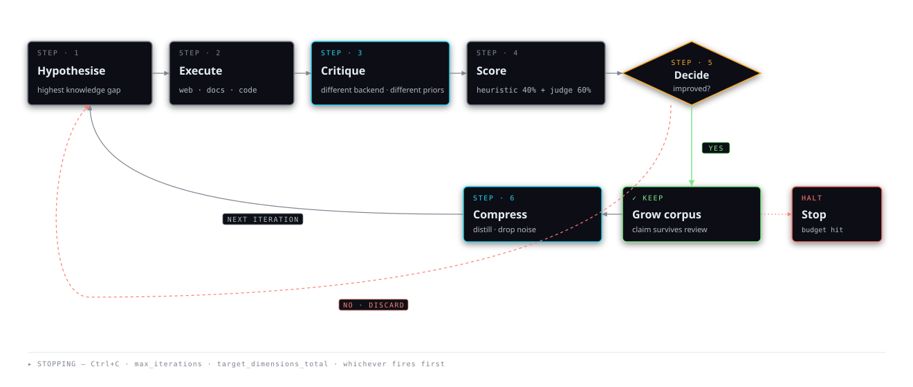
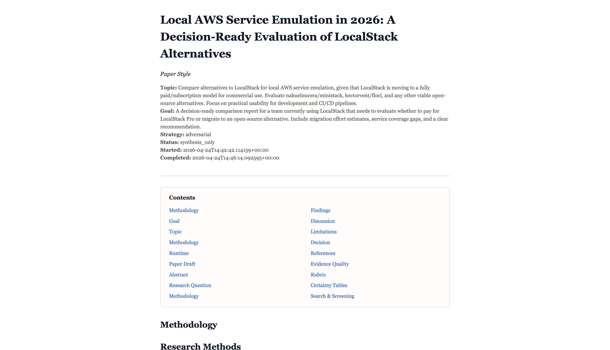
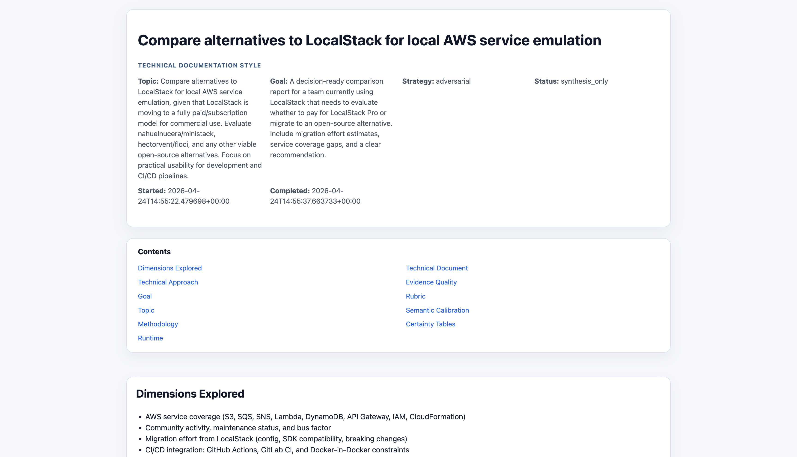

<!--
DEMO RUNBOOK — READ BEFORE PRESENTING
======================================
Format: staged run (real outputs, played back). 30 minutes.
Terminal pre-work:
  1. cd multillm-adversarial-convergence
  2. Open: configs/research/localstack_alternatives_copilot_codex.yaml
  3. Have open in browser (tabs):
       docs/showcase/localstack-alternatives/raw/report.html
       docs/showcase/localstack-alternatives/paper/report.html
       docs/showcase/localstack-alternatives/technical/report.html
  4. Have ready: cat docs/showcase/localstack-alternatives/technical/audit_trail.jsonl | python3 -m json.tool | head -60

SLIDE TIMING
  Slides 1–4   (intro + origin + loop)     ~5 min
  Slides 5–8   (agentic patterns)          ~7 min
  Slides 9–12  (demo: config + run)        ~5 min
  Slides 13–15 (convergence proof)         ~5 min
  Slides 16–18 (output styles)             ~4 min
  Slides 19–21 (artifacts + trust + cost)  ~3 min
  Slides 22–23 (takeaways + try it)        ~1 min

STAGING NOTE: Tell the audience on slide 1. Never hide it.
-->

<!-- _class: lead -->
<!-- _paginate: false -->

# Multi-LLM Adversarial Convergence Framework

### Make competing LLMs argue until they converge on the best answer

<br>

> **Staged demo** — this is a real run played back at speed.
> All artifacts shown are live outputs from the actual execution.

---
<!-- TIMING: 1 min — the problem in one sentence before any origin story -->

## The problem

Single-model research is **non-deterministic and unverifiable**.
One LLM, one pass, one perspective.

> You can't know what it missed, what it fabricated with confidence, or whether a different model would have reached the same conclusion.

**This framework's answer:**

- Run multiple backends on the same topic
- Make them **score, critique, and argue with each other**
- Keep only what survives adversarial review
- Emit a full evidence trail so you can audit every claim

---
<!-- TIMING: 2 min — origin story, now that they know what they're watching -->

## Origin: Karpathy's `autoresearch`

The loop isn't original. [Andrej Karpathy's `autoresearch`](https://github.com/karpathy/autoresearch) runs:

> *modify code → train 5 min on GPU → measure loss → keep or revert*

The insight: **this shape applies to anything you can score**.

| Karpathy's `autoresearch` | This framework |
|---|---|
| GPU training run | LLM backend call |
| Loss function | Heuristic 40% + LLM judge 60% |
| Neural network weights | Knowledge corpus |
| ~5 min per iteration | One backend call per iteration |
| Stops when loss plateaus | Stops on `max_iterations` or `target_dimensions_total` |

Same loop. Different substrate: **knowledge instead of weights**.

---
<!-- TIMING: 2 min — loop diagram. Slow down here. This is the mental model for everything that follows. -->

## The loop



<br>

| | |
|---|---|
| **Critique** (purple) | A *different* backend — different priors, different blind spots |
| **Decide** (amber) | KEEP grows the corpus · DISCARD retries the same dimension |
| **Compress** (teal) | Every N iterations: distill, drop noise, bound context cost |

Stops on `Ctrl+C`, `max_iterations`, or `target_dimensions_total`.

---
<!-- _class: divider -->
<!-- TIMING: transition, 10 sec -->

## Agentic Design Patterns

### 11 recognized patterns composing into one system

*This is not a collection of hacks. Each component maps to a named pattern
from the research literature.*

---
<!-- TIMING: 3 min — the engine group. This is the heart. Spend time on LLM-as-Judge independence. -->

<!-- _class: tight -->

## Patterns: The Engine

Three patterns drive every iteration.

| Pattern | What it does here | Canonical reference |
|---|---|---|
| **Evaluator-Optimizer** | The outer loop: propose → score → keep/discard | [Anthropic — Building Effective Agents](https://www.anthropic.com/research/building-effective-agents) |
| **LLM-as-Judge** | A *different* backend scores each candidate. No self-grading. 60% of the score signal. | [agentic-design.ai](https://agentic-design.ai/patterns/reflection/llm-as-judge) · [arXiv 2410.10934](https://arxiv.org/abs/2410.10934) |
| **Reflection / Self-Compression** | Every N iterations: the agent distills its own corpus. Forces prioritisation. Keeps context cost bounded. | [Andrew Ng — Agentic Patterns](https://www.deeplearning.ai/the-batch/how-agents-can-improve-llm-performance/) |

> **Why hybrid scoring?** A pure LLM judge can be gamed — a model learns to write for the judge.
> The heuristic (40%) is deterministic and model-agnostic: it checks coverage, citation density, dimension completion.
> Combined, they're harder to exploit.

---
<!-- TIMING: 2 min — topology group. Emphasise role isolation = cost control + replaceability. -->

<!-- _class: tight -->

## Patterns: The Topology

How backends are wired together.

| Pattern | What it does here | Canonical reference |
|---|---|---|
| **Orchestrator / Subagents** | `orchestrator.py` owns the lifecycle. Backends are narrow-contract workers with no lifecycle awareness. | [Anthropic — Building Effective Agents](https://www.anthropic.com/research/building-effective-agents) |
| **Multi-Agent Role Topology** | Named roles: `primary`, `judge`, `utility`, `research[]`. Each filled by a (potentially different) backend. Independent swap surface. | [arXiv 2405.10467](https://arxiv.org/abs/2405.10467) |
| **Routing / Specialist Dispatch** | `specialist` strategy routes each dimension to the most capable backend by declared persona. | [Anthropic — Building Effective Agents](https://www.anthropic.com/research/building-effective-agents) |
| **Parallelization (Ensemble)** | `ensemble` / `parallel`: all backends fan out simultaneously. `ThreadPoolExecutor`, merged via judge. | [Anthropic — Building Effective Agents](https://www.anthropic.com/research/building-effective-agents) |
| **Prompt Chaining (Serial)** | `serial`: backends take turns. Stage N+1 receives stage N's output as context. | [Anthropic — Building Effective Agents](https://www.anthropic.com/research/building-effective-agents) |

---
<!-- TIMING: 2 min — guardrails group. Anchor sandbox to real enterprise concerns. -->

<!-- _class: tight -->

## Patterns: The Guardrails

What prevents the agent from doing things it shouldn't.

| Pattern | What it does here | Canonical reference |
|---|---|---|
| **Adversarial Critique** | `adversarial` strategy: Researcher → Critic → Arbitrator, across *different* model families. Different RLHF = different blind spots. | [arXiv 2305.19118 — Multi-Agent Debate](https://arxiv.org/abs/2305.19118) |
| **Tool Use + Sandboxed Execution** | Declarative capability registry. Unclassified tools denied. Write boundary: `.workspace/` only. Network: `web_only` or `none`. All denials in `audit_trail.jsonl`. | [Anthropic — Writing Tools for Agents](https://www.anthropic.com/engineering/writing-tools-for-agents) |
| **Human-in-the-Loop (HITL)** | Optional phase-transition gates. Execution pauses; operator approves before irreversible actions. Decision recorded in audit trail. | [LangGraph — HITL](https://langchain-ai.github.io/langgraph/concepts/human_in_the_loop/) |

> **Sandbox as IAM:** the capability registry is the agentic equivalent of an IAM policy.
> Least privilege at the tool level, not just at the process level.

---
<!-- _class: divider -->
<!-- TIMING: transition, 10 sec -->

## Demo

### LocalStack alternatives — a real research question

*"LocalStack went fully paid. Should our team pay Pro or migrate to an open-source alternative?"*

---
<!-- TIMING: 2 min — show config in terminal. Key things to point out:
  - strategy: adversarial
  - three backends: claude-cli (primary), copilot-cli (researcher), codex-cli (adversary+judge)
  - 8 dimensions, max 10 iterations
  - allowed_tools: real web tools, not mocked
-->

<!-- _class: tighter -->

## The config — three backends, adversarial strategy

```yaml
# configs/research/localstack_alternatives_copilot_codex.yaml
research:
  topic: >
    Compare alternatives to LocalStack for local AWS service emulation.
    LocalStack is moving to a fully paid model. Evaluate MiniStack, Floci,
    and other viable open-source alternatives.
  goal: >
    A decision-ready comparison for a team evaluating LocalStack Pro vs
    open-source migration. Include migration effort, service coverage gaps,
    and a clear recommendation.
  execution:
    strategy: adversarial
    backends:
      primary:   primary_reasoner    # claude-cli (Claude Code)
      research:  [research_coder]    # copilot-cli (GitHub Copilot)
      judge:     adversary_reasoner  # codex-cli   (GPT-5.4) ← critic + judge
      utility:   adversary_reasoner
    max_iterations: 10
    allowed_tools: "WebSearch,WebFetch,Read,Bash,Glob,Grep"
```

Three different model families. Critic and judge are **deliberately different** from the researcher.

---
<!-- TIMING: 1 min — dry-run slide, then 2 min demo terminal -->

## Dry-run first — validate without spending tokens

```bash
# Validate config wiring, provider health, and tool capabilities — no backend calls
uv run python -m src.cli research \
  --config configs/research/localstack_alternatives_copilot_codex.yaml \
  --dry-run
```

Output confirms:
- All backend adapters resolve and are reachable
- Strategy is valid for the declared role topology
- Tool capability registry is satisfied
- Sandbox policy is coherent

Then run for real (this is the staged playback):

```bash
uv run python -m src.cli research \
  --config configs/research/localstack_alternatives_copilot_codex.yaml
```

<!-- PRESENTER: switch to terminal, show the staged run playing back. Point to the iteration log lines — hypothesis, score, KEEP/DISCARD decisions showing in real time. -->

---
<!-- _class: divider -->
<!-- TIMING: transition, 10 sec -->

## Adversarial critique in action

### What the critic actually said — from the real run

---
<!-- TIMING: 3 min — this is the most important slide. Show the critique finding a real error, then show it was fixed. -->

## The critic finds real errors

**Iteration 001** — Researcher (Copilot) delivers AWS service coverage findings. Score: **62.0**

The judge backend (GPT-5.4) reviews and raises:

> *"MiniStack section appears materially stale — API Gateway v1, Cognito, and KMS coverage are asserted without current primary source evidence."*

> *"Moto capabilities are mischaracterized — Lambda execution mode and IAM enforcement nuance are factually wrong."*

> *"Many fine-grained feature claims are overconfident relative to the cited evidence."*

**These are not style comments. They are factual challenges** — a different model, different training data, catching different errors.

The loop forces the next iteration to resolve these gaps or be discarded.

---
<!-- TIMING: 2 min — show the score table, draw attention to the dip in iter 007 (a harder dimension) and the jump to 76.3 in 009. -->

<!-- _class: tight -->

## Score progression — convergence is measurable

Each bar is one iteration. Score = heuristic (40%) + LLM judge (60%).

| Iteration | Dimension | Score | Decision |
|---|---|---|---|
| 001 | AWS service coverage | **62.0** | KEEP |
| 002 | Community activity & bus factor | 63.0 | KEEP |
| 003 | Migration effort | 63.5 | KEEP |
| 004 | CI/CD integration | 63.5 | KEEP |
| 005 | IaC toolchain (Terraform/CDK/SAM) | **69.5** | KEEP |
| 006 | CloudFormation source verification | 68.0 | KEEP |
| 007 | Migration effort by team profile | 63.5 | KEEP *(harder dimension)* |
| 008 | API behavioral fidelity | 66.0 | KEEP |
| **009** | Migration effort (final) | **76.3** | KEEP |

> Iter 007 dipped because the critic flagged under-validated migration estimates.
> The loop forced a harder verification pass. Iter 009 resolved it — **+12.8 points** on the final dimension.

---
<!-- TIMING: 1 min — transition to showing the outputs -->

## From one corpus — three artifacts

The research loop runs **once**. The output style is a rendering decision, not a research decision.

```yaml
reporting:
  output_style: technical_doc   # default | paper | technical_doc | executive_brief | decision_memo
```

Re-render any past run without re-running research:

```bash
uv run python -m src.cli research \
  --config configs/research/localstack_alternatives_copilot_codex_paper.yaml \
  --synthesize   # skips research loop, only re-renders
```

**Same data. Same citations. Different artifact.**

---
<!-- TIMING: 1.5 min — show raw report in browser -->

## Output: `default` — for internal exploration


Quick narrative synthesis, sectioned by dimension, embedded comparison tables.

**Use when:**
- Exploring a topic
- Sharing internal findings
- Fast iteration before committing to a format

**Closest analog:** a thorough Notion research page

---
<!-- TIMING: 1.5 min — show paper report in browser -->

## Output: `paper` — for stakeholders and external review



Abstract, methodology section, evidence-backed claims, deterministic `## References` built from `citations.json`.

**Use when:**
- Writing for external review
- Stakeholder reports where evidence provenance matters
- Anything that will be cited downstream

**Closest analog:** a literature review or RFC with bibliography

---
<!-- TIMING: 1.5 min — show technical report in browser. This is the money slide for engineering audiences. -->

## Output: `technical_doc` — for engineering decisions



Comparison tables, decision matrix, recommendation upfront, structured pros/cons per alternative.

**Use when:**
- Architecture Decision Records (ADRs)
- Vendor / tool evaluation
- Decision memos for engineering teams

**Closest analog:** an RFC or ADR with a verdict

---
<!-- TIMING: 1.5 min — show the output directory in terminal. Point to rerun.sh. -->

<!-- _class: tight -->

## Every run is fully replayable

```
output/localstack_alternatives_copilot_codex/
├── run.log                  ← human-readable operational log
├── audit_trail.jsonl        ← append-only structured trail: steps, tool calls, denials, policy events
├── effective_config.json    ← full normalized config snapshot at run time
├── tool_trace.json          ← per-tool args + truncated outputs
├── prompt_snapshot.json     ← exact prompts sent at run start
├── rerun.sh                 ← runnable exact-replay script
├── iterations/
│   ├── iter_001.md          ← hypothesis + findings + critique + score
│   └── iter_009.md
└── report.html              ← rendered output
```

`rerun.sh` is not documentation — it's an executable that reconstructs the exact run.
No "it worked on my machine."

---
<!-- TIMING: 1 min — audit trail terminal: cat ... | python3 -m json.tool | head -40 -->

<!-- _class: tight -->

## Trust + certainty — every claim is classified

Every entry in `citations.json` and `claims.json` carries a `trust_class`:

| Class | Meaning |
|---|---|
| `untrusted_web_content` | URL citation from live web search — treat as external, unverified |
| `user_provided_source_material` | Operator-provided input files — trusted by the operator |
| `inferred_claim` | LLM-synthesised without a direct citation — explicitly flagged |

Plus PRISMA-style evidence logs:
- `search_log.json` — what was searched, when, from which backend
- `screening_log.json` — what was included or excluded, and why
- `certainty_tables.json` — first-pass certainty score per claim

> Readers know **exactly how strong each conclusion is** before acting on it.

---
<!-- TIMING: 30 sec — cost. Keep it short. Numbers from the real run. -->

<!-- _class: tight -->

## This run

Real execution data from the `localstack_alternatives_copilot_codex` run:

| Metric | Value |
|---|---|
| Backends | `claude-cli` (Claude Sonnet) · `copilot-cli` (Claude Sonnet 4.6) · `codex-cli` (GPT-5.4) |
| Strategy | `adversarial` — researcher + critic + arbitrator |
| Dimensions covered | **8 of 8** |
| Iterations | **9** (+ compression at iter 4) |
| Best score reached | **76.3 / 100** |
| Output formats generated | 3 (`default`, `paper`, `technical_doc`) |
| Execution cost | **$0.00** — all CLI adapters, flat-rate subscriptions |

> CLI adapters reuse existing Claude Pro / Copilot / Codex subscriptions — **flat cost, not per-token**.
> API adapters (for CI/unattended runs) bill per-token. Choose based on context.

---
<!-- TIMING: 1 min — takeaways as conclusions -->

## What you just saw

1. Two different model families **argued about LocalStack alternatives** for 9 iterations
2. The critic (GPT-5.4) caught real factual errors in the researcher's (Copilot) output
3. The loop forced resolution — the final score improved **+14.3 points** from iteration 1 to 9
4. Three publication-ready artifacts were produced from **one research corpus**
5. Every claim carries a `trust_class` — the system is honest about what it doesn't know
6. The full run is **exactly reproducible** via `rerun.sh`

> **The adversarial loop isn't about being clever. It's about the same engineering principle
> as code review: a second set of eyes with different priors catches different bugs.**

---
<!-- _class: lead -->
<!-- _paginate: false -->

<!-- _class: tighter -->

## Try it

```bash
uv sync

# Validate without spending tokens
uv run python -m src.cli research \
  --config configs/research/localstack_alternatives_copilot_codex.yaml \
  --dry-run

# Run for real
uv run python -m src.cli research \
  --config configs/research/localstack_alternatives_copilot_codex.yaml
```

Copy a template for your own topic: `configs/research/_template.yaml`

Reference: [`docs/research.md`](../research.md) · [`docs/design/agentic-design-patterns.md`](../design/agentic-design-patterns.md) · [`AGENTS.md`](../../AGENTS.md)

<!--
Render this deck:

  # HTML (best for screen recording)
  npx @marp-team/marp-cli --allow-local-files docs/showcase/demo.md --html -o docs/showcase/demo.html

  # PowerPoint
  npx @marp-team/marp-cli --allow-local-files docs/showcase/demo.md -o docs/showcase/demo.pptx

  # PDF
  npx @marp-team/marp-cli --allow-local-files docs/showcase/demo.md --pdf -o docs/showcase/demo.pdf
-->
