<!--
EXTENDED DECK — PATTERN DEEP DIVE
======================================
Format: long-form reference. ~45-50 minutes if presented; designed
primarily for self-paced reading.

This is the companion to ``demo.md`` — the live 30-min deck groups
the 11 patterns into 3 thematic slides; this version expands every
pattern into its own slide with a dedicated mermaid diagram.

Pre-rendering: ``./build.sh`` builds every ``patterns/*.mmd`` to
``patterns/*.svg`` and renders this deck to ``demo_extended.html``
and ``demo_extended.pptx``.

Slide map (22 slides):
   1   Cover
   2   Why these patterns
   3   Origin: Karpathy
   4   The loop
   5   Divider — patterns
   6   Pattern 1 — Evaluator-Optimizer
   7   Pattern 2 — LLM-as-Judge
   8   Pattern 3 — Reflection / Self-Compression
   9   Pattern 4 — Orchestrator / Subagents
  10   Pattern 5 — Multi-Agent Role Topology
  11   Pattern 6 — Routing / Specialist Dispatch
  12   Pattern 7 — Parallelization (Ensemble)
  13   Pattern 8 — Prompt Chaining (Serial)
  14   Pattern 9 — Adversarial Critique
  15   Pattern 10 — Tool Use + Sandboxed Execution
  16   Pattern 11 — Human-in-the-Loop (HITL)
  17   How they compose — strategy lattice
  18   Demo run snapshot
  19   Output styles
  20   Trust + reproducibility
  21   References — full citation table
  22   Try it
-->

<!-- _class: lead -->
<!-- _paginate: false -->

# Multi-LLM Adversarial Convergence
## Pattern Deep Dive — 11 Agentic Patterns, One System

<br>

> A long-form companion to the live demo.
> One slide per pattern, with diagram, mechanism, and codebase mapping.

---
<!-- _class: tight -->

## Why these patterns matter

This codebase is **not a collection of hacks**.

Every component maps to a named pattern from the agentic-design literature.
That matters for three reasons:

1. **Replaceability** — when a pattern is named, swapping the implementation is mechanical
2. **Defensibility** — code review can ask *"is this Evaluator-Optimizer or Reflection?"* instead of *"is this fine?"*
3. **Onboarding** — new contributors recognise shapes; they don't have to reverse-engineer intent

> The 11 patterns shown here are not all of agentic design — they're the subset that this framework actually composes.
> Roughly: **engine** (3) + **topology** (5) + **guardrails** (3).

---
<!-- _class: tight -->

## Origin: the Karpathy `autoresearch` shape

The convergence loop is borrowed from [Andrej Karpathy's `autoresearch`](https://github.com/karpathy/autoresearch):

> *modify code → train 5 min on GPU → measure loss → keep or revert*

| Karpathy's `autoresearch` | This framework |
|---|---|
| GPU training run | LLM backend call |
| Loss function | Heuristic 40% + LLM judge 60% |
| Neural network weights | Knowledge corpus |
| ~5 min per iteration | One backend call per iteration |
| Stops when loss plateaus | Stops on `max_iterations` or `target_dimensions_total` |

**The insight:** this loop shape — *propose · score · keep-or-revert* — applies to anything you can score. Knowledge converges the same way weights do.

---
<!-- _class: pattern -->

## The loop in one picture

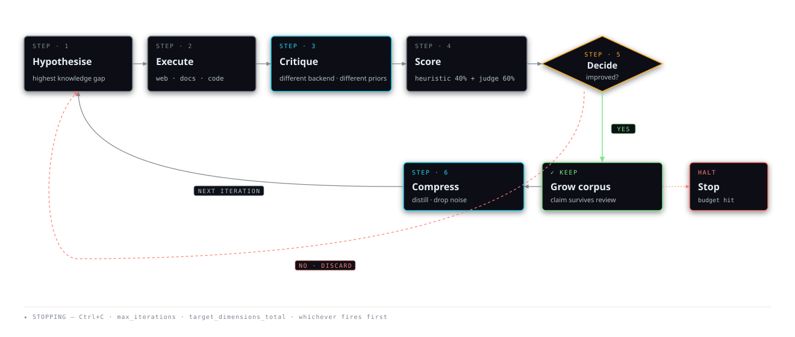

**Five steps repeat until convergence.** The critique is performed by a *different* backend than the producer (different priors → different blind spots). Compression every N iterations bounds the working corpus.

---
<!-- _class: divider -->

## Eleven patterns

### Engine · Topology · Guardrails

*Each named, each cited, each replaceable.*

---
<!-- _class: pattern -->

## 1 · Evaluator-Optimizer

> *The outer loop. Propose, score, keep or discard, repeat.*


**The pattern** — A generator produces candidates. An evaluator scores them against an objective. The system keeps high-scoring candidates and discards (or revises) the rest. The loop runs until score plateaus or a budget is exhausted.

**In this codebase**
- `src/research_loop.py` — owns the iteration cycle
- `src/scorer.py` — composite score (heuristic 40% + judge 60%); see `IterationScore`
- `KEEP` vs `DISCARD` decision recorded per iteration in `audit_trail.jsonl`

<span class="ref">**Reference:** [Anthropic — Building Effective Agents](https://www.anthropic.com/research/building-effective-agents)</span>

---
<!-- _class: pattern -->

## 2 · LLM-as-Judge

> *A different model scores the candidate. No self-grading.*


**The pattern** — The model that *produces* an output cannot reliably *score* it (self-evaluation is biased toward verbosity and confidence). A separate judge model — ideally from a different family — evaluates outputs against a rubric. Its score is one input to the keep/discard decision.

**In this codebase**
- `src/scorer.py` — `judge_response()` calls a non-producer backend
- Hybrid: 40% deterministic heuristic + 60% LLM judge (configurable via `scoring.weights`)
- Multi-judge mode: `evaluation.judges = [...]` enables consensus + disagreement detection (`detect_judge_disagreement()`)

<span class="ref">**Reference:** [agentic-design.ai — LLM-as-Judge](https://agentic-design.ai/patterns/reflection/llm-as-judge) · [arXiv 2410.10934](https://arxiv.org/abs/2410.10934)</span>

---
<!-- _class: pattern -->

## 3 · Reflection / Self-Compression

> *Every N iterations: distill the corpus, drop noise.*


**The pattern** — Naive iteration grows context monotonically — every kept claim is added to the working memory. Without compression, runs balloon: token costs explode, the model loses focus, and signal-to-noise drops. Compression is a forced rank-and-prune step where the agent rewrites its own corpus, keeping only what it judges load-bearing.

**In this codebase**
- `compression_interval` config flag (default: every 4 iterations)
- The agent re-reads its own corpus and emits a distilled version
- Audit event: `corpus_compressed` with before/after token counts

<span class="ref">**Reference:** [Andrew Ng — Agentic Patterns](https://www.deeplearning.ai/the-batch/how-agents-can-improve-llm-performance/)</span>

---
<!-- _class: pattern -->

## 4 · Orchestrator / Subagents

> *One owner of lifecycle. Many narrow-contract workers.*

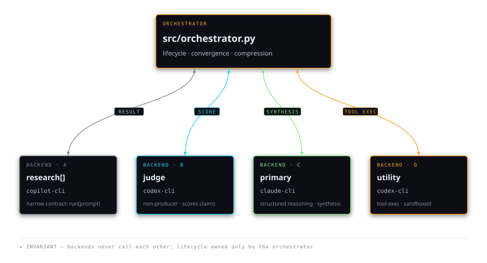

**The pattern** — Centralise control flow in one component. Backends are *workers* — they receive a task, return a result, and have no awareness of the wider lifecycle. This makes them replaceable, testable, and prevents cross-cutting state from leaking into transport adapters.

**In this codebase**
- `src/orchestrator.py` — the only owner of phase transitions, convergence checks, compression triggers
- `src/backends/` — adapters with a single contract: `run(prompt) → response`
- Backends never call each other; they only return to the orchestrator

<span class="ref">**Reference:** [Anthropic — Building Effective Agents](https://www.anthropic.com/research/building-effective-agents)</span>

---
<!-- _class: pattern -->

## 5 · Multi-Agent Role Topology

> *Configure roles, not models. Swap backends without changing logic.*


**The pattern** — Roles (`primary`, `judge`, `utility`, `research[]`) are abstract names that the codebase reasons about. Each is bound to a concrete backend at config time. The same orchestrator code works whether `judge` is `codex-cli` today and `gemini-api` tomorrow — the indirection is the swap surface.

**In this codebase**
- `configs/research/<topic>.yaml` — `execution.backends` map roles to backend IDs
- `src/config.py` — `BackendsConfig` schema; validates role completeness
- Role names appear in audit events: `role=judge backend=codex-cli`

<span class="ref">**Reference:** [arXiv 2405.10467 — Multi-Agent Role Topology](https://arxiv.org/abs/2405.10467)</span>

---
<!-- _class: pattern -->

## 6 · Routing / Specialist Dispatch

> *Each dimension goes to the backend best suited for it.*


**The pattern** — Different work needs different priors. Coverage-style breadth questions favour a broad-recall model; precision-critique questions favour a model trained for adversarial review. The router inspects the dimension's declared persona and dispatches accordingly.

**In this codebase**
- `src/strategy.py` — `specialist` strategy
- Each dimension declares a persona in config; persona → backend lookup at dispatch time
- Falls back to `primary` if no specialist matches

<span class="ref">**Reference:** [Anthropic — Building Effective Agents](https://www.anthropic.com/research/building-effective-agents)</span>

---
<!-- _class: pattern -->

## 7 · Parallelization (Ensemble)

> *Fan out to all backends in parallel. Merge via judge.*


**The pattern** — Variance reduction. Run the same task across N backends simultaneously; their answers will diverge in interesting ways. A judge picks the strongest, or a vote/merge step combines them. Useful when the cost of a wrong answer is high and budget allows redundancy.

**In this codebase**
- `src/strategy.py` — `ensemble` and `parallel` strategies
- `concurrent.futures.ThreadPoolExecutor` — bounded parallelism
- Judge selects best response or synthesises an ensemble answer

<span class="ref">**Reference:** [Anthropic — Building Effective Agents](https://www.anthropic.com/research/building-effective-agents)</span>

---
<!-- _class: pattern -->

## 8 · Prompt Chaining (Serial)

> *Backends take turns. Each stage receives the previous stage's output.*


**The pattern** — Specialisation by stage rather than by task. One backend researches; the next critiques; the next refines. Each stage operates on the previous stage's output, so the chain accumulates context. Cheaper than ensemble (no parallel calls) but slower end-to-end.

**In this codebase**
- `src/strategy.py` — `serial` strategy
- Stage N+1's prompt includes stage N's full output as context
- Used when stages have asymmetric specialisations (research → critique → synthesis)

<span class="ref">**Reference:** [Anthropic — Building Effective Agents](https://www.anthropic.com/research/building-effective-agents)</span>

---
<!-- _class: pattern -->

## 9 · Adversarial Critique

> *Researcher · Critic · Arbitrator — across different model families.*

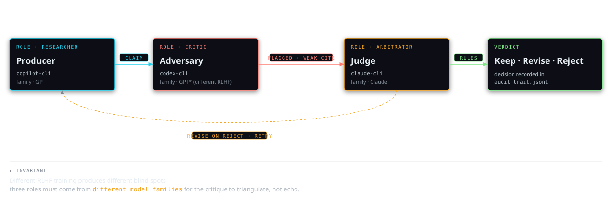

**The pattern** — A debate-shaped variant of serial chaining. The researcher proposes claims; the critic — *deliberately a different model family* — looks for errors, weak citations, and logical gaps; the arbitrator (different family again) renders a verdict. Different RLHF training produces different blind spots, so weaknesses in one model are visible to another.

**In this codebase**
- `src/strategy.py` — `adversarial` strategy (used in the demo run)
- Three roles: `researcher`, `critic`, `arbitrator` — each a different backend family
- Audit log records every critique flag and arbitrator decision

<span class="ref">**Reference:** [arXiv 2305.19118 — Multi-Agent Debate](https://arxiv.org/abs/2305.19118)</span>

---
<!-- _class: pattern -->

## 10 · Tool Use + Sandboxed Execution

> *The capability registry is the agentic equivalent of an IAM policy.*


**The pattern** — Agents need tools (web fetch, code execution, file write) but every tool widens the attack surface. The registry approach: every tool is declared with its capabilities; unclassified calls are denied. Filesystem writes are scoped to a sandbox directory; network access is gated to `web_only` or `none`. Every denial is auditable.

**In this codebase**
- `src/policy/` — capability registry, sandbox executor, audit hooks
- Write boundary: `output/<run>/.workspace/` — outside is read-only
- Network policy: `web_only` (allowlisted endpoints) or `none`
- Audit events: `tool_denied`, `write_intent`, `network_intent`

<span class="ref">**Reference:** [Anthropic — Writing Tools for Agents](https://www.anthropic.com/engineering/writing-tools-for-agents)</span>

---
<!-- _class: pattern -->

## 11 · Human-in-the-Loop (HITL)

> *Phase-transition gates. Operator approves before irreversible actions.*

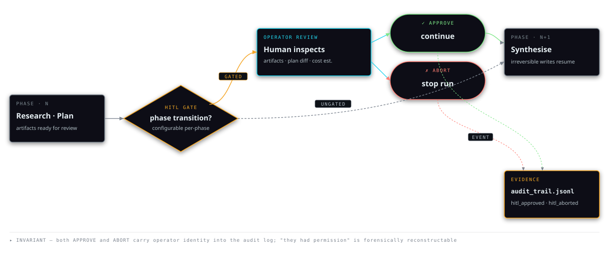

**The pattern** — Some actions are too consequential to trust to a fully autonomous agent: deploys, irreversible writes, large spends. HITL inserts an explicit pause at phase boundaries; the operator reviews artifacts, plan diffs, and cost estimates, then approves or aborts. Both decisions are recorded so the run remains fully auditable.

**In this codebase**
- `src/policy/hitl.py` — phase-transition gate
- Configurable per-phase: `hitl.gates = [research_to_synthesis, plan_approve, ...]`
- Audit events: `hitl_approved`, `hitl_aborted` — both with operator identity

<span class="ref">**Reference:** [LangGraph — Human-in-the-Loop](https://langchain-ai.github.io/langgraph/concepts/human_in_the_loop/)</span>

---
<!-- _class: tight -->

## How they compose — the strategy lattice

The 11 patterns are not orthogonal — they layer:

| Layer | Patterns | Concern |
|---|---|---|
| **Engine** | Evaluator-Optimizer · LLM-as-Judge · Reflection | What makes a single iteration meaningful |
| **Topology** | Orchestrator · Role Topology · Routing · Parallel · Serial | How backends are wired and dispatched |
| **Guardrails** | Adversarial Critique · Sandbox · HITL | What prevents the agent from doing the wrong thing |

> **A configured strategy is a tuple over the layers.** The demo run = `Adversarial Critique` (guardrail) over `Serial Chaining` (topology) using `Evaluator-Optimizer + LLM-as-Judge` (engine), with `Sandbox` always on.

> Patterns are **mix-and-match**, not a menu of mutually exclusive options.

---
<!-- _class: tight -->

## Demo run snapshot — what the patterns produced

| Field | Value |
|---|---|
| Topic | LocalStack alternatives (open-source, local AWS emulation) |
| Strategy | `adversarial` (researcher + critic + arbitrator) |
| Backends | `claude-cli` (primary) · `copilot-cli` (research) · `codex-cli` (judge + critic) |
| Iterations | 9 + 1 compression at iter 4 |
| Dimensions covered | 8 of 8 |
| Final score | 76.3 / 100 (from 62.0 at iter 1 → +14.3) |
| Cost | $0.00 (CLI adapters, flat-rate subscriptions) |

> All artifacts live in [`./localstack-alternatives/`](./localstack-alternatives/) — three rendering profiles, full audit trail, structured gap state, replayable via `rerun.sh`.

---
<!-- _class: tight -->

## Output styles — same corpus, three readers

| Profile | For | Key transformations |
|---|---|---|
| `default` | Internal exploration | Raw artefacts; full audit trail visible; minimal cosmetic transforms |
| `paper` | Stakeholders & external review | Abstract · structured sections · citation list · executive summary |
| `technical_doc` | Engineering decisions | Decision matrix · trust classifications · open questions · migration path |

> The corpus is the asset. Each profile is a *render* over it — pick the audience, get the right shape.

---
<!-- _class: tight -->

## Trust + reproducibility

Every claim emitted by the system is **classified** and **traceable**:

- **`trust_class`** — one of `verified` (citation + evidence), `likely` (single source), `inferred` (derived), `speculative` (no evidence). Set per claim.
- **`audit_trail.jsonl`** — append-only structured log. Every backend call, tool invocation, denial, score, gap promotion, HITL decision.
- **`rerun.sh`** — replays the run with the exact same config, prompts, and seeds. Outputs are byte-comparable when backends are deterministic.

> The system is honest about what it doesn't know. That's the point.

---
<!-- _class: tight -->

## References — full citation map

| Pattern | Source |
|---|---|
| Evaluator-Optimizer · Orchestrator · Routing · Parallel · Serial | [Anthropic — Building Effective Agents](https://www.anthropic.com/research/building-effective-agents) |
| LLM-as-Judge | [agentic-design.ai](https://agentic-design.ai/patterns/reflection/llm-as-judge) · [arXiv 2410.10934](https://arxiv.org/abs/2410.10934) |
| Reflection / Self-Compression | [Andrew Ng — Agentic Patterns](https://www.deeplearning.ai/the-batch/how-agents-can-improve-llm-performance/) |
| Multi-Agent Role Topology | [arXiv 2405.10467](https://arxiv.org/abs/2405.10467) |
| Adversarial Critique | [arXiv 2305.19118 — Multi-Agent Debate](https://arxiv.org/abs/2305.19118) |
| Tool Use + Sandbox | [Anthropic — Writing Tools for Agents](https://www.anthropic.com/engineering/writing-tools-for-agents) |
| Human-in-the-Loop | [LangGraph — HITL](https://langchain-ai.github.io/langgraph/concepts/human_in_the_loop/) |

> See also: [`docs/design/agentic-design-patterns.md`](../design/agentic-design-patterns.md) — the in-repo reference with code mappings.

---
<!-- _class: tighter -->
<!-- _paginate: false -->

## Try it

```bash
uv sync

CONFIG=configs/research/localstack_alternatives_copilot_codex.yaml

# Validate without spending tokens
uv run python -m src.cli research --config "$CONFIG" --dry-run

# Run for real
uv run python -m src.cli research --config "$CONFIG"
```

Templates: `configs/research/_template.yaml` · `configs/refine/prd_template.yaml` · `configs/plan/plan_template.yaml`

Reference: [`docs/research.md`](../research.md) · [`docs/design/agentic-design-patterns.md`](../design/agentic-design-patterns.md) · [`AGENTS.md`](../../AGENTS.md)
