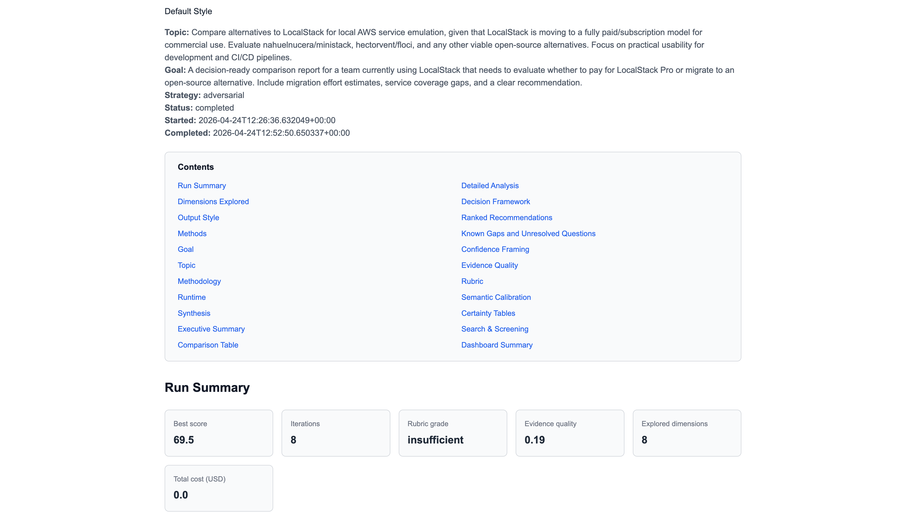
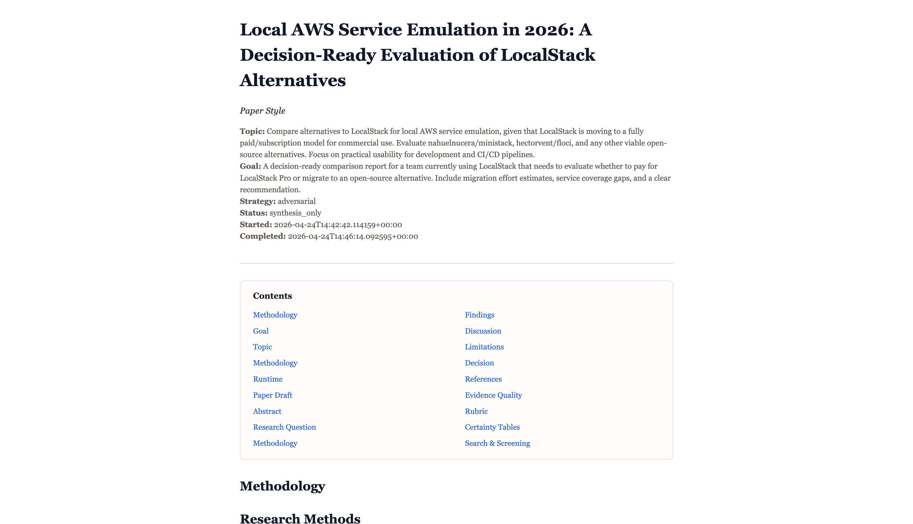
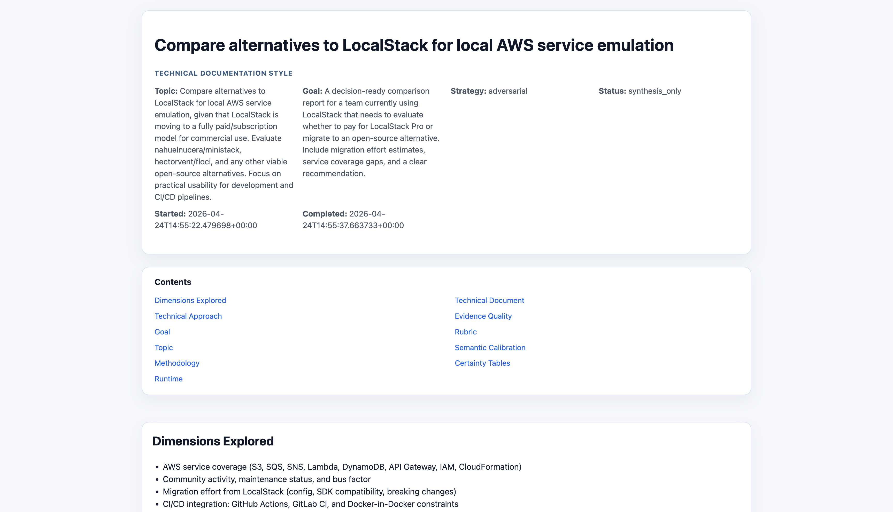

# LocalStack alternatives showcase

This showcase persists the outputs of three configs built from the same completed research run:

- `configs/research/localstack_alternatives_copilot_codex.yaml` → raw/default rendering
- `configs/research/localstack_alternatives_copilot_codex_paper.yaml` → paper rendering
- `configs/research/localstack_alternatives_copilot_codex_technical.yaml` → technical-document rendering

The artifacts below are stored in this folder so the repo can demonstrate the differences in output style without rerunning the research loop.

## Raw / default format

- persisted output: [`./raw/`](./raw/)
- HTML report: [`./raw/report.html`](./raw/report.html)
- synthesis: [`./raw/synthesis.md`](./raw/synthesis.md)

## Paper format

- persisted output: [`./paper/`](./paper/)
- HTML report: [`./paper/report.html`](./paper/report.html)
- synthesis: [`./paper/synthesis.md`](./paper/synthesis.md)

## Technical format

- persisted output: [`./technical/`](./technical/)
- HTML report: [`./technical/report.html`](./technical/report.html)
- synthesis: [`./technical/synthesis.md`](./technical/synthesis.md)

## Notes

- The three variants reuse the same underlying research corpus.
- The paper and technical versions were regenerated with `--synthesize`, not by rerunning research iterations.
- Screenshot images are Quick Look thumbnails of the generated HTML reports and are intended as visual documentation, not canonical artifacts.
