# Iris — Product Requirements Document

> Status: Authoritative

---

## Document Control

| Field | Value |
|---|---|
| Product name | Iris |
| Version | v1.1 |
| Status | Authoritative |
| Last updated | April 2026 |
| Primary audience | Product, engineering, platform, leadership |

---

## 1. Executive Summary

### 1.1 Product Summary
Iris is a multi-tenant engineering intelligence product that turns operational evidence into ranked, explainable, and actionable outputs.

Its value chain is:

```text
Evidence -> Pattern detection -> Grounded recommendation -> Human review -> Action framing
```

Iris ingests signals from systems such as Jira, GitHub, Slack, and Wiz, identifies recurring problems, retrieves relevant historical resolutions, and produces outputs for managers, reviewers, executives, technical leads, and operational support workflows.

### 1.2 Product Thesis
Engineering organizations do not need more isolated metrics. They need a system that can:

- identify recurring problems reliably
- explain why those problems matter
- connect them to historical precedent
- support review before publication
- turn operational pain into credible action
- decide when a case should be answered automatically, delegated to a human, or converted into a longer-term product or engineering investment

### 1.3 Strategic Differentiator
The primary moat is **Resolution Memory**: the ability to reuse historical problem-to-resolution knowledge to improve recommendation quality and trust.

A second differentiator is the ability to transform operational signals into **action-classified outputs** rather than generic summaries. Iris must distinguish between issues that require feature investment, automatable remediation, operator-assisted scripting, help-desk delegation, or knowledge-only guidance. Without this taxonomy, recommendation outputs are structurally incompatible and unmergeable across the product.

A later multiplier is **cross-tenant intelligence**, but that is not a v1 promise. It becomes relevant only after enough tenant corpus exists to generate signal safely and credibly.

### 1.4 v1 Center of Gravity
The primary v1 wedge is the **Manager + Reviewer loop**.

- Managers consume ranked patterns, findings, and action framing
- Reviewers validate quality, evidence, and trustworthiness before publication
- Executives are consumers, not the primary daily loop
- Technical leads are important in v1, but technical depth is intentionally scoped

The architecture must also preserve a path to a second use case: **realtime support triage** — inbound Jira tickets and Slack messages enriched, classified, and routed. Managers remain the primary daily consumer in v1, but the platform must not be architecturally trapped in batch-only operation. The event-driven ingestion path is an engineering requirement in v1 even when realtime triage is not yet a product surface.

### 1.5 Release Framing at a Glance
Iris is planned in staged delivery:

- **v1-alpha** proves the Manager + Reviewer loop
- **v1** is the first sellable product
- **v1.x** activates guided triage and response workflows for inbound Jira and Slack events
- **v1.5** activates cross-tenant intelligence
- **v2** adds code-aware technical depth and deeper execution support

---

## 2. Problem Statement

Engineering organizations with meaningful support and incident volume face the same recurring failure mode: important patterns are buried inside operational noise.

### 2.1 Current Pain
- Evidence is fragmented across Jira, GitHub, Slack, security tools, and incident artifacts
- Teams analyze tickets one by one instead of recognizing recurring patterns
- Historical resolutions are not systematically reused
- Prioritization is reactive and anecdotal
- Dashboards often stop at diagnosis and do not help drive action
- AI outputs are distrusted when they cannot be traced to evidence or precedent
- Support and operational teams do not have a consistent way to decide whether an inbound case should be answered immediately, routed to help desk, turned into a product feature, or converted into an automatable remediation pattern

### 2.2 Why Existing Approaches Fall Short
The observed BIMS POC proves that engineering intelligence is valuable, but also exposes limitations:

- single-tenant orientation
- low flexibility
- weak productization for multi-company rollout
- unclear regulated-tenant suitability
- limited portability beyond one-company scope
- limited support for realtime decisioning and inbound triage workflows

### 2.3 Primary Pain Owner
The primary pain owner in v1 is the **Engineering Manager** who needs to convert recurring support and operational noise into engineering priorities without manual synthesis across disconnected systems.

### 2.4 Secondary Operational Pain Owner
A second pain owner is the **support and operational triage function** that needs help deciding whether an inbound case should:

- receive an immediate grounded response
- be delegated to help desk or support operations
- be escalated to engineering
- be classified as a product feature gap
- be handled by a runbook or script

This use case is strategically important because it turns Iris from a reporting product into a decision-support system for operational flow. It also validates the action taxonomy: if the taxonomy is correct, both batch pattern analysis and realtime triage produce the same class of outputs.

---

## 3. Goals and Non-Goals

### 3.1 Product Goals
Iris v1 must:

- identify recurring operational problems across tenant-scoped source systems
- rank patterns by recurrence, severity, impact, and strategic value
- generate recommendations grounded in historical precedent where available
- distinguish grounded, heuristic, and mixed outputs
- support a trust-building review workflow before high-impact publication
- provide executive summaries, quick wins, and lightweight action framing
- operate safely for both standard and regulated tenants
- classify recurring and inbound cases into explicit action outcome categories from a canonical taxonomy
- support a future realtime triage loop for inbound Jira and Slack events without requiring platform redesign

### 3.2 Business Goals
Iris v1 should:

- replace manual synthesis for engineering prioritization
- demonstrate that grounded recommendations are accepted more often than generic ones
- onboard at least two tenants without bespoke architecture
- establish the foundation for external sale after internal validation
- prove that historical evidence improves operational triage quality, not only reporting quality

### 3.3 Non-Goals
Iris v1 does **not** aim to:

- perform unrestricted autonomous remediation or code changes
- provide no-code self-service workflow design for non-technical users
- provide full sprint-planning or execution automation
- perform code retrieval or code-level reasoning in technical opinions
- replace ticketing, incident management, or engineering systems of record
- provide broad enterprise BI outside engineering intelligence
- learn adaptively from reviewer corrections beyond storing feedback
- auto-respond to users without explicit tenant policy controls and confidence thresholds
- allow unrestricted cross-tenant evidence sharing

---

## 4. Users, Roles, and Access Model

### 4.1 Personas

#### Engineering Manager
Primary v1 user. Needs ranked patterns, strategic findings, and action framing.

#### Reviewer / Analyst
Primary trust gatekeeper. Needs evidence drill-down, historical precedent, and approval controls.

#### Executive Sponsor
Consumes summaries, quick wins, and strategic findings.

#### Technical Lead
Consumes scoped technical opinions and evaluates feasibility of recommendations.

#### Support Lead / Help Desk Lead
Needs help classifying inbound issues, deciding when to respond directly, when to delegate to help desk, and when to escalate to engineering. Primary consumer of the triage queue in v1.x.

#### Platform Operator
Onboards tenants, configures integrations, manages pipelines, and monitors health.

#### Compliance Admin
Reviews access boundaries, retention controls, and regulated-tenant governance.

### 4.2 Base Roles
| Role | Core access |
|---|---|
| `executive_viewer` | Executive summaries, quick wins, findings |
| `manager` | Ranked patterns, findings, action plans |
| `reviewer` | Review queue, trust labels, evidence drill-down |
| `analyst` | Reviewer access plus ticket explorer and archive |
| `technical_reviewer` | Technical opinions and supporting context |
| `support_operator` | Realtime triage queue, action class suggestions, delegation and escalation guidance |
| `operator` | Tenant setup, connectors, pipeline controls, monitoring |
| `compliance_admin` | Audit visibility, retention controls, regulated oversight |

### 4.3 Authorization Model
Iris authorization is evaluated by:

- role
- tenant scope
- domain scope
- capability set
- action autonomy level

A user may be allowed to see summaries without being allowed to inspect raw evidence. A `support_operator` may be allowed to see response suggestions without being allowed to approve cross-tenant derived intelligence. A tenant may allow delegation routing but forbid any automated user-facing response publication.

**v1-alpha activation:** v1-alpha ships with three active roles — `manager`, `reviewer`, and `operator` — scoped at the tenant level. The fuller role, scope, and capability model remains the target product design and is progressively activated in v1 as multi-tenant and regulated behavior matures. The `support_operator` role activates in v1.x.

### 4.4 Sensitive Capabilities
These capabilities must be permissioned explicitly:

- raw ticket visibility
- forensic archive detail
- technical opinion detail
- export actions
- audit-log visibility
- retention and governance controls
- regulated-tenant restricted evidence
- auto-response enablement
- source-system write-back
- use of cross-tenant derived intelligence

### 4.5 Authentication
Iris authenticates users through any **OIDC-compliant identity provider**. Okta is the current v1 reference implementation, but the product must not be tied to a single IdP vendor.

Iris owns the internal authorization model. Raw IdP groups do not define product permissions by themselves.

---

## 5. Target Customers and Deployment Context

### 5.1 First Buyer
The first buyer is the holding's CIO / CTO office, whose buying event is expanding engineering intelligence from a single-company POC into a multi-tenant product for the broader group.

### 5.2 First Proof of Value
Within 30–90 days, the product should prove:

> leadership can identify at least three actionable engineering priorities per sprint without manual cross-system synthesis.

A second proof of value is targeted for v1.x:

> operational teams can resolve or route a meaningful subset of inbound Jira or Slack cases faster using grounded historical evidence and action classification.

**Cold-start acknowledgment:** Iris depends on Resolution Memory for its strongest value, but the memory corpus will be sparse at launch. During the first 30–90 days, the product must still create value through pattern clustering, ranking, and clearly labeled recommendations even before grounding rates mature. See `docs/design/ONBOARDING_NARRATIVE_DAY1_DAY7_DAY30.md` for the companion onboarding narrative.

### 5.3 Ideal Customer Profile
A strong-fit customer:

- operates across multiple engineering systems
- has recurring support or incident volume
- struggles to convert operational pain into prioritized engineering work
- has enough historical closed issues to make Resolution Memory useful
- needs both leadership-facing outputs and operational follow-through
- benefits from consistent triage and response behavior across multiple companies or business units

### 5.4 Buyer / User Split
Iris is bought by leadership, validated by managers and reviewers, and trusted or rejected by technical users and operational users.

That means the product must satisfy both:
- strategic purchasing logic
- day-to-day operational utility

### 5.5 Tenant Categories
| Category | Description |
|---|---|
| Standard | Multi-source engineering intelligence without the strictest regulatory constraints |
| Regulated | Stronger evidence restrictions, governance controls, audit requirements, and dedicated operational boundaries |
| Operator context | Cross-tenant product operations without unrestricted tenant evidence access |

Cross-company intelligence must be **governed**, not assumed. Tenant-isolated operation is the default. Cross-company derived learning is an opt-in, policy-controlled capability. Regulated tenants are permanently excluded from cross-tenant intelligence unless future governance decisions explicitly approve otherwise.

---

## 6. Core Product Capabilities

The product is organized into six capability domains.

### 6.1 Evidence Capability Domain
Purpose: make the product trustworthy by ingesting and normalizing raw signals.

Capabilities:
- source ingestion (scheduled, operator-triggered, and event-driven paths)
- normalized evidence model
- ticket explorer
- evidence drill-down
- forensic archive
- source binding and source lineage tracking

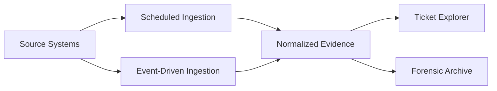

### 6.2 Knowledge Capability Domain
Purpose: make historical precedent reusable across batch analysis and realtime triage.

Capabilities:
- Resolution Memory corpus
- Knowledge Corpus (squad-owned documentation and runbooks)
- Visual Corpus (screenshots and operational surfaces)
- tenant-scoped and policy-scoped corpus retrieval
- freshness and provenance metadata

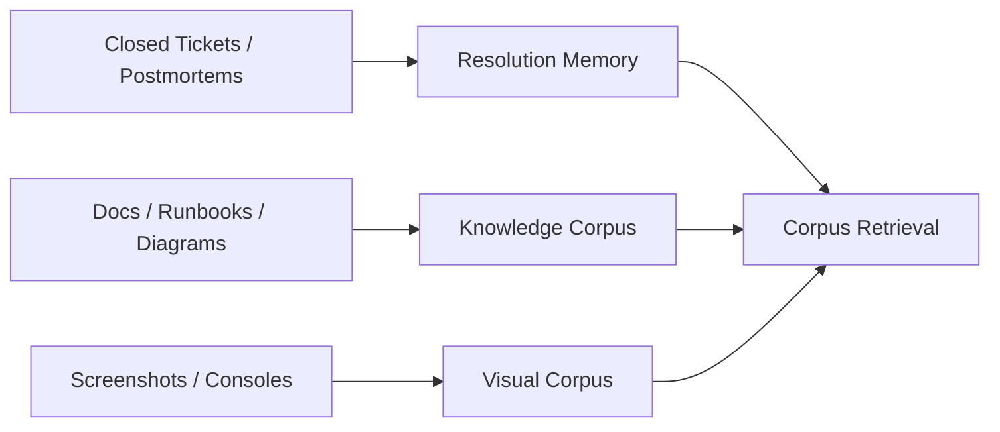

### 6.3 Intelligence Capability Domain
Purpose: convert evidence into structured understanding and candidate actions.

Capabilities:
- deduplication
- pattern clustering
- ranking
- concentration analysis
- trend analysis
- strategic findings
- action classification (assigning canonical action class to findings and inbound cases)
- trust label assignment (`grounded`, `heuristic`, `mixed`)

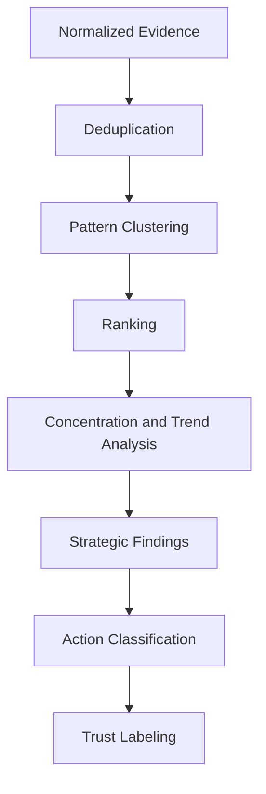

### 6.4 Decision Capability Domain
Purpose: generate outputs that users can trust and act on.

Capabilities:
- corpus retrieval for current context
- grounded recommendation generation
- scoped technical opinions
- reviewer approval workflow
- AI traceability

For the launch-quality bar for recommendations, findings, and quick wins, see `docs/product/MINIMUM_CREDIBLE_INSIGHT_STANDARD.md`.

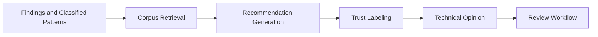

### 6.5 Execution Capability Domain
Purpose: convert insights into action framing and route operational cases to appropriate outcomes.

Capabilities:
- quick wins
- strategic initiatives
- lightweight sequenced action plans
- dashboard delivery
- roadmap-candidate framing
- triage queue and routing (v1.x)
- response suggestion and delegation (v1.x)
- controlled source-system write-back where allowed (v1.x)

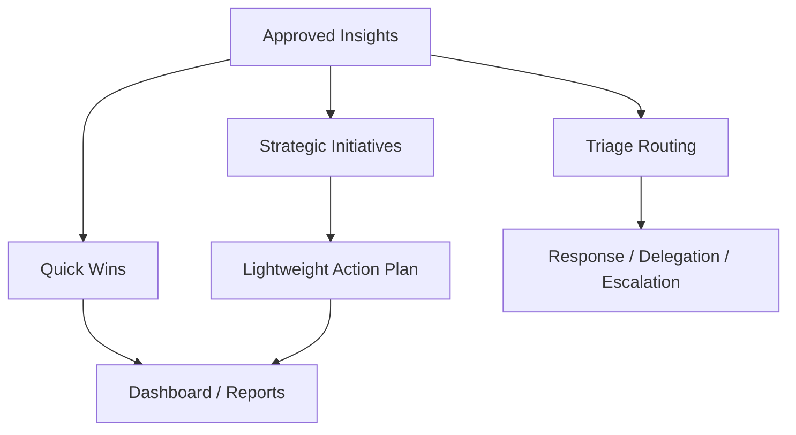

### 6.6 Governance Capability Domain
Purpose: ensure the product behaves safely across all tenants, autonomy levels, and evidence boundaries.

Capabilities:
- tenant boundary enforcement
- regulated vs standard behavior controls
- review gate requirements
- action autonomy policy
- cross-tenant intelligence policy
- audit and retention enforcement

---

## 7. Action Classification Taxonomy

Iris must classify all findings and inbound cases into explicit outcome categories. Without a shared taxonomy, recommendation outputs are structurally incompatible, review gates are arbitrary, and automation confidence cannot be enforced consistently.

This taxonomy applies to both batch pattern analysis (recommendations, findings, action plans) and realtime triage (inbound Jira tickets, Slack messages).

### 7.1 Canonical Action Classes

| Class | Description |
|---|---|
| `feature_investment` | Recurring problem reflects a missing product or platform capability. Correct output is a roadmap candidate, not a fix. |
| `automatable_fix` | Remediation can be executed automatically with acceptable confidence and within policy boundaries. Requires autonomy approval. |
| `operator_assisted_fix` | A runbook or script exists but requires a human to initiate or supervise. Correct output is a runbook reference with delegation guidance. |
| `helpdesk_delegation` | Case should be routed to an operational support queue with enriched context. Resolution is a human judgment call. |
| `knowledge_guidance` | A grounded answer can be provided to the user, but no action in a source system should be triggered. Typical for how-to cases. |
| `manual_escalation` | Confidence is too low, risk is too high, or policy blocks automated handling. Requires human expert review. |
| `unclassified` | Case does not fit existing taxonomy and requires explicit operator triage. |

### 7.2 Classification Rules

- A finding or case carries one primary action class and an optional secondary class
- Classification must be grounded in pattern evidence and corpus retrieval, not generated cold
- A confidence score must accompany every classification
- The action class is part of the insight record and is visible in the review interface
- Once a reviewer approves an insight, the action class is locked; reclassification requires a new review cycle

### 7.3 Confidence and Autonomy Thresholds

Automation eligibility is gated by confidence. Thresholds are tenant-configurable within platform-defined bounds.

| Action Class | Minimum confidence for non-human-initiated output | Requires review gate |
|---|---|---|
| `automatable_fix` | ≥ 0.85 (tenant-configurable) | Yes, unless tenant policy explicitly bypasses |
| `helpdesk_delegation` | ≥ 0.70 | No — routing only, no end-user-facing response |
| `knowledge_guidance` | ≥ 0.70 | No — response suggestion, no write-back |
| All other classes | N/A | Yes, always |

Regulated tenants apply stricter thresholds and may not configure autonomy bypass for any class.

### 7.4 Functional Requirements for Action Classification

| ID | Requirement | MoSCoW |
|---|---|---|
| FR-CLS-01 | Classify findings and inbound cases into action categories from the canonical taxonomy | M |
| FR-CLS-02 | Assign a primary and optional secondary action class to each classified output | M |
| FR-CLS-03 | Assign a confidence score to every classification | M |
| FR-CLS-04 | Apply tenant-configured confidence thresholds to determine autonomy eligibility | M |
| FR-CLS-05 | Expose action class and confidence score in the review interface | M |
| FR-CLS-06 | Lock action class after reviewer approval; require new review cycle for reclassification | S |
| FR-CLS-07 | Apply stricter thresholds and disallow autonomy bypass for regulated tenants | M |

---

## 8. Realtime Triage and Response

Iris must support a realtime inbound flow for source systems such as Jira and Slack. This is a v1.x product surface, but the architectural path that enables it is a v1 engineering requirement.

### 8.1 Trigger
A new Jira ticket, Slack message, or other inbound operational event appears in a watched queue or channel.

### 8.2 Expected System Behavior

1. Ingest the event through the event-driven path
2. Normalize the evidence using the shared evidence model
3. Retrieve relevant corpus (Resolution Memory + Knowledge Corpus)
4. Enrich the case with grounded context and similar historical records
5. Classify the likely action class with a confidence score
6. Evaluate confidence against tenant-configured thresholds
7. Route to one of:
   - **Response suggestion** — present a grounded answer to a `support_operator` or publish directly if policy allows
   - **Help-desk delegation** — route to support queue with enriched context
   - **Engineering escalation** — route to review queue with evidence and classification
   - **Human review** — confidence below threshold or policy requires explicit approval

### 8.3 Autonomy and Confidence Policy

- Every automated user-facing action requires explicit tenant policy enablement
- Any output below the configured confidence threshold routes to human review, never auto-responds
- Regulated tenants: no automated user-facing response without explicit governance approval
- All routing decisions, response suggestions, and escalation actions are auditable
- Source-system write-back (posting to Jira or Slack) is a sensitive capability requiring explicit authorization

### 8.4 Architectural Constraint

The v1 ingestion pipeline must preserve an event-driven path. Specifically:

- The ingestion capability domain must support webhook or event-subscription triggers alongside scheduled runs
- Normalization, corpus retrieval, and action classification must be callable as discrete operations, not only as batch pipeline steps
- This architectural requirement applies in v1 even when realtime triage is not yet a product-visible feature

Violating this constraint would require a pipeline redesign to add realtime triage in v1.x, which is not acceptable.

### 8.5 v1 vs v1.x vs v2 Scope

| Stage | Scope |
|---|---|
| v1 | Event-driven ingestion path exists; realtime triage is not exposed as a product surface |
| v1.x | Triage queue, response suggestion, delegation routing, and source write-back become product surfaces; `support_operator` role activates |
| v2 | Higher-confidence auto-response for approved tenants; adaptive confidence tuning |

### 8.6 Functional Requirements for Realtime Triage

These requirements activate together when the realtime triage capability is enabled. All are `S` (Should) because they are v1.x product scope, but the underlying architecture (FR-ING-07) is `S` in v1 itself.

| ID | Requirement | MoSCoW |
|---|---|---|
| FR-TRI-01 | Support event-driven ingest of Jira tickets and Slack messages | S |
| FR-TRI-02 | Enrich inbound events with corpus retrieval before routing | S |
| FR-TRI-03 | Classify inbound events using the canonical action taxonomy | S |
| FR-TRI-04 | Route classified events to: response suggestion, help-desk delegation, engineering escalation, or human review queue | S |
| FR-TRI-05 | Require explicit tenant policy enablement before any automated user-facing response | S |
| FR-TRI-06 | Apply regulated-tenant restrictions to all triage flows | S |
| FR-TRI-07 | Audit all routing decisions, response suggestions, and escalation actions | S |
| FR-TRI-08 | Surface triage queue and routing outcomes to `support_operator` role | S |

---

## 9. Scoped v1 Decisions

### 9.0 Corpus Architecture and Ownership Model
This is a foundational product operating-model decision, included here because it directly shapes v1 scope and ownership. Iris depends on three distinct corpora, each with a different purpose and ownership model.

| Corpus | Purpose | Typical Content | Ownership |
|---|---|---|---|
| Resolution Memory | Ground recommendations in historical precedent | closed tickets, postmortems, validated outcomes, linked fixes | platform-managed from tenant operational history |
| Knowledge Corpus | Explain how a system works | docs, diagrams, use cases, architecture notes, component and sequence flows | squad-owned content, platform-ingested |
| Visual Corpus | Explain what a UI or operational surface looks like | screenshots of products, flows, consoles, tools, key screens | squad-owned content, platform-ingested |

**Ownership rule:** corpus ownership follows product ownership.

This means:
- squads own the correctness and freshness of domain and UI corpus content
- the platform owns ingestion, vectorization, indexing, retrieval, and derived metadata
- the platform is not the editorial owner of squad content

**v1 stance:**
- Resolution Memory is core and active
- Knowledge Corpus support is operator-assisted and source-driven
- Visual Corpus support begins with manual or operator-assisted upload
- automated visual corpus updates through CI/CD are a later maturity step

See `docs/companion/CORPUS_ARCHITECTURE.md` for the companion spec.


### 9.1 Technical Opinions in v1
Technical opinions are part of v1 because excluding them would make Iris materially weaker than the observed BIMS product.

However, v1 technical opinions are explicitly limited to:

- synthesis of ticket patterns
- historical resolution grounding
- implementation-relevant language without code retrieval

The UI must say this clearly. That limitation is a trust statement, not a disclaimer.

### 9.2 Cross-Tenant Intelligence in v1.5
Cross-tenant intelligence is strategically important, but operational activation is deferred to **v1.5**.

#### v1
- architecture supports it
- anonymization pipeline exists
- regulated tenants are structurally excluded
- no production retrieval is activated

#### v1.5
- opt-in standard tenants can contribute
- anonymized precedent retrieval can activate after sufficient corpus depth exists

### 9.3 Regulated Behavior Is Concrete
For regulated tenants, product behavior changes in real ways.

| Area | Standard | Regulated |
|---|---|---|
| Raw evidence export | allowed by permission | disallowed |
| Storage boundary | shared tenant-safe boundary | dedicated regulated storage and evidence-access boundary (exact deployment shape defined in platform/security design) |
| Audit retention | standard retention | 90-day minimum, immutable |
| Compliance role | optional | required |
| Cross-tenant intelligence | opt-in possible later | excluded by default |
| Automation thresholds | tenant-configurable | stricter bounds; autonomy bypass disallowed |

### 9.4 Pipeline Experimentation
Operators must be able to compare pipeline versions safely.
This is not just an infra detail; it is an operator product capability.

Capabilities:
- define control and treatment versions
- set traffic split
- compare quality and trust metrics
- promote the winning version

**Release scope:** Pipeline experimentation is a v1 operator capability. It is not part of v1-alpha scope. v1-alpha uses a single pipeline version per tenant.

### 9.5 Review Gating Decision
The question of which outputs are mandatory-review versus directly publishable is a v1-alpha scope decision, not a late implementation detail.

Current product stance:
- recommendations, technical opinions, and action-plan artifacts are **mandatory-review** in v1-alpha
- executive summaries and dashboard aggregates may be published from approved underlying artifacts rather than independently reviewed as separate objects
- any future auto-publication path must be explicitly introduced later and should not be assumed in v1-alpha

This decision keeps the Manager + Reviewer loop real in the first proof milestone and prevents the review workflow from becoming optional theater.

---

## 10. Use Cases

### 10.1 Must-Have v1 Use Cases
This table defines the full sellable v1 must-have scope. Only the rows marked `v1-alpha` are required for the first proof milestone — the complete end-to-end Manager + Reviewer loop. All remaining rows are required for the sellable v1 product.

#### Infrastructure Prerequisites
These are must-have engineering foundations. They are essential, but they are not the primary user-facing product loop.

| ID | Use Case | Milestone |
|---|---|---|
| UC-01 | Connect tenant data sources | v1-alpha |
| UC-02 | Ingest engineering and operational signals | v1-alpha |
| UC-03 | Normalize source records | v1-alpha |
| UC-04 | Deduplicate repeated records | v1-alpha |
| UC-16 | Support multiple tenants | v1-alpha (baseline), v1 (full) |
| UC-20 | Trace and audit AI behavior | v1-alpha |
| C-04 | Apply tenant-specific retention and governance rules | v1-alpha (baseline), v1 (full) |
| UC-EVT-01 | Support event-driven ingestion path for supported source systems | v1 (infrastructure-only; triage surface in v1.x) |

#### Product Use Cases
| ID | Use Case | Milestone | Rationale |
|---|---|---|---|
| UC-05 | Cluster recurring patterns | v1-alpha | Core intelligence — required to prove the loop |
| UC-06 | Rank problems by operational importance | v1-alpha | Core manager value |
| UC-08 | Retrieve similar historical resolutions | v1-alpha | Resolution Memory differentiator |
| UC-09 | Generate grounded recommendations | v1-alpha | Core decision output |
| UC-10 | Distinguish grounded vs heuristic output | v1-alpha | Trust labeling is essential |
| UC-ACT-01 | Classify findings and patterns into the canonical action taxonomy | v1-alpha | Required for coherent recommendation semantics — without this, all outputs collapse into undifferentiated "recommendations" |
| UC-11 | Review and approve generated insights | v1-alpha | Core reviewer loop |
| UC-12 | Publish insights to dashboard | v1-alpha | Primary consumption surface |
| UC-14 | Track reviewer feedback | v1-alpha | Required for quality iteration |
| UC-23 | Generate executive audit summaries | v1-alpha | Sponsor visibility for the proof loop |
| UC-24 | Identify quick wins | v1-alpha | Immediate manager value |
| UC-25 | Surface strategic findings | v1-alpha | Leadership-facing synthesis |
| C-01 | Explain why an insight was generated | v1-alpha | Explainability required for trust |
| UC-17 | Enforce stronger controls for regulated tenants | v1 | Regulated tier, not alpha-critical |
| UC-21 | Convert recurring support pain into roadmap candidates | v1 | Execution depth after the loop is proven |
| UC-29 | Explore raw ticket evidence behind insights | v1 | Deeper drill-down after alpha |
| UC-31 | Generate scoped technical opinions | v1 | Competitive parity, but not alpha-critical |
| UC-32 | Convert findings into lightweight action plans | v1 | Execution depth after core trust loop |
| UC-TRI-01 | Triage inbound Jira tickets and Slack messages through realtime corpus enrichment and action classification | v1.x | Realtime loop — architecture-ready in v1 |
| UC-TRI-02 | Route classified inbound cases to response suggestion, help-desk delegation, or engineering escalation | v1.x | Depends on UC-TRI-01 |

> **v1-alpha scope summary:** prove the Manager + Reviewer loop with the minimum set of infrastructure and product use cases needed to deliver ranked, reviewable, explainable, and action-classified insight.

### 10.2 Should / Could / Won't-Yet
- **Should:** operational-tool delivery, onboarding acceleration, pipeline versioning UI, trend analysis, **module health and concentration (UC-22)**, risk panels, deeper drill-down
- **Could:** richer forensic archive UX, delivery-wave grouping, pattern catalog management, technical debt lineage views
- **Won't yet:** adaptive learning from reviewer corrections, live recurrence detection, execution-system linking

### 10.3 Cross-Tenant Use Cases
- Opt-in contribution for standard tenants
- Anonymized precedent retrieval after activation
- Permanent regulated-tenant exclusion unless future governance changes explicitly approve otherwise


### 10.4 Corpus Ownership and Ingestion Use Cases
| ID | Use Case | MoSCoW |
|---|---|---|
| UC-K1 | Squad or operator configures knowledge corpus sources for a tenant domain | S |
| UC-K2 | Platform ingests and vectorizes squad-owned knowledge corpus on schedule | M |
| UC-K3 | Platform ingests squad-owned visual corpus through upload-based flow | S |
| UC-K4 | Visual corpus updates automatically through CI/CD or automation hooks | C |
| UC-K5 | Corpus retrieval respects tenant, domain, and capability boundaries | M |

---

## 11. Key User Workflows

### 11.1 Manager Workflow
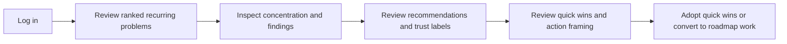

### 11.2 Reviewer Workflow
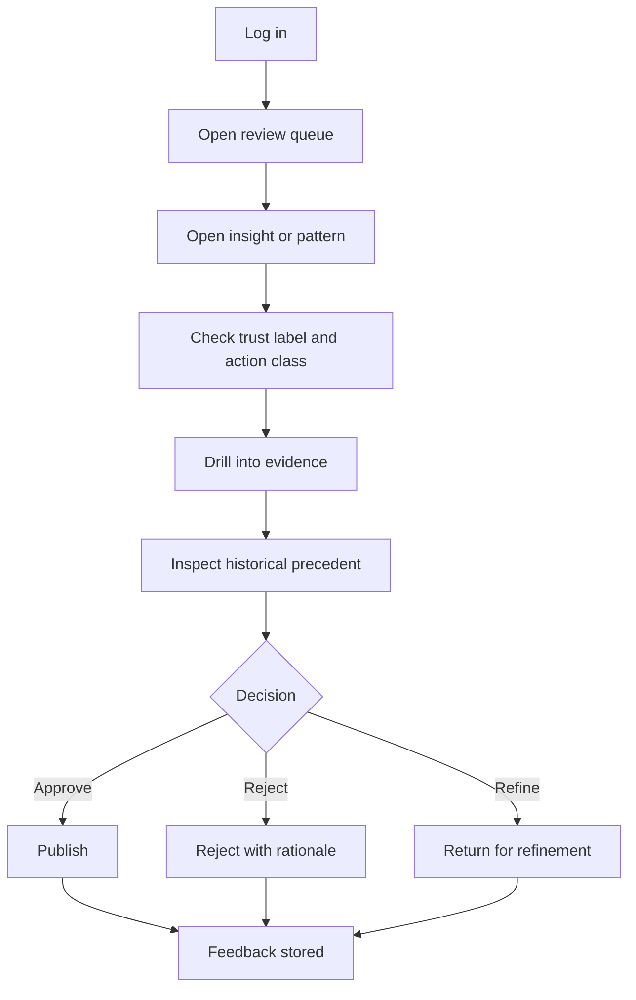


#### Reviewer Experience Design Principles
The reviewer workflow above describes the decision path. The reviewer experience must be designed as a product surface, not as a compliance gate.

Core principles:
- **Speed:** straightforward items should be reviewable in under two minutes
- **Confidence sorting:** high-confidence, well-grounded items should be visually separated from low-confidence, heuristic items
- **Batch triage:** low-risk items should support fast multi-item approval later in the product maturity curve
- **Consequence visibility:** reviewers should be able to see whether their approvals led to downstream use
- **Stale queue warning:** aging items should be visible before the queue silently dies
- **Escalation path:** reviewers must be able to route uncertain items for refinement or deeper domain review

See `docs/design/REVIEWER_EXPERIENCE_PRINCIPLES.md` for the full companion artifact.

### 11.3 Executive Workflow
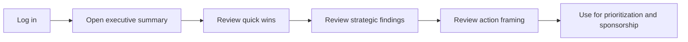

### 11.4 Technical Lead Workflow
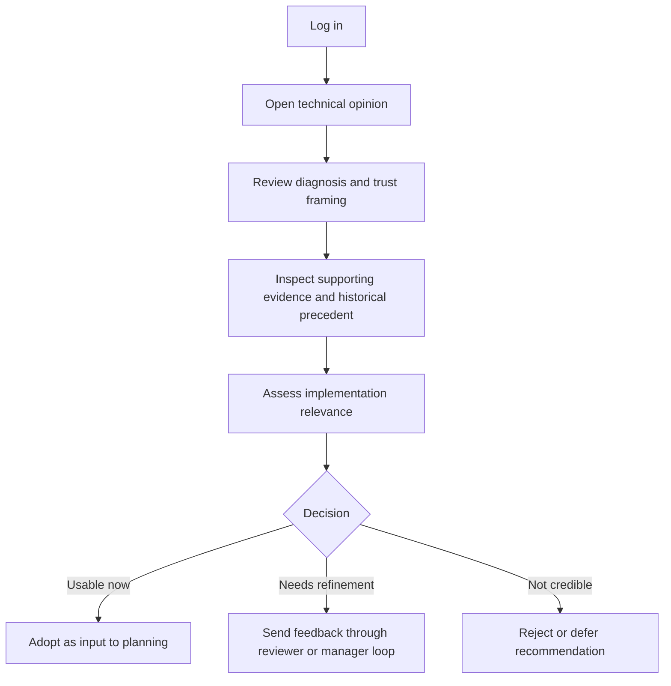

### 11.5 Operator Workflow
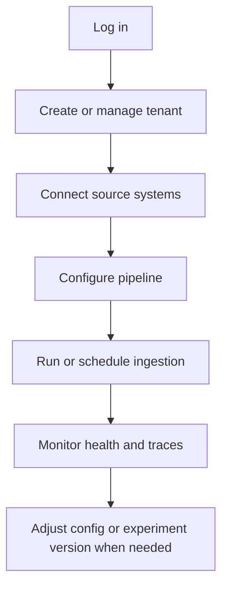

### 11.6 Support Operator Workflow (v1.x)
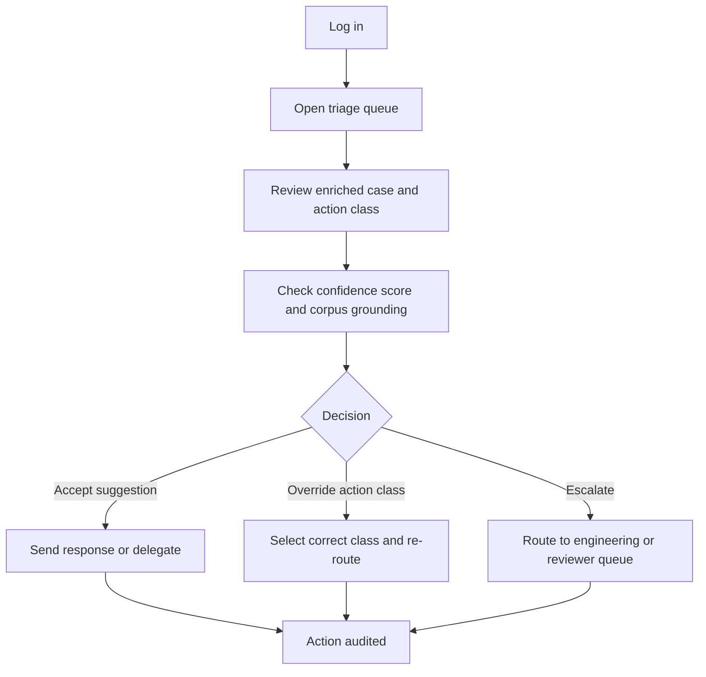

### 11.7 Realtime Triage Flow (v1.x)
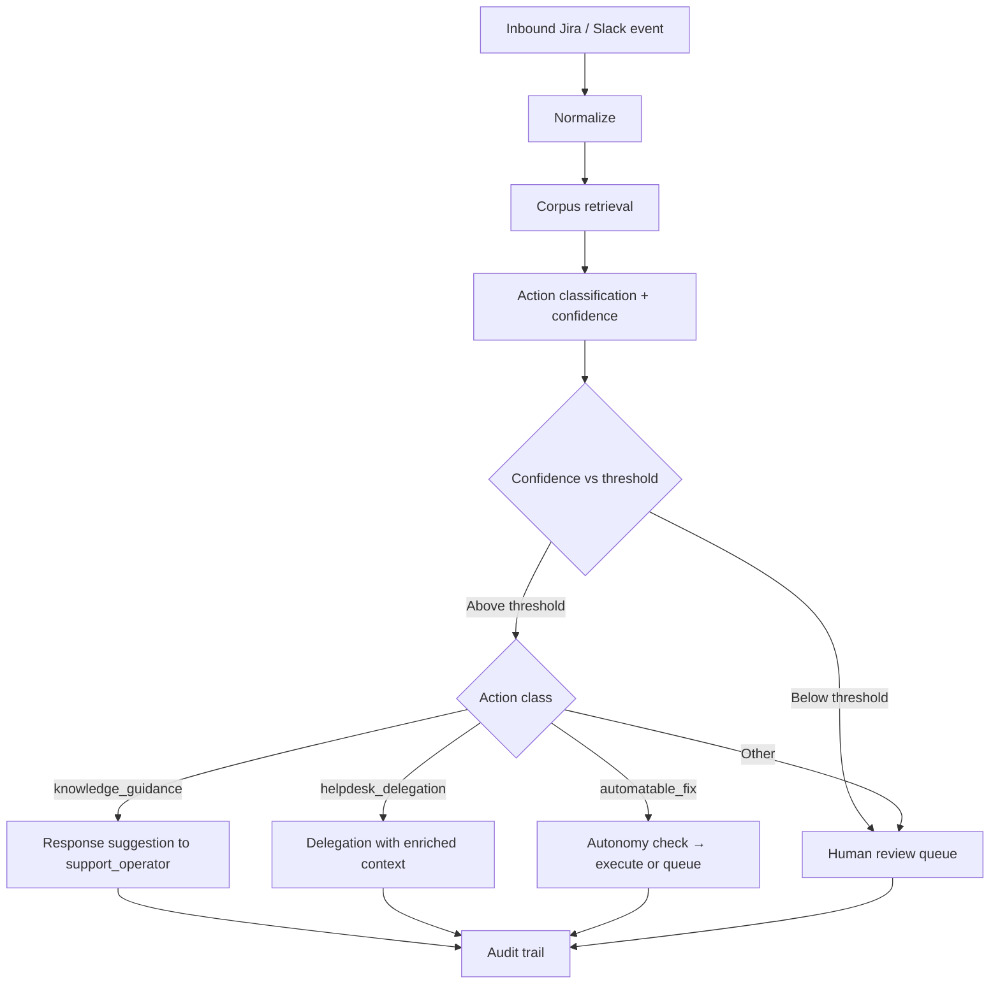

---

## 12. Functional Requirements

### 12.1 Ingestion
| ID | Requirement | MoSCoW |
|---|---|---|
| FR-ING-01 | Support tenant-scoped connections to Jira, GitHub, Slack, Wiz, and similar systems | M |
| FR-ING-02 | Store source configuration per tenant | M |
| FR-ING-03 | Support scheduled and operator-triggered ingestion | M |
| FR-ING-04 | Prefer incremental ingestion where possible | S |
| FR-ING-05 | Expose ingestion status and source failures | M |
| FR-ING-06 | Tolerate non-critical source failures and label incompleteness | M |
| FR-ING-07 | Support event-driven ingestion via webhook or event subscription for supported source systems | S |


### 12.2 Corpus Ingestion and Ownership
| ID | Requirement | MoSCoW |
|---|---|---|
| FR-COR-01 | Support ingesting squad-owned knowledge corpus from configured source systems such as Confluence, GitHub, Notion, or equivalent sources | M |
| FR-COR-02 | Preserve the distinction between squad-owned source content and platform-owned derived artifacts such as embeddings, metadata, and indexes | M |
| FR-COR-03 | Support upload-based ingestion of squad-owned visual corpus in v1 | S |
| FR-COR-04 | Support automated visual corpus ingestion through CI/CD or browser automation in later releases | C |
| FR-COR-05 | Enforce tenant, domain, and capability boundaries when retrieving corpus content | M |
| FR-COR-06 | Preserve provenance and freshness metadata for knowledge and visual corpus artifacts | M |

### 12.3 Analysis
| ID | Requirement | MoSCoW |
|---|---|---|
| FR-ANL-01 | Normalize heterogeneous evidence into a common internal model | M |
| FR-ANL-02 | Deduplicate repeated records | M |
| FR-ANL-03 | Detect recurring patterns | M |
| FR-ANL-04 | Rank patterns by configured importance factors | M |
| FR-ANL-05 | Support trend analysis | S |
| FR-ANL-06 | Support concentration analysis by module, domain, or team | S |
| FR-ANL-07 | Generate strategic findings | M |
| FR-ANL-08 | Support drill-down from findings to evidence | M |

### 12.4 Action Classification
See §7.4 for the full FR-CLS-* table.

### 12.5 Recommendations and Review
| ID | Requirement | MoSCoW |
|---|---|---|
| FR-REC-01 | Generate recommendations from ranked patterns and findings | M |
| FR-REC-02 | Use Resolution Memory where relevant precedent exists | M |
| FR-REC-03 | Label outputs as grounded, heuristic, or mixed | M |
| FR-REC-04 | Generate scoped technical opinions | M |
| FR-REC-05 | Preserve links to supporting evidence and precedent | M |
| FR-REC-06 | Expose trust and confidence indicators | M |
| FR-REV-01 | Support pending, approved, rejected, and needs-refinement states | M |
| FR-REV-02 | Allow approve, reject, annotate, and request-change actions | M |
| FR-REV-03 | Audit reviewer identity, time, and rationale | M |
| FR-REV-04 | Gate publication where review is required | M |
| FR-REV-05 | Store reviewer feedback structurally | M |

### 12.6 Action Framing
| ID | Requirement | MoSCoW |
|---|---|---|
| FR-ACT-01 | Identify quick wins | M |
| FR-ACT-02 | Generate lightweight sequenced action plans | M |
| FR-ACT-03 | Trace action-plan items to findings and evidence | M |
| FR-ACT-04 | Frame recurring pain as roadmap candidates | S |

### 12.7 Realtime Triage
See §8.6 for the full FR-TRI-* table.

### 12.8 Views and Explorer
| ID | Requirement | MoSCoW |
|---|---|---|
| FR-RPT-01 | Provide executive summary view | M |
| FR-RPT-02 | Provide pattern-analysis view | M |
| FR-RPT-03 | Provide action-plan view | M |
| FR-RPT-04 | Respect role/scope/capability restrictions across all views | M |
| FR-RPT-05 | Audit all export actions | M |
| FR-EXP-01 | Provide searchable ticket explorer for permitted roles | M |
| FR-EXP-02 | Support filtering by tenant, domain, source, module, and timeframe | S |
| FR-EXP-03 | Support navigation from summaries and patterns to source evidence | M |

### 12.9 Tenant Administration and Governance
| ID | Requirement | MoSCoW |
|---|---|---|
| FR-TEN-01 | Allow authorized operators to create and manage tenants | M |
| FR-TEN-02 | Allow per-tenant source configuration | M |
| FR-TEN-03 | Assign users by role, scope, and capability | M |
| FR-TEN-04 | Enforce regulated-tenant behavior automatically | M |
| FR-TEN-05 | Monitor pipeline status by tenant | M |
| FR-TEN-06 | Support pipeline version experiments | S |
| FR-GOV-01 | Integrate with OIDC-compliant IdP | M |
| FR-GOV-02 | Apply Iris-managed authorization rules | M |
| FR-GOV-03 | Audit review decisions, exports, sensitive access, and admin changes | M |
| FR-GOV-04 | Restrict sensitive evidence by role and scope | M |
| FR-GOV-05 | Support retention and export controls for regulated tenants | M |
| FR-GOV-06 | Preserve metadata to explain how outputs were derived | M |

---

## 13. Resolution Memory Requirements

### 13.1 Purpose
Resolution Memory helps Iris answer:
- Have we seen this before?
- What worked?
- Under what conditions?
- How much should that precedent influence current action?

### 13.2 Eligible Sources
- closed tickets with meaningful resolution detail
- incident postmortems
- issue-linked pull requests
- support threads with confirmed outcomes
- reviewer-approved insights whose outcomes are later validated

### 13.3 Memory Record Model
Minimum fields:
- problem summary
- source type and ID
- tenant and domain scope
- affected systems/modules
- severity and environment context
- resolution summary
- linked artifacts
- provenance and confidence metadata
- freshness metadata
- governance markers

### 13.4 Retrieval Requirements
| ID | Requirement | MoSCoW |
|---|---|---|
| FR-RM-01 | Retrieve similar historical records for the current context | M |
| FR-RM-02 | Respect tenant boundaries unless cross-tenant retrieval is explicitly enabled later | M |
| FR-RM-03 | Use scope-aware filtering where applicable | S |
| FR-RM-04 | Apply freshness weighting | S |
| FR-RM-05 | Retain metadata showing how precedent influenced the recommendation | M |
| FR-RM-06 | Allow authorized provenance inspection | M |

### 13.5 Governance Requirements
| ID | Requirement | MoSCoW |
|---|---|---|
| FR-RM-GOV-01 | Apply controlled ingestion rules | M |
| FR-RM-GOV-02 | Support tenant-specific retention and archival | M |
| FR-RM-GOV-03 | Support redaction of sensitive fields | M |
| FR-RM-GOV-04 | Audit creation, update, suppression, and use of memory records | M |

---

## 14. Non-Functional Requirements

| Area | Requirement | MoSCoW |
|---|---|---|
| Security | Authenticate through OIDC and enforce role/scope/capability/autonomy authorization | M |
| Compliance | Support distinct standard and regulated behavior | M |
| Auditability | Audit reviews, exports, sensitive access, admin changes, and routing decisions | M |
| Reliability | Pipelines are observable and recoverable; incompleteness is surfaced explicitly | M |
| Explainability | Insights and recommendations are traceable to evidence and precedent | M |
| Multi-tenancy | Strong tenant isolation across evidence, findings, recommendations, and archives | M |
| Performance | Executive, analytical, and review workflows remain fast enough for real operational use | S |
| Realtime latency | From event ingestion to routing decision: ≤ 30 seconds for standard cases when triage is active | S |

---

## 15. Metrics and Success Criteria

> For instrumentation details — how these metrics are computed, what events are tracked, and what dashboards are required — see `docs/product/PRODUCT_ANALYTICS_SPEC.md`.

### 15.1 Launch Metrics
| Metric | Target |
|---|---|
| Reviewer acceptance rate | >= 60% in first 30 days |
| Time from ingestion to visible insight | <= 4 hours for scheduled batch |
| Recommendations grounded in Resolution Memory | >= 30% within 90 days |
| Operator-led tenant onboarding time | <= 5 business days |
| Ingestion success rate | >= 95% of scheduled runs |
| AI trace coverage | 100% of AI calls traced |

### 15.2 Validation Metrics
- action rate on generated insights
- reviewer drill-down frequency
- comparative acceptance of grounded vs heuristic outputs
- repeat use rate by managers
- action class distribution across approved insights (reveals taxonomy calibration quality)

### 15.3 Early Success Criteria
Iris is directionally successful if:
- leadership can identify actionable engineering priorities without manual synthesis
- grounded recommendations are seen as more credible than generic ones
- more than one tenant can run on the same product architecture without bespoke redesign
- at least one regulated tenant operates with differentiated controls active
- action-classified outputs are treated differently by reviewers than unclassified ones

### 15.4 Early Warning Signals
Success metrics tell us when the product is working. These signals tell us when it is dying.

| Signal | Threshold | What it means |
|---|---|---|
| Review queue depth | > 30 unreviewed items for more than 5 business days | Reviewers have stopped reviewing and the product is blocked at the trust gate |
| Insight staleness | > 50% of visible insights older than 7 days | The pipeline is generating output that nobody is consuming |
| Manager return rate | < 1 session per week per active manager | Managers opened the product once but did not come back |
| Sustained rejection rate | > 50% rejected for more than 3 consecutive weeks | Insight quality is below the trust threshold |
| Zero action rate | 0 approved insights converted to downstream action within 30 days | The product is producing outputs that drive nothing |
| Reviewer time-to-first-action | > 48 hours from insight availability to first review action | Review queue discoverability or urgency is broken |
| Unclassified rate | > 30% of insights classified as `unclassified` after 60 days | The action taxonomy does not fit the actual case distribution |

---

## 16. Assumptions

- OIDC authentication is available; Okta is the current internal reference implementation
- multi-tenancy is required from the beginning
- regulated and standard tenants require structurally different behavior
- human review remains mandatory for high-impact outputs in v1
- historical data quality is sufficient to make Resolution Memory useful
- dashboard delivery is the primary v1 output surface
- early onboarding is operator-led
- the first deployment context is internal to the holding before external sale
- the event-driven ingestion path is an engineering requirement in v1 even when realtime triage is not yet a product surface; building a purely batch pipeline in v1 would require platform redesign to enable v1.x

---

## 17. Risks and Open Questions

### 17.1 Product Risks
- v1 still risks being too broad if all surfaces are treated as equally deep
- technical opinions may still be distrusted if language overreaches beyond evidence
- action plans may feel generic without strong enough recommendation quality
- the action taxonomy may not map cleanly to actual case distributions at a given tenant; calibration will take time

### 17.2 Data Risks
- source linkage may be incomplete across systems
- historical resolutions may be too inconsistent to support reliable grounding
- ownership metadata may be weak, limiting concentration quality
- action classification confidence may be too low for autonomous routing in early corpus stages, causing high fallback-to-human rates

### 17.3 Adoption Risks
- executives may like summaries while technical users reject the underlying outputs
- review may feel like overhead if insight quality is weak
- regulated rollout may slow if governance decisions remain ambiguous
- support operators may not trust action class suggestions if confidence calibration is poor at launch

### 17.4 Resolved Decisions

All major product and platform decisions are resolved. Full rationale in `docs/architecture/PLATFORM_DECISIONS.md`.

| Decision | Resolution |
|----------|------------|
| Which outputs are mandatory-review in v1? | Recommendations, technical opinions, and action-plan artifacts. Executive summaries and dashboard aggregates derive from approved artifacts — no independent review gate. See §9.5. |
| Temporal hosting | Self-hosted on EKS. See ADR-001. |
| Qdrant hosting | Self-hosted on EKS. See ADR-002. |
| Regulated account topology | One AWS account per tenant per environment. See ADR-003. |
| Regulated deployment boundary | Baseline accepted — dedicated PostgreSQL, Qdrant, NATS per account. Iterate to stricter isolation if required. See ADR-004. |
| Immutable audit log storage | Abstracted WORM push — S3 Object Lock / GCS Object Lock / Azure Immutable Blob. See ADR-005. |

### 17.5 Open Questions

| Question | Owner |
|----------|-------|
| How do we link tickets to repositories for v2 technical opinions? | Engineering |
| What are the tenant-configurable confidence threshold bounds for automated routing and response? | Product + Engineering |
| Which source systems support write-back APIs and what are their rate-limit and authentication constraints? | Engineering |

---

## 18. Release Framing

### 18.1 v1-alpha (~3 months)
Purpose: prove the Manager + Reviewer loop end-to-end.

Scope:
- ingestion (scheduled and operator-triggered)
- ranking
- Resolution Memory retrieval
- action classification (canonical taxonomy applied to all outputs)
- reviewer workflow
- executive summary
- quick wins
- strategic findings
- baseline multi-tenancy
- no squad-managed corpus onboarding beyond what is minimally needed for internal validation

### 18.2 v1 (~6–9 months)
Purpose: deliver the sellable product.

Adds:
- regulated tier behavior
- scoped technical opinions
- ticket explorer
- lightweight action planning
- pipeline experimentation
- knowledge corpus connector configuration and scheduled ingestion
- upload-based visual corpus ingestion
- event-driven ingestion path (infrastructure-only; not yet a product surface)

### 18.3 v1.x
Purpose: activate guided triage and response workflows.

Adds:
- `support_operator` role as a product surface
- realtime triage queue for inbound Jira and Slack events
- corpus-enriched case classification at inbound time
- response suggestion, help-desk delegation, and engineering escalation routing
- source write-back for authorized tenants and action classes

### 18.4 v1.5
Adds:
- activated cross-tenant intelligence for opted-in standard tenants

### 18.5 v2+
Adds:
- code retrieval and code-aware technical opinions
- deeper action planning and execution-system linking
- adaptive learning from reviewer corrections
- richer recurrence prediction and comparative recommendation analysis
- adaptive confidence tuning for automated routing

---

## 19. Appendix

### 19.1 Core Terms
| Term | Meaning |
|---|---|
| Tenant | A company or business unit with its own isolation boundary |
| Domain | A squad, team, or functional area within a tenant |
| Pattern | A recurring cluster of related issues |
| Insight | A reviewed output combining pattern, recommendation, and evidence links |
| Resolution Memory | Historical problem-to-resolution corpus used for grounding |
| Technical Opinion | AI-generated remediation view based on patterns and precedent |
| Quick Win | A near-term, high-value action item |
| Strategic Finding | A higher-level conclusion derived from recurring patterns |
| Grounded | Backed by historical precedent |
| Heuristic | Derived without historical precedent |
| Action Class | One of the seven canonical outcome categories that Iris assigns to a finding or inbound case: `feature_investment`, `automatable_fix`, `operator_assisted_fix`, `helpdesk_delegation`, `knowledge_guidance`, `manual_escalation`, `unclassified` |
| Triage | The process of classifying and routing an inbound operational event to the appropriate action path |
| Support Operator | A user who monitors and acts on the realtime triage queue |
| Autonomy Level | The degree to which an action can be executed automatically versus requiring explicit human approval, governed by confidence thresholds and tenant policy |
